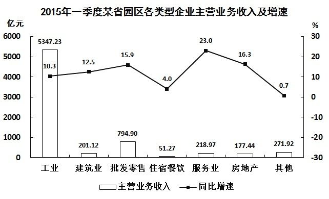

# 两期比重变化（比重差定量计算）

考点：[[20-考点/资料分析/比重/两期比重变化（比重差定量计算）|比重 / 两期比重变化（比重差定量计算）]]
材料：[[15-材料/资料分析/182582 2015年一季度某省省级及以上园区的|182582 2015年一季度某省省级及以上园区的]]

**问法模型**：题干出现'A占B的比重比上年同期上升/下降多少个百分点'→ 判定为两期比重问题，先比较部分增速a与整体增速b定升降方向，再用比重差公式(A/B)×(a-b)/(1+a)定量，或用'|变化|<|a-b|'排除量级不符选项

## 推理链
1. 第1步：从文字材料提取条件——2015年一季度上缴税金223.87亿元，同比增长14.1%（部分增速a=14.1%）；主营业务收入7062.85亿元，同比增长11%（整体增速b=11%）
2. 第2步：应用两期比重升降规则——a=14.1% > b=11%，部分增长快于整体，比重上升，排除C、D
3. 第3步：代入比重差公式——变化量=(223.87/7062.85)×(14.1%-11%)/(1+14.1%)≈3.17%×(3.1%/1.141)≈3.17%×2.72%≈0.086个百分点
4. 第4步：辅助排除——因(1+a)>1，比重变化幅度必然严格小于|a-b|=3.1个百分点，故B（3.1个百分点）不成立
5. 第5步：与选项对照——比重上升且约0.1个百分点，只有A满足，故正确答案为A

**最快解法**：⚡ 两期比重结论秒杀法：第一步比较增速14.1%>11%定上升（排除C、D）；第二步用'|比重变化|<|a-b|=3.1个百分点'直接排除B，锁定A，全程无需精算；若需定量验证可用截位：现期比重223.87/7062.85≈3.2%，乘(3.1%/1.141)≈2.7%，得约0.09≈0.1个百分点

## 易错点
- ⚠ 误选B：把|a-b|=3.1个百分点直接当作比重变化量，忽略还需乘现期比重（仅约3.2%）并除以(1+a)，实际变化仅约0.09个百分点
- ⚠ 分子分母口径陷阱：分子必须是上缴税金223.87亿元，勿误用利润279.54亿元；分母必须是全园区主营业务收入7062.85亿元，不能用主导产业收入4369.54亿元或高新技术产业产值2815.19亿元（产值≠收入）替代
- ⚠ 升降方向误判：需比较税金增速14.1%与总收入增速11%；若误与主导产业增速10.4%或利润增速11.1%比较，方向或幅度判断都会出错

## 母题抽象
> 🧩 当题干出现'部分占整体的比重比上年同期上升/下降多少个百分点'时，先用部分增速a与整体增速b的大小定升降方向，再用'|变化量|<|a-b|'排除量级选项秒杀，必要时以(A/B)×(a-b)/(1+a)精算验证

**同类特征**：占……的比重比上年同期、上升/下降了多少个百分点、两期比重问题、部分增速与整体增速比较、分子分母均给现期值和同比增速

## 相关题
- [[10-真题/资料分析/比重/5445861 两期比重变化（比重差定量计算）|5445861]]（国考 2023，相关度2）
- [[10-真题/资料分析/比重/1746802 两期比重变化比较（增速比较法，连续两年判断）|1746802]]（国考 2016，相关度1）
- [[10-真题/资料分析/综合/2049570 综合判断题（两期比重变化判断＋现期比值-占比比较）|2049570]]（新疆 2017，相关度1）
- [[10-真题/资料分析/比重/2719463 两期比重差（比重比上年同期上升-下降几个百分点）计算|2719463]]（国考 2021，相关度1）
- [[10-真题/资料分析/比重/3523610 两期比重比较（比重升降判断+计数）|3523610]]（四川 2021，相关度1）

---

### 题干
2015年一季度，该省园区企业上缴税金占主营业务收入的比重比上年同期：

### 选项
- A. 上升了0.1个百分点　✅
- B. 上升了3.1个百分点
- C. 下降了0.1个百分点
- D. 下降了3.1个百分点

### 官方解析
根据题干“2015年一季度······占······的比重比上年同期”，可判定本题为两期比重问题。定位文字资料第一段和第四段可知，2015年一季度，该省园区实现主营业务收入7062.85亿元，同比增长，上缴税金223.87亿元，同比增长。由两期比重结论可知，由于，故比重应为上升，排除C、D两项，又因为，所以上升的百分点应小于，只有A项满足。
故正确答案为A。

### 给定材料

        2015年一季度，某省省级及以上园区（以下简称园区）实现主营业务收入7062.85亿元，同比增长11%，实现主导产业主营业务收入4369.54亿元，同比增长10.4%。 

        一季度，全省园区拥有企业30975家，比上年同期增加3221家，其中本年新增企业311家，期末从业人数264.23万人，同比增长9.2%。其中，工业企业期末从业人数209.17万人，同比增长9.9%。

        一季度，全省园区高新技术产业期末从业人数90.92万人，同比增长8.3%，实现高新技术产业产值2815.19亿元，同比增长8.1%。

        一季度，全省园区共实现利润279.54亿元，同比增长11.1%。上缴税金223.87亿元，同比增长14.1%。

