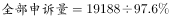

# 现期比重逆推总量（部分量÷比重求全部）

考点：[[20-考点/资料分析/比重/现期比重逆推总量（部分量÷比重求全部）|比重 / 现期比重逆推总量（部分量÷比重求全部）]]
材料：[[15-材料/资料分析/182656 2015年2月我国快递业务量与业务收|182656 2015年2月我国快递业务量与业务收]]

**问法模型**：题干求'全部申诉量约为多少'→先用'每百万件有效申诉量×业务量折合的百万件数'算出部分量（有效申诉量），再按'全部量=部分量÷占比'逆推总量

## 推理链
1. 第1步：现期为2015年2月；从正文第一段取快递业务量8.2亿件，第二段取全国每百万件有效申诉量23.4件；'有效申诉占总申诉量的比重'数字正文留空，按官方解析以原卷完整数据代入
2. 第2步：单位换算，8.2亿件=820个百万件；'每百万件23.4件'是强度指标，须乘百万件个数而非亿件数
3. 第3步：求部分量（全国有效申诉量）=23.4×820=19188件≈1.92万件
4. 第4步：按'全部申诉量=有效申诉量÷有效申诉占比'逆推；因占比小于100%且按原卷数据接近100%，结果为'略大于1.9万件'（官方解析口径），约1.96万件
5. 第5步：对照选项：A（1.96万件）与计算结果一致；B（2.36万件）反推占比仅约八成、明显偏大；C、D单位为'亿件'，比真实值大1万倍，属量级陷阱，故选A

**最快解法**：⚡ 量纲抵消+截位速算：8.2亿=820个百万，23.4×820≈23×820≈1.9万件（精确19188件）；再除以略小于100%的占比，得'略大于1.9万件'，唯一贴近项即A（1.96万件），C/D亿件量级直接秒排除

## 易错点
- ⚠ 单位量级陷阱：8.2亿件必须换成820个百万件再乘23.4件；选项C/D把'万件'偷换成'亿件'，大1万倍，应先校验量级再算数值
- ⚠ 强度指标≠总量：'每百万件23.4件'是强度相对数，必须乘以百万件个数（820）才得申诉总量，不能直接当作总量使用
- ⚠ 逆推方向易反：全部申诉量=有效申诉量÷占比（做除法），误写成乘法结果会低于有效申诉量1.92万件；且正文占比数字留空，实际代入须以原卷完整数据（接近100%）为准

## 母题抽象
> 🧩 当题干给出'单位强度指标×总规模'可折算出部分量、且已知部分量占总量的比重时，用'部分量÷比重'逆推总量；先用选项单位校验量级（万vs亿），再用部分量作下限收缩答案范围

**同类特征**：全部申诉量、每百万件有效申诉量、占总申诉量的比重、亿件业务量与百万件口径换算、选项含万件/亿件双量级、'约为'估算提问

## 相关题
（暂无）

---

### 题干
2015年2月，消费者对快递业务的全部申诉量约为：

### 选项
- A. 1.96万件　✅
- B. 2.36万件
- C. 1.96亿件
- D. 2.36亿件

### 官方解析

由题干“2015年2月”判断现期，“消费者对快递业务的全部申诉量”和文字材料第一段“占全部申诉量的”判断本题为现期比重中总量的计算问题。定位文字材料第一段“2015年2月份，快递业务量完成8.2亿件”和文字材料第二段“2015年2月，全国每百万件快递业务中有效申诉量为23.4件”可得，，，略大于1.9万件，与A项最接近。

故正确答案为A。

### 给定材料

        2015年2月，我国快递业务量完成8.2亿件，同比增长；业务收入完成136.0亿元，同比增长。消费者对快递业务进行的申诉中，有效申诉（确定企业责任的）占总申诉量的，为消费者挽回经济损失229.8万元。

        2015年2月，全国每百万件快递业务中，有效申诉量为23.4件，对企业1的每百万件有效申诉量为75.13件，环比增长，对企业2的每百万件有效申诉量为32.56件，环比增长，对企业3的每百万件有效申诉量为31.86件，环比增长，对企业4的每百万件有效申诉量为17.81件，环比增长。

