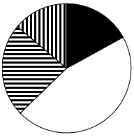
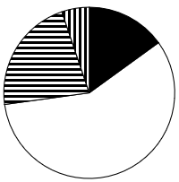
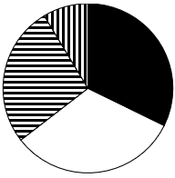
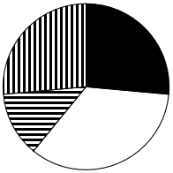
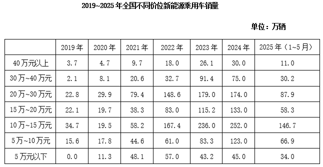

# 现期比重比较（扇形-饼图匹配）

考点：[[20-考点/资料分析/比重/现期比重比较（扇形-饼图匹配）|比重 / 现期比重比较（扇形/饼图匹配）]]
材料：[[15-材料/资料分析/4332287 2019~2025年全国不同价位新能|4332287 2019~2025年全国不同价位新能]]

**问法模型**：题干问'2023年……占比关系的是（饼图）'→ 现期比重问题：先按图例口径把7个价位档合并为4档求各部分现期量，再比较各扇区相对大小与倍数关系，定性排除选项选图

## 推理链
1. 第1步：定位表格2023年列读数（单位万辆）：5万元以下43.2、5万~10万83.3、10万~15万236.0、15万~20万115.2、20万~30万179.0、30万~40万91.4、40万以上26.1
2. 第2步：按题干4档口径跨行合并：10万元以下（黑）=83.3+43.2=126.5；10万~20万（白）=236.0+115.2=351.2；20万~30万（横）=179.0；30万以上（竖）=91.4+26.1=117.5，合计774.2万辆
3. 第3步：计算各部分占比：白351.2/774.2≈45.4%、横179.0/774.2≈23.1%、黑126.5/774.2≈16.3%、竖117.5/774.2≈15.2%
4. 第4步：硬判据①：黑色126.5＞竖线117.5（16.3%＞15.2%），B、C两项黑色扇区不大于竖线，不符合，排除
5. 第5步：硬判据②：白色351.2＞黑色×2=126.5×2=253.0，D项白色扇区不足黑色2倍，不符合，排除
6. 第6步：仅A项同时满足'黑＞竖、白＞2×黑（白约占45%接近半圆、横约占23%约为白的1/2）'，故正确答案为A

**最快解法**：⚡ 定性排除法（免精算占比）：合并4档后只用两条判据——①黑126.5＞竖117.5排B、C；②白351.2＞2×黑253.0排D；全程只需加法与倍数估算

## 易错点
- ⚠ 7档并4档时漏并：'30万以上'须将30万~40万(91.4)与40万以上(26.1)两行相加，'10万~20万'须将10万~15万(236.0)与15万~20万(115.2)相加，漏并任一行即判错扇区关系
- ⚠ 直觉陷阱：凭'低价车走量'直觉认为黑色占比最大；实际白色(10万~20万)约占45%接近半圆且大于黑色2倍，才是最大扇区，凭直觉易误选D
- ⚠ 黑(16.3%)与竖(15.2%)仅差约1个百分点，两扇区大小非常接近，须用原始数据126.5与117.5精确比较，粗略目测易在B/C间误判

## 母题抽象
> 🧩 当题干出现'以下饼图最能准确反映某年各部分占比关系'时，先把材料分类合并到与图例一致的口径，再用'部分量比大小＋倍数关系（A＞2B、A≈B）'逐项定性排除选项，无需精算百分比

**同类特征**：以下饼图中、最能准确反映、占比关系、限定具体年份（2023年）现期数据、价位分档合并（10万元以下/10万~20万/20万~30万/30万以上）、图例纹理区分（黑色/白色/横线/竖线）

## 相关题
- [[10-真题/资料分析/比重/10297452 现期比重结构与饼图匹配（部分占比比较-倍数排除）|10297452]]（四川 2025，相关度1）
- [[10-真题/资料分析/增长/16593068 增长量比较（多期同比增量趋势与柱状图匹配）|16593068]]（甘肃 2024，相关度1）
- [[10-真题/资料分析/比重/16593075 现期比重计算与饼图占比关系判断（排除法）|16593075]]（海南 2024，相关度1）
- [[10-真题/资料分析/比重/19283765 现期比重结构比较（饼图匹配）|19283765]]（国考 2025，相关度1）
- [[10-真题/资料分析/比重/2393936 现期比重计算（三年数据占合计比重＋饼图匹配）|2393936]]（青海 2019，相关度1）

---

### 题干
以下饼图中，最能准确反映2023年全国新能源乘用车销量中，10万元以下（黑色）、10万~20万元（白色）、20万~30万元（横线）和30万元以上（竖线）价位车型占比关系的是：

### 选项
- A. 

　✅
- B. 

- C. 

- D. 

### 官方解析
根据题干“2023年······占比关系的是”，结合材料给出了2023年相关数据，可判定本题为现期比重问题。定位表格材料可得2023年全国不同价位新能源乘用车销量。
10万元以下销量（黑色）=5万~10万+5万元以下=83.3+43.2=126.5万辆；10万~20万元销量（白色）=15万~20万+10万~15万=115.2+236.0=351.2万辆；20万~30万元销量（横线）为179.0万辆；30万元以上销量（竖线）=40万元以上+30万~40万元=26.1+91.4=117.5万辆。观察选项与数据可得：
10万元以下销量（黑色）30万元以上销量（竖线），B、C两项不符合，排除；
10万~20万元销量（白色）351.2万辆&gt;10万元以下销量（黑色）126.5万辆×2，D项不符合，排除。
故正确答案为A。

### 给定材料

