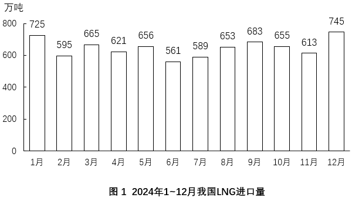
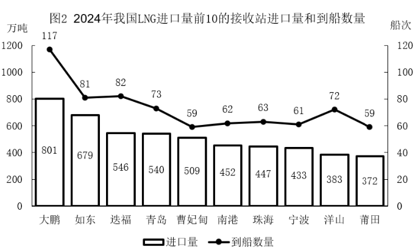
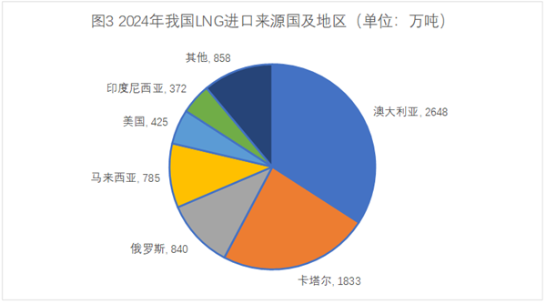

# 现期比重之差（百分点）

考点：[[20-考点/资料分析/比重/现期比重之差（百分点）|比重 / 现期比重之差（百分点）]]
材料：[[15-材料/资料分析/6792326 2024年我国LNG进口情况：分月进|6792326 2024年我国LNG进口情况：分月进]]

**问法模型**：题干问'卡塔尔占比比印度尼西亚高多少个百分点'→现期比重差模型，分子先相减再同除以全国总量：(A−B)/总量×100

## 推理链
1. 第1步：从文字材料提取分母——2024年我国LNG进口总量7761万吨；从图3提取分子——卡塔尔1833万吨、印度尼西亚372万吨（'其他858'为混合类别，本题不用）
2. 第2步：比重差公式=(1833/7761−372/7761)×100=(1833−372)/7761×100个百分点
3. 第3步：分子先减：1833−372=1461；分母截位：1461/776≈146/776，首位商1，次位商8，得约0.188即18.8个百分点
4. 第4步：量级验证：7761×19%≈1475略大于1461，7761×18%≈1397略小于1461，差值落在18%~19%之间
5. 第5步：与选项对照：约18.8个百分点与C项19最接近（与B项16、D项22均相差2以上），故选C

**最快解法**：⚡ 截位直除+先减后除：1833−372=1461，除以7761≈1461/7760≈18.8个百分点；选项间隔达3个百分点，粗算到19附近即可直接锁定C

## 易错点
- ⚠ 分母误用：不能用前10接收站合计5162万吨或图3中其他国家量作分母，必须用文字段给的全国总量7761万吨
- ⚠ 概念混淆：'高多少个百分点'是两比重相减，不能再用两国占比相除（23.6%÷4.8%≈4.9倍是倍数不是百分点）
- ⚠ 计算顺序：先分别算两个比重再相减计算量大易错，应分子先减后一次作除；同时警惕图2双轴柱线视觉错位与本饼图无关，勿混淆数据源

## 母题抽象
> 🧩 当题干出现'A占比比B高多少个百分点'且材料给出总量与两个分量时，用(分子A−分子B)÷文字段总量一次截位直除，结果对照选项取最接近值

**同类特征**：占比、高多少个百分点、卡塔尔/印度尼西亚（饼图两类别）、现期时间2024年、约（选最接近项）、分母为文字段全国总量

## 相关题
- [[10-真题/资料分析/增长/1791872 基期值计算（百分点差值比较）|1791872]]（江苏 2016，相关度1）
- [[10-真题/资料分析/比重/2144596 基期比重（占比）差值计算——双主体基期反推后作百分点差|2144596]]（选调 2018，相关度1）
- [[10-真题/资料分析/比重/5893773 基期比重还原作差（百分点减法还原+两地比较）|5893773]]（国考 2024，相关度1）
- [[10-真题/资料分析/比重/10297462 现期比重计算（部分占整体比重+区间型选项）|10297462]]（四川 2025，相关度1）
- [[10-真题/资料分析/比重/4637157 占比的同比百分点差值比较（做差计数）|4637157]]（国考 2022，相关度1）

---

### 题干
2024年我国LNG进口量中，来自卡塔尔的进口量占比约比来自印度尼西亚的高多少个百分点？

### 选项
- A. 13
- B. 16
- C. 19　✅
- D. 22

### 官方解析
根据题干“2024年······占比······”，结合材料时间为2024年，可判定本题为现期比重问题。定位文字材料可得：2024年我国LNG进口量为7761万吨；定位图3可得：2024年我国LNG进口量中，来自卡塔尔的进口量为1833万吨，来自印度尼西亚的进口量为372万吨。根据公式：比重，可得所求，即2024年我国LNG进口量中，来自卡塔尔的进口量占比约比来自印度尼西亚的高18.7个百分点，与C项最接近。
故正确答案为C。

### 给定材料

        2024年我国LNG进口量为7761万吨，同比增长8.1%。

