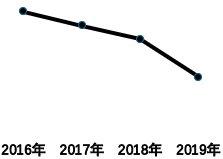
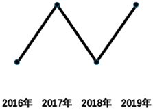
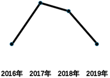
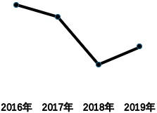

# 现期比重计算与比重变化趋势判断（折线图匹配）

考点：[[20-考点/资料分析/比重/现期比重计算与比重变化趋势判断（折线图匹配）|比重 / 现期比重计算与比重变化趋势判断（折线图匹配）]]
材料：[[15-材料/资料分析/3895161 以2024年底城乡居民基本医疗保险参|3895161 以2024年底城乡居民基本医疗保险参]]

**问法模型**：题干出现'某时段内A占B的比重变化趋势+折线图选择'→逐年计算现期比重A/(A+B)得到比重序列，再按升降形态匹配折线图选项

## 推理链
1. 第1步：从统计图提取2016~2019年数据：财政补助分别为2045、3943、4446、5733亿元，个人缴费分别为680、1491、2396、2737亿元
2. 第2步：规则：城乡居民医疗保险收入=财政补助+个人缴费，比重=财政补助÷收入合计
3. 第3步：先求各年合计：2016年2725、2017年5434、2018年6842、2019年8470亿元
4. 第4步：代入计算比重：2016年2045/2725≈75.0%，2017年3943/5434≈72.6%，2018年4446/6842≈65.0%，2019年5733/8470≈67.7%
5. 第5步：比重序列75.0%→72.6%→65.0%→67.7%，形态为连续两年下降后一年上升（先降后升）
6. 第6步：与选项对照，只有D项折线呈先降后升形态，故选D

**最快解法**：⚡ 比重定性比较法（分子分母增速对比）：逐段比较财政补助增速与合计增速——2016→2017年92.8%<99.4%降、2017→2018年12.8%<25.9%降、2018→2019年28.9%>23.8%升，得'降降升'即先降后升，无需精算比重直接锁定D；若精算可用截位直除（如2045/2725≈75%、4446/6842≈65%）验证

## 易错点
- ⚠ 堆积柱读数陷阱：易把柱顶高度（两项合计）误读为财政补助单项值，须按图下表格两行分别取数
- ⚠ 比重分母漏加总：分母必须是财政补助+个人缴费之和，不能误用单项（如财政补助÷个人缴费）作比重
- ⚠ 趋势判断不完整：只比较首尾两年（2016年75% vs 2019年68%）会误判为持续下降，必须逐年算出4个比重才能确定'降-降-升'形态

## 母题抽象
> 🧩 当题干出现'某时间段内A占B比重的变化趋势+折线图匹配'特征时，逐年计算A/(A+B)（或用分子、分母增速大小定性判断每段升降），得到比重序列形态后与选项折线一一比对

**同类特征**：折线图…比重变化趋势、限定连续年份区间（2016~2019年）、'占…收入比重'、堆积柱状图分层取数、现期比重逐年计算、先降后升形态匹配

## 相关题
（暂无）

---

### 题干
以下折线图中，最能准确反映2016~2019年间，财政补助收入占城乡居民医疗保险收入比重变化趋势的是：

### 选项
- A. 

- B. 

- C. 

- D. 

　✅

### 官方解析
根据题干“······2016~2019年间······占······比重变化趋势······”，结合材料给出2016~2019年相关数据，可判定本题为现期比重问题。定位统计图可得2016~2019年每年的财政补助收入和个人缴费收入。根据公式：比重，结合城乡居民医疗保险收入=财政补助收入+个人缴费收入，故2016~2019年财政补助收入占城乡居民医疗保险收入的比重分别为：
2016年：；
2017年：；
2018年：；
2019年：。
观察可得，变化趋势为先下降后上升，只有D项符合。
故正确答案为D。

### 给定材料

        截至2024年底，城乡居民基本医疗保险参保94713.73万人，收入11180.91亿元，支出10661.49亿元。

