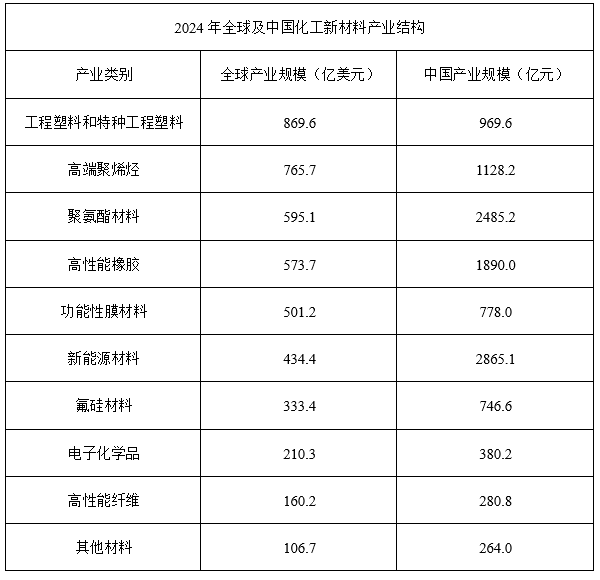

# 现期比重计算（部分求和÷整体）

考点：[[20-考点/资料分析/比重/现期比重计算（部分求和÷整体）|比重 / 现期比重计算（部分求和÷整体）]]
材料：[[15-材料/资料分析/6935600 2022-2024年全球及中国化工新|6935600 2022-2024年全球及中国化工新]]

**问法模型**：题干'2024年中美两国规模之和占全球比重约为'→ 现期比重模型：(中国现期值+美国现期值)÷全球现期值

## 推理链
1. 第1步：从文字材料提取2024年中国化工新材料产业规模1655.6亿美元、美国1455.0亿美元（美国数据仅出现在文字段）
2. 第2步：从表1提取2024年全球化工新材料产业规模4550.3亿美元，与两国数据同为亿美元口径，无需汇率换算
3. 第3步：现期比重公式：比重=部分之和÷整体=(1655.6+1455.0)÷4550.3
4. 第4步：分子加总：1655.6+1455.0=3110.6亿美元
5. 第5步：截位直除：3110.6÷4550.3≈311÷455≈0.684，即约68.4%
6. 第6步：与选项对照：68.4%与D项68%最接近，锁定D

**最快解法**：⚡ 截位直除：分子1655.6+1455.0=3110.6，取3110；分母4550取4550；4550×0.68=3094≈3110，故商略高于0.68即约68%，直接锁定D，无需精算

## 易错点
- ⚠ 单位口径陷阱：中国规模在表1是11787.7亿元，若误用亿元数÷全球4550.3亿美元会得到约259%的荒谬结果；必须用文字段同口径的1655.6亿美元（同一指标的两种表达）
- ⚠ 漏加美国：美国1455.0亿美元只在文字段出现，若只算中国占比1655.6÷4550.3≈36%，将完全偏离选项
- ⚠ 时间口径：题干直接问2024年比重且材料时间一致，属现期比重，无需用增速做基期还原

## 母题抽象
> 🧩 当题干出现'某年份A与B之和占整体比重约为'且部分与整体同现期、同单位时，用现期比重公式（部分相加÷整体）截位直除，验证结果与最接近选项；跨货币口径的数据先统一单位再相加

**同类特征**：现期年份直接提问（2024年）、'两国规模之和'需部分相加、'占全球比重'整体为全球规模、'约为'暗示估算即可、部分与整体口径需同为亿美元

## 相关题
- [[10-真题/资料分析/比重/2377296 现期比重计算（部分求和÷整体）|2377296]]（选调 2019，相关度2）
- [[10-真题/资料分析/比重/5911367 现期比重计算（部分求和÷整体）|5911367]]（浙江 2024，相关度2）
- [[10-真题/资料分析/比重/2255857 现期比重计算（部分求和÷整体）|2255857]]（江西 2016，相关度2）

---

### 题干
2024年，中美两国化工新材料产业规模之和占全球比重约为：

### 选项
- A. 52%
- B. 57%
- C. 63%
- D. 68%　✅

### 官方解析
根据题干“2024年······占······比重约为”，结合材料时间为2024年，可判定本题为现期比重问题。定位文字材料和统计表1可得：2024年，中国化工新材料产业规模达到1655.6亿美元，居全球第一位。其次是美国，化工新材料产业规模为1455.0亿美元；2024年全球化工新材料产业规模为4550.3亿美元。根据公式：比重，故所求为，与D项最接近。
故正确答案为D。

### 给定材料

        2024年，中国化工新材料产业规模达到1655.6亿美元，居全球第一位。其次是美国，化工新材料产业规模为1455.0亿美元。

