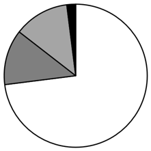
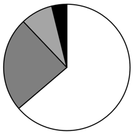
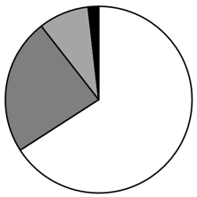
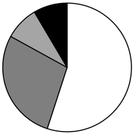

# 现期比重计算与饼图扇区识别

考点：[[20-考点/资料分析/比重/现期比重计算与饼图扇区识别|比重 / 现期比重计算与饼图扇区识别]]
材料：[[15-材料/资料分析/6511139 2023年全国软件和信息技术服务业软|6511139 2023年全国软件和信息技术服务业软]]

**问法模型**：题干问'哪个饼图能准确反映2023年四个领域收入占比'→用比重=领域收入÷总收入123258算出各扇区占比，再以占比排序和部分间倍数关系匹配饼图

## 推理链
1. 第1步：从材料提取2023年四领域收入：软件产品29030亿元、信息技术服务81226亿元、信息安全产品2232亿元、嵌入式系统软件10770亿元，总收入123258亿元；验证29030+81226+2232+10770=123258，恰等于总额，确认口径无子项混入
2. 第2步：现期比重公式：比重=领域收入÷总收入123258
3. 第3步：截位直除代入：信息技术服务81226/123258≈65.9%，软件产品29030/123258≈23.6%（约1/4），嵌入式10770/123258≈8.7%，信息安全2232/123258≈1.8%
4. 第4步：排序为信息技术服务>软件产品>嵌入式系统软件>信息安全
5. 第5步：倍数验证：软件产品占比≈23.6%接近1/4圈，故排名第二扇区约占四分之一，排除A、D；排名第三的嵌入式÷排名第四的信息安全=10770/2232≈4.8≈5倍，排除B
6. 第6步：与选项对照，只有C同时满足'第二大扇区≈1/4圈、第三大≈第四大5倍'，故选C

**最快解法**：⚡ 比重截位直除+倍数排除法：总额123258，先算软件产品29030/123258≈23.6%≈1/4圈排除A、D；再算嵌入式/信息安全=10770/2232≈4.8≈5倍，B中第三扇区不足第四扇区5倍，排除B锁定C；信息安全的扇区极小（约1.8%≈1/55圈）可作辅助验证

## 易错点
- ⚠ 子项混入领域：工业软件2824、云服务/大数据12470、集成电路设计3069、电商平台技术服务11789均为领域内子项，误与四领域并列算占比会导致重复计算且扇区排序错乱
- ⚠ 饼图排序陷阱：本题饼图未按常规'12点钟顺时针从大到小'排列，不能只看扇区起始位置，必须按扇区角度（占比大小与倍数）判断
- ⚠ 部分-总体口径：'信息安全产品和服务'与'信息安全产品'指同一领域；四领域之和恰等于123258亿元，若误加子项或漏算某领域会使占比失真

## 母题抽象
> 🧩 当题干出现'饼图能准确反映……占比情况'特征时，先验证各部分之和是否等于总量（防子项混入），再用部分÷总量截位估算各扇区百分比，最后用部分间倍数关系（如第三÷第四≈5倍、第二大≈1/4圈）快速排除选项

**同类特征**：饼图、收入占比情况、四个领域、现期比重（2023年）、扇区大小排序、部分与总体关系

## 相关题
- [[10-真题/资料分析/比重/2571801 基期比重还原（百分点变化反推）+饼图匹配|2571801]]（山东 2020，相关度1）
- [[10-真题/资料分析/比重/2444768 现期比重比较（饼图辨析型）|2444768]]（四川 2019，相关度1）
- [[10-真题/资料分析/比重/4637459 现期比重计算与饼图占比对照|4637459]]（国考 2022，相关度1）
- [[10-真题/资料分析/比重/5445864 现期比重计算（饼图匹配）|5445864]]（国考 2023，相关度1）
- [[10-真题/资料分析/比重/13504304 现期比重饼图识别（结构占比比较+排除法）|13504304]]（河南 2025，相关度1）

---

### 题干
以下饼图中能准确反映2023年软件业务四个领域收入占比情况的是：

### 选项
- A. 

- B. 

- C. 

　✅
- D. 

### 官方解析
根据题干“······能准确反映2023年······占比情况的是”，结合材料时间为2023年，可判定本题为现期比重问题。定位文字材料第一至五段可得：2023年，全国软件和信息技术服务业规模以上企业累计完成软件业务收入123258亿元。其中，软件产品实现收入29030亿元，信息技术服务收入81226亿元，信息安全产品实现收入2232亿元，嵌入式系统软件产品实现收入10770亿元。根据公式：比重，则2023年软件产品收入占比为，即占比排名第二的领域所占比重约为，排除A、D两项；倍，即占比排名第三的领域约是排名第四的5倍，排除B项，C项当选。
故正确答案为C。
注：一般情况下，饼图的作图顺序为从12点钟按照顺时针方向排列。本题为非常规考查，按占比从大到小排列，但解题的思路不变。

### 给定材料

        2023年，全国软件和信息技术服务业规模以上企业超3.8万家，累计完成软件业务收入123258亿元，同比增长13.4%，较上年同期增长2.2个百分点。

        四个领域分别由软件产品、信息技术服务、信息安全产品和服务、嵌入式系统软件组成。软件产品实现收入29030亿元，同比增长11.1%，较上年同期增长1.2个百分点。其中，工业软件产品实现收入2824亿元，同比增长12.3%。

        信息技术服务收入81226亿元，同比增长14.7%，其中云服务、大数据服务共实现收入12470亿元，同比增长15.4%；集成电路设计收入3069亿元，同比增长6.4%；电子商务平台技术服务收入11789亿元，同比增长9.6%。

        信息安全产品实现收入2232亿元，同比增长12.4%，较上年同期增长2.0个百分点。

        嵌入式系统软件产品实现收入10770亿元，同比增长10.6%，较上年同期下降0.7个百分点。

