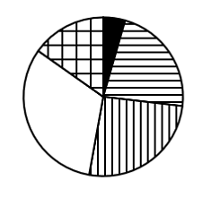
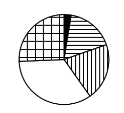

# 现期比重结构比较（饼图匹配）

考点：[[20-考点/资料分析/比重/现期比重结构比较（饼图匹配）|比重 / 现期比重结构比较（饼图匹配）]]
材料：[[15-材料/资料分析/5080790 2019-2023年我国五批次公示的|5080790 2019-2023年我国五批次公示的]]

**问法模型**：题干要求选出'最能准确反映五批次上市企业数量比例关系'的饼图 → 只需比较各批次数值大小并对应扇区纹理，用排除法锁定，无需精算比重

## 推理链
1. 第1步：从图1白色柱提取五批次上市企业数量：第一批39家、第二批198家、第三批229家、第四批282家、第五批134家
2. 第2步：加总得整体：39+198+229+282+134=882家，各批次份额=该批次数÷882
3. 第3步：排序比较：282＞229＞198＞134＞39，即第四批（白色）约32.0%＞第三批（竖线）约26.0%＞第二批（横线）约22.4%＞第五批（网格）约15.2%＞第一批（黑色）约4.4%
4. 第4步：最大扇区为第四批次（白色，282/882≈32%），凡白色扇区非最大的选项排除A、D
5. 第5步：比较第五批（网格，134，约15.2%）与第二批（横线，198，约22.4%），网格扇区应小于横线扇区，排除二者关系画反的C
6. 第6步：B项同时满足'白色最大'与'网格＜横线'的大小关系，当选

**最快解法**：⚡ 大小排序排除法：不求比重，直接对39/198/229/282/134排序；锁定最大值（第四批282，白色扇区）排除A、D，再用第五批134（网格）＜第二批198（横线）排除C，全程无需除法

## 易错点
- ⚠ 口径误用：误把图1灰色柱（企业总数）或图2五批次累计城市数据当分子分母，本题只能用图1白色柱各批次当期值（总量882家需自行加总）
- ⚠ 白色柱数值小且柱形贴地，第五批134与第一批39易漏读或读错，导致大小关系判断失误
- ⚠ 扇区纹理与批次对应错位：须将黑色/横线/竖线/白色/网格逐一对应五个批次，只看扇区相对面积不核对纹理会误选

## 母题抽象
> 🧩 当题干出现'最能准确反映……比例关系的饼图'时，先读出各部分数值并排序，用'最大扇区排除＋一组易混扇区大小关系排除'两轮筛选即可锁定答案，不必计算各部分比重

**同类特征**：最能准确反映、饼状图、五批次公示的上市企业、批次纹理（黑色/横线/竖线/白色/网格）、数量比例关系、现期比重结构

## 相关题
- [[10-真题/资料分析/比重/10297452 现期比重结构与饼图匹配（部分占比比较-倍数排除）|10297452]]（四川 2025，相关度1）
- [[10-真题/资料分析/增长/16593068 增长量比较（多期同比增量趋势与柱状图匹配）|16593068]]（甘肃 2024，相关度1）
- [[10-真题/资料分析/比重/16593075 现期比重计算与饼图占比关系判断（排除法）|16593075]]（海南 2024，相关度1）
- [[10-真题/资料分析/比重/17900953 现期比重结构判断（饼图-示意图比例匹配）|17900953]]（江苏 2024，相关度1）
- [[10-真题/资料分析/比重/2393936 现期比重计算（三年数据占合计比重＋饼图匹配）|2393936]]（青海 2019，相关度1）

---

### 题干
以下饼状图中，最能准确反映2019-2023年五批次公示的专精特新“小巨人”上市企业中，第一批次（黑色）、第二批次（横线）、第三批次（竖线）、第四批次（白色）和第五批次（网格）企业数量比例关系的是：

### 选项
- A. 

- B. 

　✅
- C. 

- D. 

### 官方解析
根据题干“······最能准确反映2019-2023年······企业数量比例关系的是”，结合材料时间为2019-2023年，可判定本题为现期比重问题。定位统计图可知：2019-2023年五批次公示的专精特新“小巨人”上市企业数量分别为39家、198家、229家、282家、134家。根据第四批次公示上市企业数量（282家）最多，可知第四批次（白色）占比最大，排除A、D两项；第五批次公示上市企业数量（134家）&lt;第二批次公示上市企业数量（198家），可知第五批次（网格）占比&lt;第二批次（横线）占比，排除C项，B项当选。
故正确答案为B。

### 给定材料

