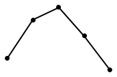
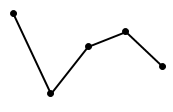

# 现期比重计算+比重变化趋势（折线图匹配）

考点：[[20-考点/资料分析/比重/现期比重计算+比重变化趋势（折线图匹配）|比重 / 现期比重计算+比重变化趋势（折线图匹配）]]
材料：[[15-材料/资料分析/6473137 第6-15届全国大学生数学竞赛（CM|6473137 第6-15届全国大学生数学竞赛（CM]]

**问法模型**：题干出现'最能准确反映……第10-14届……比重……变化趋势的折线图'→逐期计算现期比重（决赛人数÷参赛人数），再与选项折线形态（升降走势+谷峰位置）对照

## 推理链
1. 第1步：从图1定位第10-14届共5期数据：参赛人数（柱，万人）13.88、17.08、20.69、21.89、23.18；决赛人数（折线，人）539、604、646、748、922
2. 第2步：公式：比重=决赛人数÷参赛人数；因柱为'万人'、线为'人'，分母须×10000统一单位（如13.88万人=138800人）
3. 第3步：代入计算：第10届539/138800≈0.39%；第11届604/170800≈0.35%；第12届646/206900≈0.31%；第13届748/218900≈0.34%；第14届922/231800≈0.40%
4. 第4步：趋势判定：0.39%→0.35%→0.31%→0.34%→0.40%，先降后升呈V形，谷底在第12届，最高点在第14届
5. 第5步：与选项对照：仅B项为先降后升、第12届最低、第14届最高的V形折线，故选B

**最快解法**：⚡ 单位统一后截位直除（分子分母各取前三位）：539/139≈3.9、604/171≈3.5、646/207≈3.1、748/219≈3.4、922/232≈4.0（千分比量级），一眼看出'降→升'V形且谷底在第12届，直接锁定B，无需精算百分比

## 易错点
- ⚠ 双轴单位陷阱：柱=万人、线=人，相差10^4倍；若不把万人换成'人'，比重会错1万倍（算成万分之几量级）
- ⚠ 形态误判：柱与折线本身均单调上升，但比重并非单调递增而是先降后升的V形，只看单一图形走势会误选持续上升的选项
- ⚠ 期数定位错误：第10-14届对应13.88~23.18万人这5期，误取第6-10届或第11-15届（含28.84万人）会算出完全不同的趋势

## 母题抽象
> 🧩 当题干出现'最能准确反映某连续若干期'A占B'比重变化趋势（选折线图）'时，先统一分子分母单位，用截位直除快速算各期比重只比量级与升降，重点定位谷底/峰值所在期，再匹配选项折线形态

**同类特征**：最能准确反映……变化趋势、折线图（选图题）、第10-14届连续5期区间、决赛人数占参赛人数比重、双轴柱线复合图跨轴取数、单位不一致需换算

## 相关题
（暂无）

---

### 题干
以下折线图中，最能准确反映第10-14届CMC决赛人数占参赛人数比重变化趋势的是：

### 选项
- A. 

- B. 

　✅
- C. 

- D. 

### 官方解析

根据题干“······第10-14届······比重······”，结合材料给出第10-14届CMC参赛人数情况，可判定本题为现期比重问题。定位统计图可知第10-14届CMC参赛人数及决赛人数。根据公式：比重，可得第10-14届CMC决赛人数占参赛人数比重分别为：

第10届，；

第11届，；

第12届，；

第13届，；

第14届，。

比较可知，第12届比重最小，第14届比重最大，只有B项满足。

故正确答案为B。

### 给定材料

