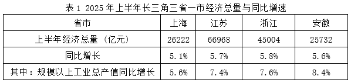

# 现期比重计算与比较（社零总额÷经济总量）

考点：[[20-考点/资料分析/比重/现期比重计算与比较（社零总额÷经济总量）|比重 / 现期比重计算与比较（社零总额÷经济总量）]]
材料：[[15-材料/资料分析/4237594 2025年上半年长三角三省一市（沪苏|4237594 2025年上半年长三角三省一市（沪苏]]

**问法模型**：题干自定义'社零占GDP百分比=消费依赖程度'并问哪个省市最高 → 现期比重模型，对四省市逐一计算比重后比大小取最大

## 推理链
1. 第1步：题干给出定义式：依赖程度=社会消费品零售总额÷经济总量×100%，时间口径为2025年上半年（现期）
2. 第2步：定位表1，四省市经济总量：上海26222亿元、江苏66968亿元、浙江45004亿元、安徽25732亿元
3. 第3步：定位表2，四省市社零总额：上海8260亿元、江苏23949亿元、浙江18979亿元、安徽12051亿元（两表列序均为沪苏浙皖，逐列对齐）
4. 第4步：代入计算：上海8260/26222≈31.5%，江苏23949/66968≈35.8%，浙江18979/45004≈42.2%，安徽12051/25732≈46.8%
5. 第5步：比较四者：46.8%（皖）＞42.2%（浙）＞35.8%（苏）＞31.5%（沪），安徽省最高
6. 第6步：与选项对照，最高者对应D安徽省，与官方答案一致

**最快解法**：⚡ 截位直除+首位商排除：四个除式各截前三位直除看首位商——皖12051/25732商4余大（约46.8%）、浙18979/45004商4余小（约42.2%）、苏23949/66968与沪8260/26222首位均商3；只需在皖、浙两个'4字头'之间比较，皖12051/25732显然大于浙（12051/25732≈46.8%＞42.2%），直接锁定D，苏沪无需精算

## 易错点
- ⚠ 分母口径：必须用表1的'经济总量'（GDP）作分母，勿误用同行'规模以上工业总产值增速'或以增速代替总量参与计算
- ⚠ 跨表对位：表1、表2省市列序一致（沪苏浙皖），拼合时防错列，如把浙江社零18979配上安徽GDP25732
- ⚠ 总量≠比重：江苏社零绝对额最大（23949亿元），但其GDP也最大，比值仅35.8%，被'绝对额最大'误导会错选B

## 母题抽象
> 🧩 当题干出现'A占B的百分比最高/最低（依赖度、占比等自定义比值）'特征时，用现期比重模型，对每个对象算A÷B，先用首位商/量级排除，再对接近者精算比大小

**同类特征**：占…的百分比、依赖程度最高、长三角省市横向对比、2025年上半年现期、社零÷经济总量、跨表拼合计算

## 相关题
（暂无）

---

### 题干
可以用“社会消费品零售总额”占“经济总量”的百分比来近似表示经济增长对内部最终消费的依赖程度。2025年上半年，长三角省市中，经济增长对内部最终消费的依赖程度最高的省市是        。

### 选项
- A. 上海市
- B. 江苏省
- C. 浙江省
- D. 安徽省　✅

### 官方解析
根据题干“······占······的百分比来近似表示经济增长对内部最终消费的依赖程度。2025年上半年······经济增长对内部最终消费的依赖程度最高的省市是······”，结合材料时间为2025年上半年，可判定本题为现期比重问题。定位表1可得：2025年上半年上海市、江苏省、浙江省、安徽省的经济总量分别为26222亿元、66968亿元、45004亿元、25732亿元；定位表2可得：2025年上半年上海市、江苏省、浙江省、安徽省的社会消费品零售总额分别为8260亿元、23949亿元、18979亿元、12051亿元。根据题干“可以用‘社会消费品零售总额’占‘经济总量’的百分比来近似表示经济增长对内部最终消费的依赖程度”，则越高，说明经济增长对内部最终消费的依赖程度越高。则2025年上半年，上海市、江苏省、浙江省、安徽省的分别为：，，，。2025年上半年，安徽省的最高，故2025年上半年，长三角省市中，安徽省经济增长对内部最终消费的依赖程度最高。
故正确答案为D。

### 给定材料

        2025年7月22日，上海市统计局发布上半年上海国民经济运行数据，至此，长三角三省一市已全部公布上半年经济运行情况。

        上半年，上海的三大先导产业制造业产值同比增长9.1%，增速快于全市规模以上工业总产值3.5个百分点。其中，人工智能制造业增长12.3%，集成电路制造业增长11.7%，生物医药制造业增长4.4%。上半年，工业战略性新兴产业制造业总产值同比增长6.7%。其中，新一代信息技术产业增长13.9%，新能源产业增长12.5%，高端装备产业增长10.7%。上半年，智能手机产量同比增长1.3倍，微型计算机设备、电子元件、笔记本计算机、工业机器人和半导体存储盘产量分别增长14.7%、13.4%、13.1%、11.9%和8.9%。江苏上半年装备制造业增加值同比增长10.2%，对全部规模以上工业增长的贡献率为73.5%，比一季度提升2.2个百分点；其中，计算机、通信和其他电子设备制造业增长14.3%，汽车制造业增长11.1%，铁路、船舶、航空航天和其他运输设备制造业增长15.0%。浙江上半年的工业机器人、锂离子电池、笔记本计算机、新能源汽车等产品产量分别增长85.7%、65.2%、47.3%、43.3%。上半年安徽的主要工业产品中，新能源汽车产量增长17.3%，集成电路增长9.9%，工业机器人增长93.3%。

