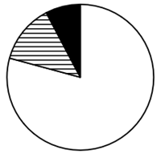
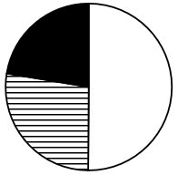

# 现期比重-结构占比饼图比对（部分-总体加总后看比例关系）

考点：[[20-考点/资料分析/比重/现期比重-结构占比饼图比对（部分-总体加总后看比例关系）|比重 / 现期比重/结构占比饼图比对（部分-总体加总后看比例关系）]]
材料：[[15-材料/资料分析/5257034 一张统计表呈现2024年上半年中国医|5257034 一张统计表呈现2024年上半年中国医]]

**问法模型**：题干'饼图最能准确反映……占比关系'→ 先对图例三个小类分别做'出口+进口'合成现期进出口额，再算各自占西药类进出口总额的比重或相互倍数，与扇区大小对照排除选图

## 推理链
1. 第1步：定位表中西药类下三个小类现期值——西药原料出口213.43、进口51.78；西成药出口35.24、进口110.28；生化药出口20.71、进口97.84（亿美元）
2. 第2步：模型：各部分进出口额=出口+进口，比重=各部分进出口额÷西药类进出口总额（表中未给总额，需自行加总）
3. 第3步：代入合成——西药原料=213.43+51.78=265.21，西成药=35.24+110.28=145.52，生化药=20.71+97.84=118.55，三者合计约529.28亿美元
4. 第4步：算比重——白色约265.21/529.28≈50%，横线约145.52/529.28≈27.5%，黑色约118.55/529.28≈22.4%
5. 第5步：算倍数——白/横=265.21/145.52≈1.8倍，横/黑=145.52/118.55≈1.2倍，即白色约占一半、横线略大于黑色
6. 第6步：对照选项——C中白色不是最大，排除；A中白与横比例明显偏离1.8倍关系，排除；B中横与黑明显偏离1.2倍（近相等或反向），排除；D符合'白≈50%、横≈27.5%、黑≈22.5%'，选D

**最快解法**：⚡ 倍数排除法：加总后只算两个倍数——白265.21约为横145.52的1.8倍（白约占半圆），横145.52约为黑118.55的1.2倍（横略大于黑），逐项对照扇区大小即可，无需精算百分比

## 易错点
- ⚠ 分母是'西药类进出口总额'（出口269.37+进口259.90≈529.27），不是出口总额，且总额表中未直接给出，须先加总预处理
- ⚠ 三个部分都必须用'出口+进口'合成，只取出口（如西成药仅35.24）或只取进口会全错；西成药、生化药均为出口小、进口大，结构反差大
- ⚠ 横线与黑色占比接近（约27.5%对22.4%），易把两者看成相等或大小颠倒；比对饼图时用1.2倍关系而非目测差不多
- ⚠ 注意'医药保健品合计'是全材料总口径，西药原料/西成药/生化药只是西药类下的三个小类，取数行不能错

## 母题抽象
> 🧩 当题干出现'饼图最能准确反映……占比关系'特征时，先按图例对每个部分做'出口+进口'（或各分量）加总得现期值，再用'部分÷部分'倍数或'部分÷总体'比重与扇区大小做排除比对，验证最大扇区、相邻扇区倍数关系即可定图

**同类特征**：饼图最能准确反映占比关系、西药类进出口总额、西药原料/西成药/生化药、白色、横线、黑色图例、2024年上半年、现期比重

## 相关题
- [[10-真题/资料分析/比重/4792819 现期比重计算（多部分比重依次求解）|4792819]]（新疆 2014，相关度1）
- [[10-真题/资料分析/比重/827355 现期比重比较（部分占比过半速判）|827355]]（政法干警 2014，相关度1）
- [[10-真题/资料分析/比重/2272297 现期比重比较|2272297]]（选调 2015，相关度1）
- [[10-真题/资料分析/比重/2032972 现期比重计算（多地区占比求和）|2032972]]（吉林 2015，相关度1）
- [[10-真题/资料分析/比重/2187857 现期比重计算（部分量需先由'总量−其中量'减法间接求得）|2187857]]（山东 2018，相关度1）

---

### 题干
以下饼图中，最能准确反映2024年上半年中国西药类进出口总额中，西药原料（白色）、西成药（横线）和生化药（黑色）占比关系的是：

### 选项
- A. 

- B. 

- C. 

- D. 

　✅

### 官方解析

根据题干“······最能准确反映2024年上半年······占比关系的是”，结合材料时间为2024年上半年，可判定本题为现期比重问题。定位统计表可知：2024年上半年，西药原料出口额为213.43亿美元、进口额为51.78亿美元；西成药出口额为35.24亿美元、进口额为110.28亿美元；生化药出口额为20.71亿美元、进口额为97.84亿美元。则2024年上半年，西药原料（白色）进出口额=213.43+51.78=265.21亿美元，西成药（横线）进出口额=35.24+110.28=145.52亿美元，生化药（黑色）进出口额=20.71+97.84=118.55亿美元。可知西药原料（白色）进出口额最大，排除C项；西药原料（白色）与西成药（横线）倍数关系为，排除A项；西成药（横线）与生化药（黑色）倍数关系为，排除B项。

故正确答案为D。

### 给定材料

> [!warning] 疑点（官方解析可能有误，待人工复核）
> 官方解析中两处倍数关系数值显示缺失（'倍数关系为，排除A/B'处为空），按数据补全应为白/横≈1.8倍、横/黑≈1.2倍，不影响正确答案D；另西药类三小类出口加总269.38与大类269.37存在0.01尾差，本题占比按三小类加总做分子、合计做分母处理即可

<!-- CODEX-ANSWER-REVIEW:BEGIN -->
### 本次独立复核

**复核状态：** `resolved`（答案与解析已核定）

**计分答案：** D（可计分）

**复核解析：**

三类进出口额分别为原料265.21、西成药145.52、生化药118.55亿美元，总计529.28。占比约50.1%、27.5%、22.4%；原料/西成药≈1.82，西成药/生化药≈1.23。对照四个饼图，D匹配最大白色约半圆、横线略大于黑色，选D。原解析缺失的两个倍数可以由表格数值补算；0.01尾差来自分项与合计的舍入。

**相关信息：**

各分项进出口额=出口+进口；三项分母用其总和，避免将出口额误当进出口总额。

**题源依据：** [固定版本原题](https://github.com/Mentat-Uran/kaogongzhentizhengliu/blob/84ab93d4b64b61d897bece8a1c0a5bab06b4feb2/10-%E7%9C%9F%E9%A2%98/%E8%B5%84%E6%96%99%E5%88%86%E6%9E%90/%E6%AF%94%E9%87%8D/19526216%20%E7%8E%B0%E6%9C%9F%E6%AF%94%E9%87%8D-%E7%BB%93%E6%9E%84%E5%8D%A0%E6%AF%94%E9%A5%BC%E5%9B%BE%E6%AF%94%E5%AF%B9%EF%BC%88%E9%83%A8%E5%88%86-%E6%80%BB%E4%BD%93%E5%8A%A0%E6%80%BB%E5%90%8E%E7%9C%8B%E6%AF%94%E4%BE%8B%E5%85%B3%E7%B3%BB%EF%BC%89.md)；固定内容 commit `84ab93d4b64b61d897bece8a1c0a5bab06b4feb2`，Markdown blob `456d94fe6e38eeb26fbf0d22dbdf3a92a8231514`。
<!-- CODEX-ANSWER-REVIEW:END -->
