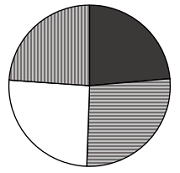
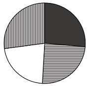
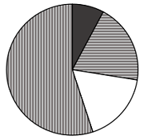

# 现期比重计算与大小比较（饼图占比匹配）

考点：[[20-考点/资料分析/比重/现期比重计算与大小比较（饼图占比匹配）|比重 / 现期比重计算与大小比较（饼图占比匹配）]]
材料：[[15-材料/资料分析/5741847 2024年我国与联合国定义的45个最|5741847 2024年我国与联合国定义的45个最]]

**问法模型**：题干要求选出'最能准确反映自最不发达国家进口值中铜材/原油/金属矿砂/其他占比关系'的饼状图 → 先用'进口总值−三个已列商品之和'补出'其他'，再按各部分大小顺序与关键比重匹配图形

## 推理链
1. 第1步：从材料第1段取分母——2024年自最不发达国家进口值5565.5亿元；从第3段取三个已列部分——铜材1469.6亿元、原油1364.2亿元、金属矿砂1221亿元
2. 第2步：饼图四扇区之和须等于进口总值，故'其他'=5565.5−1469.6−1364.2−1221=1510.7亿元（三个已列商品合计仅4054.8亿元，不能直接当整张饼）
3. 第3步：大小排序为其他1510.7>铜材1469.6>原油1364.2>金属矿砂1221，对应比重约27.1%、26.4%、24.5%、21.9%，四块均接近1/4
4. 第4步：由铜材1469.6>原油1364.2，可排除铜材不大于原油的A、C项（仅需比分子，不用除法）
5. 第5步：精算关键比重验证：铜材占比=1469.6÷5565.5≈26.4%，仅略高于1/4、远不足一半，D项扇区大小与此不符，排除
6. 第6步：唯一满足'其他略最大、铜材次之、原油第三、金属矿砂最小，四块均近1/4'的是B项，故选B

**最快解法**：⚡ 排序排除+单次截位直除：第一步只比分子1469.6>1364.2>1221即可排除A、C；第二步算一个比重定形——铜材1469.6÷5565.5，截位取1470÷5570≈26.4%（略高于1/4），排除扇区明显偏离的D；再心算'其他'=5565.5−4054.8≈1510.7略大于铜材，直接锁定B

## 易错点
- ⚠ 漏算'其他'：三个已列商品合计仅4054.8亿元，距进口总值5565.5亿元还差1510.7亿元，把三项当整饼会导致四块占比全部失真
- ⚠ 分母选错：应以进口值5565.5亿元为整体，若误用进出口总值14230.2亿元，所有比重约减半，无图可匹配
- ⚠ 扇区与图例（黑色/横线/白色/竖线）对应混乱：必须按'铜材>原油>金属矿砂'的材料数字排序，不能凭'原油通常是最大进口品'的常识直觉替换材料事实
- ⚠ 比重精度陷阱：四块比重均落在21.9%~27.1%的窄区间，任何一块明显超过30%或低于20%的选项（如D）都应果断排除

## 母题抽象
> 🧩 当题干出现'饼状图最能准确反映各部分占比关系'且已列部分未覆盖整体时，先用'整体−已列部分之和'补出'其他'，再按分子大小排序排除选项，最后只算一个关键比重（如最大已列部分占比）验证扇区大小即可锁定答案

**同类特征**：'饼状图'+'最能准确反映……占比关系'、以'自最不发达国家进口值'为整体范围、指定四部分并绑定图例样式（铜材黑色、原油横线、金属矿砂白色、其他竖线）、已列商品未覆盖整体，需倒推'其他'、现期（2024年）比重比较型图形匹配题、选项为图形，采用排序+关键比重排除法

## 相关题
（暂无）

---

### 题干
下列饼状图，最能准确反映2024年我国自最不发达国家进口值中，铜材（黑色），原油（横线），金属矿砂（白色）和其他（竖线）进口值占比关系的是：

### 选项
- A. 

- B. 

　✅
- C. 

- D. 

### 官方解析
根据题干“下列饼状图，最能准确反映2024年······占比关系的是”，结合材料时间为2024年，可判定本题为现期比重问题。定位文字材料第一段可得：2024年，我国······进口5565.5亿元；定位文字材料第三段可得：2024年，我国自最不发达国家进口铜材、原油、金属矿砂分别为1469.6亿元、1364.2亿元、1221亿元。观察发现，铜材进口值&gt;原油进口值，排除A、C项。根据公式：比重，则2024年铜材进口值占进口值的比重，排除D项。 
故正确答案为B。

### 给定材料

        2024年，我国对联合国定义的45个最不发达国家（以下简称最不发达国家）进出口14230.2亿元人民币，占同期我国外贸进出口总值的3.2%。其中出口8664.6亿元，同比（下同）增长4.3%；进口5565.5亿元，增长12.8%。

        2024年，我国对最不发达国家出口机电产品3942.2亿元，增长13.5%。其中出口船舶690.8亿元，增长65.9%，主要出口至全球第一大船旗国利比里亚。出口金额654.3亿元，增长67%；出口工程机械、火车分别为165.3亿元、91.6亿元，分别增长28.9%、39.5%；出口劳动密集型产品2481亿元，增长3.7%，其中纺织品1623.5亿元，增长15.3%。

        2024年，我国自最不发达国家进口铜材、原油、金属矿砂分别为1469.6亿元、1364.2亿元、1221亿元。最不发达国家成为我国钢材、铝矿、锡矿、钨矿、钛矿第一大进口来源地，分别占我国同类商品进口总值的38.2%，73.1%，65.4%，57.7%，58.1%。

        2024年12月1日起，我国给予所有已建交的最不发达国家100%税目产品零关税待遇。12月，我国自最不发达国家进口512.7亿元，增长18.1%，其中自刚果民主共和国、几内亚、老挝、赞比亚分别进口156.3亿元，54.7亿元，35.6亿元，33.9亿元，分别增长84.6%，40.3%，25.7%、127.27%。

