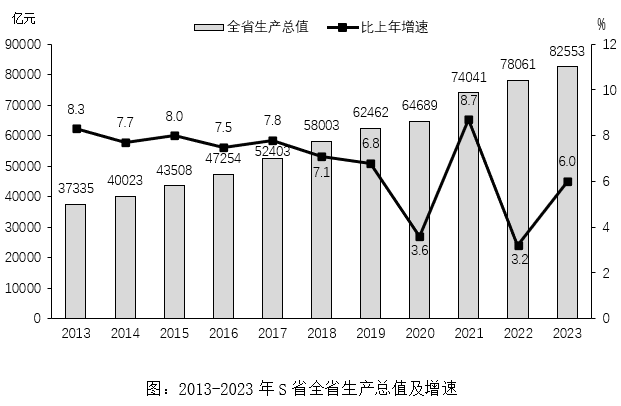

# 现期比重（部分占整体，结构比直读+计算验证）

考点：[[20-考点/资料分析/比重/现期比重（部分占整体，结构比直读+计算验证）|比重 / 现期比重（部分占整体，结构比直读+计算验证）]]
材料：[[15-材料/资料分析/5600284 S省2013-2023年全省生产总值|5600284 S省2013-2023年全省生产总值]]

**问法模型**：题干问'2023年第二产业增加值占全省生产总值比重约为'→ 现期比重=部分值÷整体值，且材料已直接给出三次产业结构比，可直读后用截位直除验证

## 推理链
1. 第1步：从文字材料第一段提取数据：2023年第二产业增加值33953亿元，全省生产总值82553亿元，三次产业增加值比约为2.8:41.1:56.1
2. 第2步：所用规则：现期比重=部分值/整体值；材料已给出结构比，第二产业对应中间项41.1%
3. 第3步：代入验证：33953/82553≈0.4113，即约41.1%（截位直除：3395/8255≈41.1%），与结构比41.1%互验一致
4. 第4步：与选项对照：41.1%与C项41%最接近（A.35%、B.37%、D.48%均偏差明显），故选C

**最快解法**：⚡ 结构比直读法：材料第一段直接给出三次产业增加值比2.8:41.1:56.1，第二产业占比41.1%≈41%，秒选C；若需验证，用截位直除33953/82553≈41%即可，全程无需复杂计算

## 易错点
- ⚠ 问的是现期（2023年）比重，误用二产增速5.0%去套基期比重公式或把增速当比重
- ⚠ 混淆产业对应项：41.1%对应第二产业、56.1%对应第三产业、2.8%对应第一产业，看错列会误选D（48%接近56.1%误读或错误组合）
- ⚠ 结构比是'约为'，与计算值33953/82553≈41.1%有微小口径差，选项贴近时应以部分÷整体的计算值为准，但本题两者同指向41%

## 母题抽象
> 🧩 当题干出现'某年某产业/某部分占总体比重约为'且材料正文直接给出结构比时，先直读结构比锁定答案，再用部分值÷整体值截位直除做一次验证（误差1个选项内即确认）

**同类特征**：现期比重问法、'占全省生产总值比重'为部分占整体、材料已给三次产业比2.8:41.1:56.1、'约为'要求选最接近项、取数于文字第一段、分子分母同为2023年当年值

## 相关题
- [[10-真题/资料分析/比重/2188157 现期比重计算|2188157]]（陕西 2018，相关度1）
- [[10-真题/资料分析/比重/2742283 现期比重计算（表格无合计行，整体需7行同年加总）|2742283]]（北京 2021，相关度1）

---

### 题干
2023年第二产业增加值占S省全省生产总值比重约为：

### 选项
- A. 35%
- B. 37%
- C. 41%　✅
- D. 48%

### 官方解析
定位文字材料第一段可得：2023年······第一、二、三产业增加值比约为2.8：41.1：56.1。则2023年第二产业增加值占S省全省生产总值比重，与C项最接近。
故正确答案为C。

### 给定材料

        2023年S省全省生产总值为82553亿元，比上年约增长6.0%。分产业看，第一、二、三产业增加值分别为2332亿元、33953亿元和46268亿元，分别增长4.2%、5.0%和6.7%，三次产业增加值比约为2.8：41.1：56.1。

        2023年年末全省常住人口6627万人，比上年末增加50万人。其中，男性人口3459万人，女性人口3168万人。全年出生人口38.3万人，出生率为；死亡人口44.0万人，死亡率为；自然增长率为。城镇化率为74.2%。

