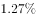
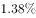
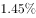
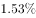

# 混合比重（全年比率=各季度比率的加权平均，介于最小与最大季度值之间）

考点：[[20-考点/资料分析/比重/混合比重（全年比率=各季度比率的加权平均，介于最小与最大季度值之间）|比重 / 混合比重（全年比率=各季度比率的加权平均，介于最小与最大季度值之间）]]
材料：[[15-材料/资料分析/184700 2015年第1季度至2016年第1季|184700 2015年第1季度至2016年第1季]]

**问法模型**：题干要求'2015年全年不良贷款率'而材料只给出2015年四个季度的不良率 → 识别为混合比重模型：全年比率必介于各季度比率的最小值与最大值之间，区间夹逼排除选项

## 推理链
1. 第1步：从图2提取2015年城商行四个季度不良贷款率（时间轴倒序，2015Q1在最右）：1.29%、1.37%、1.44%、1.40%（注意城商行率非单调，Q3的1.44%高于Q4的1.40%），全年比率材料未直接给出
2. 第2步：全年不良贷款率=全年不良贷款余额合计÷全年贷款总额合计，属混合比重（加权平均），混合之后居中，结果必落在四个季度比率的最小值与最大值之间
3. 第3步：min=1.29%（2015Q1）、max=1.44%（2015Q3），故全年不良贷款率必在1.29%~1.44%之间；若加权精算验证：余额合计1002+1120+1215+1213=4450亿元，总额合计≈1002/1.29%+1120/1.37%+1215/1.44%+1213/1.40%≈330444亿元，4450÷330444≈1.35%，落在区间内
4. 第4步：对照选项，只有B位于1.29%~1.44%区间内（约1.35%量级），其余选项均越界，故正确答案为B

**最快解法**：⚡ 混合居中法（区间夹逼）：全年比率必介于四季度比率的min(1.29%)与max(1.44%)之间，先框定1.29%~1.44%区间，再扫四个选项，唯一落在区间内的B即为答案，全程无需计算

## 易错点
- ⚠ 倒序轴陷阱：图2最左是2016Q1（1.46%），2015年四个季度在右侧四组，若误把2016Q1的1.46%计入'2015全年'，区间会错框为1.29%~1.46%，可能多选或错选
- ⚠ 误用简单算术平均：(1.29%+1.37%+1.44%+1.40%)/4≈1.375%，全年应为加权平均而非四季平均；本题靠区间夹逼可规避，但若区间内有多个选项则必须按各季贷款总额（=不良余额÷不良率）加权精算
- ⚠ 双轴口径混淆：把柱（不良贷款余额，亿元，左轴）误当贷款总额，或把折线（%，右轴）与柱值混读，导致无法定位比率区间；且两条折线勿张冠李戴（▲为农商行、×为城商行）

## 母题抽象
> 🧩 当题干出现'全年（整体）比率/比重'而材料只给各分段的比率时，用混合居中原则：整体比率必介于各分段比率最小值与最大值之间，先区间夹逼排除选项；若区间内有多个候选，再按各分段总量（分段比率对应分母）加权精算验证

**同类特征**：全年不良贷款率、城市商业银行、材料只给季度比率、混合比重、区间夹逼定唯一选项、倒序时间轴取数

## 相关题
- [[10-真题/资料分析/比重/5893732 混合比重（基期比重与现期比重比较，利用新增占比居中判定）|5893732]]（国考 2024，相关度1）
- [[10-真题/资料分析/比重/2136622 混合比重（两期合计比重，偏向基数大的一方）|2136622]]（河南 2017，相关度1）

---

### 题干
2015年城市商业银行全年不良贷款率约为：

### 选项
- A. 

- B. 

　✅
- C. 

- D. 

### 官方解析
由题干“2015年城市商业银行全年不良贷款率”可知为比重问题，结合材料中只给出2015年一、二、三、四个季度的不良贷款率，求全年不良贷款率可知本题为混合比重问题。
定位图表可知，2015年城市商业银行不良贷款率第一季度至第四季度依次为：、、、。混合之后居中，故2015年城市商业银行全年不良贷款率应在~之间，只有B项符合。
故正确答案为B。

### 给定材料

 

