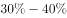
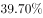
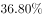
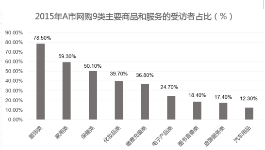

# 占比区间判断（柱状图直读+组合排除）

考点：[[20-考点/资料分析/比重/占比区间判断（柱状图直读+组合排除）|比重 / 占比区间判断（柱状图直读+组合排除）]]
材料：[[15-材料/资料分析/184894 2015年A市统计局对5000名有网|184894 2015年A市统计局对5000名有网]]

**问法模型**：题干要求找出受访者占比落在指定区间（30%~40%）的商品和服务项目组合 → 直读柱状图数值，逐项验证选项中两类是否均落在区间内

## 推理链
1. 第1步：从柱状图提取9类受访者占比：服饰类78.50%、家用类59.30%、保健类50.10%、化妆品类39.70%、缴费充值类36.80%、电子产物类24.70%、图书音像类18.40%、旅游服务类17.40%、汽车用品12.30%
2. 第2步：由官方解析'占比在（区间）之间的商品和服务项目只有化妆品类和缴费充值类'确定判据为占比在30%~40%之间
3. 第3步：核对区间：仅化妆品类39.70%与缴费充值类36.80%两个数值落在30%~40%之间
4. 第4步：逐项排除——B含保健类50.10%（超40%）和汽车用品12.30%（低于30%）；C含旅游服务类17.40%（低于30%）；D含电子产物类24.70%（低于30%）
5. 第5步：仅A项（化妆品、缴费充值类）两类均落在区间内，与选项对照得出答案A

**最快解法**：⚡ 直读排除法：先锁定30%~40%区间，图中仅有39.70%（化妆品类）和36.80%（缴费充值类）两根柱；B/C/D各含一根明显在区间外的柱（50.10%、17.40%、24.70%），直接排除，秒选A

## 易错点
- ⚠ 选项中'旅游类''电子产品类'是图中'旅游服务类''电子产物类'的近义改写，必须对应回原图条目再核对数值，防止错配
- ⚠ 图中为受访者占比且各类之和超100%（受访者可多选），不能当作构成比或人数相加验证
- ⚠ 边界读数勿错档：保健类50.10%略超50%不属30%~40%档，电子产物类24.70%接近但不足30%，勿凭'差不多'误判

## 母题抽象
> 🧩 当题干出现'占比在X%~Y%之间的项目是'且选项为两两组合时，先从图中数出区间内的全部类别，再用排除法剔除含区间外项目的选项，验证唯一剩余项

**同类特征**：占比区间判断、两两组合选项、柱状图直接读数、受访者占比、商品和服务项目类别名、组合排除法

## 相关题
（暂无）

---

### 题干

2015年，在A市中，受访者网购的商品和服务项目是：

### 选项
- A. 化妆品、缴费充值类　✅
- B. 保健类、汽车用品类
- C. 缴费充值类、旅游类
- D. 化妆品、电子产品类

### 官方解析

定位图形材料，占比在之间的商品和服务项目只有化妆品类和缴费充值类。

故正确答案为A。

### 给定材料

        A市统计局在该市范围内做了一项调查，抽取了5000名18到70周岁且在2015年有过网购经历的居民，结果显示：受访者2015年人均网购次数为19.4次。从分组情况看，有三类人群使用网购相对频繁：一是年轻群体，35岁以下的受访者人均网购次数为25.5次；二是较高学历群体，文化程度为大学本科及以上学历和大专学历的受访者人均网购次数分别是27.3次和21.8次；三是中高收入群体，个人月收入为10000元以上和5000到10000元的受访者人均网购次数分别是31.0次和26.0次。此外，女性受访者人均网购次数为21.1次，比男性受访者高出3.8次。2015年该市网购9类主要商品和服务的受访者占比情况如下图。

> [!warning] 疑点（官方解析可能有误，待人工复核）
> 题干与官方解析文字均疑漏印具体占比区间数值（解析原文'占比在之间'缺区间），依据图中数据（化妆品39.70%、缴费充值36.80%落在30%~40%，其余选项各含区间外类别）反推该区间应为30%~40%，与官方答案A完全一致，不影响作答结论

<!-- CODEX-ANSWER-REVIEW:BEGIN -->
### 本次独立复核

**复核状态：** `resolved`（答案与解析已核定）

**计分答案：** A（可计分）

**复核解析：**

题干公式图给出的区间是30%—40%。柱图中化妆品类39.7%、缴费充值类36.8%落入该区间；其余选项各含低于30%或高于40%的项目，选A。

**相关信息：**

比重变化：分项增速高于整体增速时占比上升；基期比重需分别还原分子、分母后求比。

**题源依据：** [固定版本原题](https://github.com/Mentat-Uran/kaogongzhentizhengliu/blob/84ab93d4b64b61d897bece8a1c0a5bab06b4feb2/10-%E7%9C%9F%E9%A2%98/%E8%B5%84%E6%96%99%E5%88%86%E6%9E%90/%E6%AF%94%E9%87%8D/2022276%20%E5%8D%A0%E6%AF%94%E5%8C%BA%E9%97%B4%E5%88%A4%E6%96%AD%EF%BC%88%E6%9F%B1%E7%8A%B6%E5%9B%BE%E7%9B%B4%E8%AF%BB%2B%E7%BB%84%E5%90%88%E6%8E%92%E9%99%A4%EF%BC%89.md)；固定内容 commit `84ab93d4b64b61d897bece8a1c0a5bab06b4feb2`，Markdown blob `df787f7a13d96756d41a33683b657dbc60d91bdf`。
<!-- CODEX-ANSWER-REVIEW:END -->
