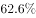
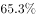
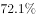
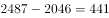
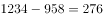
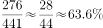

# 增量比重（新建量中分项占比，分母为总长度增量）

考点：[[20-考点/资料分析/比重/增量比重（新建量中分项占比，分母为总长度增量）|比重 / 增量比重（新建量中分项占比，分母为总长度增量）]]
材料：[[15-材料/资料分析/184986 2010-2015年全国各种光缆线路|184986 2010-2015年全国各种光缆线路]]

**问法模型**：题干问'2015年新建光缆中接入网所占比重'→'新建'是流量概念，须用相邻两年存量相减构造分子（接入网增量）与分母（总长度增量），再作除法求比重

## 推理链
1. 第1步：从柱状图提取数据：光缆线路总长度2015年为2487、2014年为2046；接入网光缆2015年为1234、2014年为958（单位：万公里）
2. 第2步：'新建'为流量，须相邻两年存量相减：新建总光缆=2487-2046=441万公里（分母），新建接入网光缆=1234-958=276万公里（分子）
3. 第3步：代入比重公式：比重=276÷441≈0.626，即约62.6%
4. 第4步：与选项对照，约62.6%与选项B相符，故选B

**最快解法**：⚡ 截位直除：先做两组减法得276/441，直除441×0.6=264.6，余11.4，11.4/441≈0.026，合计约62.6%，对照选项选B；分子分母均来自同一组'现期-基期'减法，可一次列式(1234-958)/(2487-2046)完成

## 易错点
- ⚠ 直接拿现期值算比重：1234/2487≈49.6%，误把存量当新建量是本题最高频错误
- ⚠ 分母错用现期总长度2487或基期总长度2046，正确分母必须是总长度的增量441（2487-2046）
- ⚠ 单位量级：图中数据单位为'万公里'且柱顶数字不带单位，读数与代入时勿错判量级；另注意接入网柱与本地网中继柱在2015年数值接近（1234与1157），勿按图例错位读数

## 母题抽象
> 🧩 当题干出现'某年新建/净增中某部分所占比重'特征时，用'现期存量-基期存量'分别构造分子（部分增量）与分母（总量增量），再作除法对照选项验证

**同类特征**：2015年新建光缆、接入网光缆线路长度所占比重、存量相减构造增量、分项增量作分子、总增量作分母、现期比重的增量变形、分组柱状图逐年读数

## 相关题
- [[10-真题/资料分析/增长/2024184 同比增长率比较（超阈值年份计数）|2024184]]（重庆 2016，相关度1）

---

### 题干
2015年全国新建光缆中，接入网光缆线路长度所占比重为：

### 选项
- A. 

- B. 

　✅
- C. 

- D. 

### 官方解析

由题干“2015年…接入网光缆线路长度所占比重为”，可判定该题属于现期比重问题。定位柱状图中数据，2015年全国新建光缆为万公里；2015年新建接入光缆为万公里。，接近答案B。

故正确答案为B。

### 给定材料

> [!warning] 疑点（官方解析可能有误，待人工复核）
> 官方解析中'2015年全国新建光缆为___万公里；2015年新建接入光缆为___万公里'两处数据缺失未给出具体数值，但按图数据计算(1234-958)/(2487-2046)=276/441≈62.6%与答案B一致，结论无误

<!-- CODEX-ANSWER-REVIEW:BEGIN -->
### 本次独立复核

**复核状态：** `resolved`（答案与解析已核定）

**计分答案：** B（可计分）

**复核解析：**

图中总光缆长度2014、2015年分别为2046、2487万公里，接入网光缆分别为958、1234万公里。新建量按存量差计算：总增量441，接入网增量276；276/441≈62.59%，选B。原解析空缺的两数可由原图读数补齐。

**相关信息：**

“新建”指年度新增量，不是2015年存量；单位万公里在比值中抵消。

**题源依据：** [固定版本原题](https://github.com/Mentat-Uran/kaogongzhentizhengliu/blob/84ab93d4b64b61d897bece8a1c0a5bab06b4feb2/10-%E7%9C%9F%E9%A2%98/%E8%B5%84%E6%96%99%E5%88%86%E6%9E%90/%E6%AF%94%E9%87%8D/2024186%20%E5%A2%9E%E9%87%8F%E6%AF%94%E9%87%8D%EF%BC%88%E6%96%B0%E5%BB%BA%E9%87%8F%E4%B8%AD%E5%88%86%E9%A1%B9%E5%8D%A0%E6%AF%94%EF%BC%8C%E5%88%86%E6%AF%8D%E4%B8%BA%E6%80%BB%E9%95%BF%E5%BA%A6%E5%A2%9E%E9%87%8F%EF%BC%89.md)；固定内容 commit `84ab93d4b64b61d897bece8a1c0a5bab06b4feb2`，Markdown blob `4917f714be73f8fedae16b56ef78c0dc3aea0c92`。
<!-- CODEX-ANSWER-REVIEW:END -->
