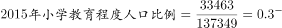
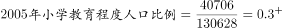
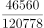
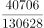
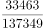

# 两期比重比较＋综合判断题（占比变化趋势验证）

考点：[[20-考点/资料分析/比重/两期比重比较＋综合判断题（占比变化趋势验证）|比重 / 两期比重比较＋综合判断题（占比变化趋势验证）]]
材料：[[15-材料/资料分析/184988 全国1%人口抽样调查下1995—20|184988 全国1%人口抽样调查下1995—20]]

**问法模型**：题干为'能够从上述资料推出的是'的四选一综合判断 → 逐项将选项转化为占比/可推性验证，用比重比较模型逐项证伪或证实

## 推理链
1. 第1步：从统计表提取三个调查时点数据：小学人口1995/2005/2015年为46560/40706/33463万人，同期总人口为120778/130628/137349万人
2. 第2步：验证A项，用比重=部分/整体：2015年小学占比33463/137349≈24.4%，2005年为40706/130628≈31.2%，2015年＜2005年，A错误
3. 第3步：验证B项，2005年高中为绝对数15083万人，2010年仅有率口径'每10万人中14032人'，材料未给2010年总人口，无法还原为绝对数比较，B不可推出
4. 第4步：验证C项，小学占比1995年46560/120778≈38.5%＞2005年40706/130628≈31.2%＞2015年33463/137349≈24.4%，三个抽样时点持续下降，C正确
5. 第5步：定性核验C项：小学人口（分子）逐期减小而总人口（分母）逐期增大，占比必然逐期下降，与计算一致
6. 第6步：验证D项，1995年初中33045万人＜小学46560万人，初中占比低于同期小学，并非高于其他各类受教育人口，D错误
7. 第7步：对照四个选项，唯一能从资料推出的是C

**最快解法**：⚡ 定性判断（分子分母同向变化法）秒杀C项：小学人口46560→40706→33463逐期减小，总人口120778→130628→137349逐期增大，占比必持续下降，直接锁定C；A项同法（分子降分母升则占比降，2015＜2005）排除，D项看1995年小学46560＞初中33045排除，B项因2010年总人口缺失排除

## 易错点
- ⚠ 口径混排陷阱：B项中2005年是'万人'绝对数、2010年是'每10万人中人数'率口径，数值14032与15083不可直接横比，且材料无2010年总人口无法折算还原
- ⚠ 时间口径陷阱：表格时点间隔为10年（1995/2005/2015），'持续下降'须对三个抽样时点逐期比较，不能只看首尾两端
- ⚠ 总体口径陷阱：表格'总人口'包含未受教育人口，比较'高于其他受教育人口'应与各受教育类别分别比较，1995年小学＞初中即可否定D

## 母题抽象
> 🧩 当综合判断题选项出现'占比持续上升/下降'特征时，用分子分母同向变化定性判断：分子逐期减小且分母逐期增大则占比必降，免计算直接锁定；选项涉及绝对数与率口径并存时，先检查材料是否给了还原所需的总人口，缺失即判'不可推出'

**同类特征**：能够从上述资料推出的是、四选一综合判断、所占比例持续下降、两期比重比较、绝对数与每10万人率口径混排、材料未给数据（2010年总人口）不可推

## 相关题
- [[10-真题/资料分析/综合/1797586 综合判断题（逐项验证：直接读数+倍数+差值比较）|1797586]]（黑龙江 2016，相关度2）
- [[10-真题/资料分析/综合/1797612 综合判断题（逐项验证-能推出型）|1797612]]（山东 2016，相关度2）
- [[10-真题/资料分析/综合/10204448 综合分析-逐项判断（历史极值确认、两期比重比较、多期累计求和、基期比重）|10204448]]（广东 2024，相关度1）
- [[10-真题/资料分析/综合/13319330 综合分析（可推出判断），涉及增长n倍求基期量、年均增速时间口径、'四成以上'方向词甄别、增长倍数比较|13319330]]（江苏 2025，相关度1）
- [[10-真题/资料分析/比重/17097813 两期比重比较（比重差计算）|17097813]]（山西 2024，相关度1）

---

### 题干
能够从上述资料推出的是：

### 选项
- A. 2015年小学教育程度人口比例高于2005年
- B. 2010年高中教育程度人口相比于2005年出现下降
- C. 小学教育程度人口在抽样年份中所占比例持续下降　✅
- D. 初中教育程度人口在抽样年份中所占比例高于同期其他受教育人口

### 官方解析

A项： ，，2015年数据小于2005年，错误。

B项：2005年高中教育程度人口为15083万人，2010年每10万人中具有高中教育程度人口有14032人。材料中没有2010年的总人口数据，所以无法从上述材料推断，错误。

C项：1995年：，2005年：，两者相比，前者分子大分母小，故1995年数据大于2005年。2015年：，与2005年相比，2005年的分子大分母小，故2005年数据大于2015年。因此小学教育人口所占比例持续下降，正确。

D项：在1995年中，小学教育程度人口大于初中，所以1995年初中教育程度人口比例小于小学，错误。

故正确答案为C。

### 给定材料

        2005年全国人口抽样调查主要数据公报显示，同2000年第五次全国人口普查相比，2005年具有大学教育程度的人口增加2193万人；具有高中教育程度的人口增加974万人；具有初中教育程度的人口增加3746万人，具有小学教育程度的人口减少4485万人。

        2015年全国人口抽样调查主要数据公报显示，同2010年第六次全国人口普查相比，2015年每10万人中具有大学教育程度的人口由8930人上升为12445人；具有高中教育程度人口由14032人上升为15350人；具有初中教育水平人口由38788人下降到35633人；具有小学教育程度人口由26779人下降为24356人。

