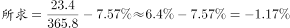

# 现期比重（利润率）求值与百分点差值比较

考点：[[20-考点/资料分析/比重/现期比重（利润率）求值与百分点差值比较|比重 / 现期比重（利润率）求值与百分点差值比较]]
材料：[[15-材料/资料分析/185160 2015年我国钟表行业年度经营概况：|185160 2015年我国钟表行业年度经营概况：]]

**问法模型**：题干问'钟表行业主营业务利润率比轻工行业平均水平高/低几个百分点' → 现期比值模型：先按定义算钟表利润率（利润÷主营业务收入），再与轻工平均利润率直接作差，结果单位为'个百分点'。

## 推理链
1. 第1步：定位材料第三段，提取2015年规模以上工业企业主营业务收入365.8亿元、实现利润23.4亿元；轻工行业主营业务利润率平均水平原卷为7.6%（所给文本该数值缺失，可由官方答案C'低1.2个百分点'与第3步的6.4%反推确认）。
2. 第2步：材料已给定义，主营业务利润率=利润÷主营业务收入；两率比较用直接作差，差值单位是'个百分点'。
3. 第3步：代入计算钟表行业利润率：23.4÷365.8≈6.4%（截位直除：234÷3658首商得6.4%）。
4. 第4步：作差：6.4%−7.6%=−1.2个百分点，即钟表行业利润率比轻工平均水平低1.2个百分点。
5. 第5步：与选项对照：A低3、B高3、C低1.2、D高1.2，只有C'低1.2个百分点'与计算结果吻合，故选C。

**最快解法**：⚡ 截位直除：23.4÷365.8，分子分母各截两位（234÷3658）商首两位约6.4%；6.4%<轻工平均7.6%，方向为'低'，差值7.6%−6.4%=1.2个百分点，直选C。

## 易错点
- ⚠ 口径错配：分母必须是'规模以上'企业的主营业务收入365.8亿元，误用第一段全行业工业总产值675亿元作分母会算出约3.5%，差值与方向全错。
- ⚠ 方向搞反：23.4÷365.8≈6.4%小于轻工平均7.6%，应为'低'；若大小关系判断失误会误选D'高1.2个百分点'。
- ⚠ 单位与数据缺失：两率之差单位是'个百分点'而非'%'；且所给文本中'轻工行业平均水平'的数值缺失（原卷为7.6%），考场须回到原文读取，不得凭空补数。

## 母题抽象
> 🧩 当题干出现'A的某比率比B（或B的平均水平）高/低多少个百分点'的特征时，用'分子÷分母'分别求出两个比率再直接作差，结果记为'个百分点'，分子分母必须取同一口径指标，高低方向由两率大小关系确定。

**同类特征**：主营业务利润率、比轻工行业平均水平、高/低…个百分点、规模以上工业企业、现期比值作差、利润÷主营业务收入（材料已给定义）

## 相关题
- [[10-真题/资料分析/比重/10297259 两期比重比较（跨图做差求剩余子项占比）|10297259]]（浙江 2025，相关度1）

---

### 题干
2015年我国钟表行业规模以上工业企业主营业务利润率比轻工行业平均水平：

### 选项
- A. 低3个百分点
- B. 高3个百分点
- C. 低1.2个百分点　✅
- D. 高1.2个百分点

### 官方解析

      根据“2015年…利润率比轻工业平均水平，选项里是百分点”判断本题为现期比重问题。定位材料第三段，2015年我国钟表行业规模以上工业企业主营业务收入365.8亿元，实现利润23.4亿元。2015年轻工行业主营业务利润率的平均水平为。，。C项最接近。

故正确答案为C。

### 给定材料

        2015年我国钟表全行业实现工业总产值约675亿元，同比增长，增速比上年同期提高1.7个百分点。

        全行业全年生产手表10.7亿只，同比增长，完成产值约417亿元，同比增长，增速提高1.9个百分点；生产时钟（含钟心）5.2亿只，同比下降，完成产值162亿元，同比下降，降幅扩大1.3个百分点；钟表零配件、定时器及其它计时仪器产值96亿元，同比增长，增速基本保持上年水平。

        2015年我国钟表行业规模以上工业企业主营业务收入365.8亿元，同比增长；实现利润23.4亿元，与上年相比下降，而2015年轻工行业主营业务利润率（利润/主营业务收入）的平均水平为。

        2015年我国钟表行业海关进出口总额为92.5亿美元，同比增长，完成出口总额为57.7亿美元，同比增长，进口额34.8亿美元。出口总额中加工贸易额占，较上年缩小2个百分点。

