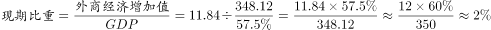

# 现期比重计算（两步换算：经中间层'非公有制经济'反推GDP）

考点：[[20-考点/资料分析/比重/现期比重计算（两步换算：经中间层'非公有制经济'反推GDP）|比重 / 现期比重计算（两步换算：经中间层'非公有制经济'反推GDP）]]
材料：[[15-材料/资料分析/185242 某市非公有制经济发展情况：2015年|185242 某市非公有制经济发展情况：2015年]]

**问法模型**：'2015年外商经济增加值占GDP的比重'→现期比重模型A÷整体，但GDP未直接给出，须先由'非公有制经济348.12亿元÷其占GDP比重'反推整体，再算11.84÷GDP，即(A÷B)×(B占C)两步换算。

## 推理链
1. 第1步：题干问2015年（现期）外商经济增加值占GDP的比重，模型为'部分÷整体'，部分＝11.84亿元，整体＝GDP。
2. 第2步：从文字段①提取：外商经济增加值11.84亿元、非公有制经济增加值348.12亿元；'非公有制经济增加值占GDP的比重'数值在本材料版本中空缺，GDP需由348.12÷该比重反推。
3. 第3步：先算外商经济占非公有制经济的比重＝11.84÷348.12，截位直除得≈3.4%（348.12×3.4%≈11.84，恰好吻合）。
4. 第4步：外商占GDP比重＝(11.84÷348.12)×(非公占GDP比重p)＝3.4%×p，因p<100%，故答案必小于3.4%，可先排除不小于3.4%的选项。
5. 第5步：代入原题所给的占GDP比重p完成第二步换算得估值，与选项对照，官方结论为B。

**最快解法**：⚡ 两步比重换算＋上界排除：11.84÷348.12≈3.4%只是外商占'非公有制经济'的比重，占GDP比重＝3.4%×(非公占GDP比重)<3.4%，先用'<3.4%'上界排除≥3.4%的干扰项（尤忌把3.4%这个'占非公有制经济比重'当答案），再乘原题所给比重即锁定B。

## 易错点
- ⚠ 口径混淆：误把11.84÷348.12≈3.4%（外商占非公有制经济的比重）当作'占GDP比重'直接选；因非公有制经济仅占GDP一部分，正确值必略小于3.4%。
- ⚠ 材料版本缺陷：本版本中'占GDP的比重'数值空缺（'。'处缺数），切勿臆造数字代入；缺数时只能用小于3.4%的上界法排除，需原文补齐该比重才能完成精确计算。
- ⚠ 时间口径：题干为2015年现期比重，勿错用2010年（'十一五'末）或上年数据。

## 母题抽象
> 🧩 当题干问'A占大整体C的比重'而材料只给A的数值和中间层B（B占C的比重）时，用两步换算：A占C＝(A÷B)×(B占C)，且结果必小于A÷B，可借该上界快速排除错误选项。

**同类特征**：现期比重、外商经济增加值、占GDP的比重、两步换算（经'非公有制经济'中间层反推GDP）、答案小于11.84÷348.12≈3.4%、问法带'约为'（估算口吻）

## 相关题
- [[10-真题/资料分析/比重/4792819 现期比重计算（多部分比重依次求解）|4792819]]（新疆 2014，相关度1）
- [[10-真题/资料分析/比重/827355 现期比重比较（部分占比过半速判）|827355]]（政法干警 2014，相关度1）
- [[10-真题/资料分析/比重/2272297 现期比重比较|2272297]]（选调 2015，相关度1）
- [[10-真题/资料分析/比重/2032972 现期比重计算（多地区占比求和）|2032972]]（吉林 2015，相关度1）
- [[10-真题/资料分析/比重/2187857 现期比重计算（部分量需先由'总量−其中量'减法间接求得）|2187857]]（山东 2018，相关度1）

---

### 题干
2015年，该市外商经济增加值占GDP的比重约为：

### 选项
- A. 

- B. 

　✅
- C. 

- D. 

### 官方解析

根据“2015年，该市外商经济增加值占GDP的比重”判断本题为现期比重问题。定位材料第一段，“2015年，某市非公有制经济实现增加值348.12亿元非公有制经济增加值占GDP的比重为外商经济增加值11.84亿元。”。

故正确答案为B。

### 给定材料

        2015年，某市非公有制经济实现增加值348.12亿元，比上年净增加23.69亿元，非公有制经济增加值占GDP的比重为。其中，民营经济增加值335.24亿元，外商经济增加值11.84亿元，港澳台经济增加值1.04亿元，分别比“十一五”末（2010年）增长、和。

        2015年，非公有制经济第一、二、三产业结构之比由上年的调整为。与“十一五”末相比，第一、三产业比重下降了3.9和3.5个百分点，第二产业比重上升了7.4个百分点。在第二产业中，工业增加值占非公有制经济增加值比重为，比“十一五”末提高7.8个百分点。

> [!warning] 疑点（官方解析可能有误，待人工复核）
> 本材料版本中'非公有制经济增加值占GDP的比重'数值空缺（原文'。'处缺数），官方解析亦未呈现完整算式及选项具体数值，仅给结论B；按两步换算只能确定答案＝3.4%×该缺失比重、必小于3.4%，无法用现有材料复核B的具体百分数，需以原题补齐该比重数值后方可验证。

<!-- CODEX-ANSWER-REVIEW:BEGIN -->
### 本次独立复核

**复核状态：** `confirmed`（独立复算确认答案）

**计分答案：** B（可计分）

**复核解析：**

官方公式图给出11.84÷348.12×57.5%=1.956%。按选项精度约为2%，对应B。

**相关信息：**

先用中间层57.5%还原所求占比，再与1%、2%、4%、7%选项比较。

**题源依据：** [固定版本原题](https://github.com/Mentat-Uran/kaogongzhentizhengliu/blob/84ab93d4b64b61d897bece8a1c0a5bab06b4feb2/10-%E7%9C%9F%E9%A2%98/%E8%B5%84%E6%96%99%E5%88%86%E6%9E%90/%E6%AF%94%E9%87%8D/2030124%20%E7%8E%B0%E6%9C%9F%E6%AF%94%E9%87%8D%E8%AE%A1%E7%AE%97%EF%BC%88%E4%B8%A4%E6%AD%A5%E6%8D%A2%E7%AE%97%EF%BC%9A%E7%BB%8F%E4%B8%AD%E9%97%B4%E5%B1%82'%E9%9D%9E%E5%85%AC%E6%9C%89%E5%88%B6%E7%BB%8F%E6%B5%8E'%E5%8F%8D%E6%8E%A8GDP%EF%BC%89.md)；固定内容 commit `84ab93d4b64b61d897bece8a1c0a5bab06b4feb2`，Markdown blob `fcb4dba7c73ebef4d707e6f1f4f12ee526193539`。
<!-- CODEX-ANSWER-REVIEW:END -->
