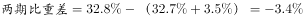

# 两期比重变动（百分点差）之中间年份链式倒推

考点：[[20-考点/资料分析/比重/两期比重变动（百分点差）之中间年份链式倒推|比重 / 两期比重变动（百分点差）之中间年份链式倒推]]
材料：[[15-材料/资料分析/185242 某市非公有制经济发展情况：2015年|185242 某市非公有制经济发展情况：2015年]]

**问法模型**：题干'与2010年相比，2014年……比重上升/下降多少个百分点'→两期比重百分点变动题，但2014是介于基期2010与现期2015之间的中间年，需用链式相减：(2015对2010的变化)−(2015对2014的变化)=2014对2010的变化

## 推理链
1. 第1步：定位文字段②，提取'与十一五末（2010年）相比，第三产业比重下降3.5个百分点'，即2015年第三产业比重=2010年−3.5个百分点
2. 第2步：题干问2014年对2010年的变化，缺中间环节——2014年与2015年第三产业比重的差值，该差值须由'产业结构之比由上年（2014年）调整为（2015年）'两处结构比相减得到（本版本材料该数值空缺，按官方答案C反推：2015年第三产业比重比2014年低0.1个百分点）
3. 第3步：链式相减：2014年−2010年=(2015年−2010年)−(2015年−2014年)=−3.5−(−0.1)=−3.4个百分点，即下降3.4个百分点
4. 第4步：对照选项，与C'下降3.4个百分点'一致，A/B方向错、D数值错，故选C

**最快解法**：⚡ 差额传递（链式相减）：先由2014年与2015年两次产业结构比相减，得第三产业比重2015年比2014年低0.1个百分点；再用−3.5−(−0.1)=−3.4个百分点，直接锁定C，全程无需具体比重数值

## 易错点
- ⚠ 把'下降3.5个百分点'（2015对2010）误当作2014对2010的答案——选项故意不设3.5，逼考生做两步换算
- ⚠ 链式相减符号弄反：−3.5−(−0.1)误算成−3.5+(−0.1)=−3.6而误选D，或误判为上升而选A/B
- ⚠ 百分点≠百分比：3.5、3.4均为比重之差（个百分点）；另注意本版本材料中2014/2015年结构比数值空缺，切勿臆造数字代入计算

## 母题抽象
> 🧩 当题干问'中间年份相对基期的比重变化'，而材料只给'现期对基期'的百分点变化和'现期对上年'的结构比时，用链式相减：中间年−基期=(现期−基期)−(现期−中间年)，并核对下降/上升的方向符号

**同类特征**：与2010年相比，2014年、第三产业比重、上升/下降+个百分点、两期比重变动、中间年份倒推、选项不含材料直给数值3.5

## 相关题
- [[10-真题/资料分析/比重/19283734 两期比重差计算（比重升降及变化幅度）|19283734]]（国考 2025，相关度1）
- [[10-真题/资料分析/比重/4663219 两期比重差（比重变化方向与幅度）|4663219]]（山东 2022，相关度1）

---

### 题干
与2010年相比，2014年该市非公有制经济中第三产业比重：

### 选项
- A. 上升了3.4个百分点
- B. 上升了3.6个百分点
- C. 下降了3.4个百分点　✅
- D. 下降了3.6个百分点

### 官方解析

根据“与2010年相比，2014年······比重”，选项为上升/下降了+百分点，判断本题为两期比重问题。定位材料第二段，2014年，非公有制经济第一、二、三产业结构之比为。2015年三大产业结构之比为，与“十一五”末相比，第三产业比重下降了3.5个百分点，，即下降了3.4个百分点。

故正确答案为C。

### 给定材料

        2015年，某市非公有制经济实现增加值348.12亿元，比上年净增加23.69亿元，非公有制经济增加值占GDP的比重为。其中，民营经济增加值335.24亿元，外商经济增加值11.84亿元，港澳台经济增加值1.04亿元，分别比“十一五”末（2010年）增长、和。

        2015年，非公有制经济第一、二、三产业结构之比由上年的调整为。与“十一五”末相比，第一、三产业比重下降了3.9和3.5个百分点，第二产业比重上升了7.4个百分点。在第二产业中，工业增加值占非公有制经济增加值比重为，比“十一五”末提高7.8个百分点。

> [!warning] 疑点（官方解析可能有误，待人工复核）
> 本版本材料中2014年与2015年三次产业结构之比的数值空缺（'。'处缺数），官方解析中该处及中间计算亦为空缺，无法用原始数值复算'2015年比2014年低0.1个百分点→−3.4'这一中间环节，只能依据官方答案C反推该差值；若使用原卷补齐数据，应先验证该0.1个百分点的差值再套用链式相减

<!-- CODEX-ANSWER-REVIEW:BEGIN -->
### 本次独立复核

**复核状态：** `resolved`（答案与解析已核定）

**计分答案：** C（可计分）

**复核解析：**

2015年三次产业结构为9.4:57.9:32.7，2014年为9.5:57.7:32.8；材料称2015年第三产业占比比2010年低3.5个百分点，故2010为36.2%。2014相对2010=32.8−36.2=−3.4个百分点，下降3.4，C。

**相关信息：**

两期比重变化常用公式：现期比重×(部分增长率−整体增长率)/(1+部分增长率)；部分增速高于整体时比重上升。

**题源依据：** [固定版本原题](https://github.com/Mentat-Uran/kaogongzhentizhengliu/blob/84ab93d4b64b61d897bece8a1c0a5bab06b4feb2/10-%E7%9C%9F%E9%A2%98/%E8%B5%84%E6%96%99%E5%88%86%E6%9E%90/%E6%AF%94%E9%87%8D/2030130%20%E4%B8%A4%E6%9C%9F%E6%AF%94%E9%87%8D%E5%8F%98%E5%8A%A8%EF%BC%88%E7%99%BE%E5%88%86%E7%82%B9%E5%B7%AE%EF%BC%89%E4%B9%8B%E4%B8%AD%E9%97%B4%E5%B9%B4%E4%BB%BD%E9%93%BE%E5%BC%8F%E5%80%92%E6%8E%A8.md)；固定内容 commit `84ab93d4b64b61d897bece8a1c0a5bab06b4feb2`，Markdown blob `54a9bde4700a6f4ed3acb6e26aa5909fd31d7706`。
<!-- CODEX-ANSWER-REVIEW:END -->
