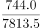
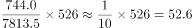

# 现期比重（部分=总体×比重，跨总体同比例分布）

考点：[[20-考点/资料分析/比重/现期比重（部分=总体×比重，跨总体同比例分布）|比重 / 现期比重（部分=总体×比重，跨总体同比例分布）]]
材料：[[15-材料/资料分析/185292 2015年全国吸收外商直接投资状况：|185292 2015年全国吸收外商直接投资状况：]]

**问法模型**：题干出现'分布比例与所有外商直接投资相同'→ 转化为现期比重模型：目标量 = '一带一路'总量526亿元 ×（批发零售金额744.0 ÷ 总计7813.5）

## 推理链
1. 第1步：从文字段提取'一带一路'沿线国家实际使用外商直接投资金额526亿元（现期值，无需基期换算）
2. 第2步：定位表格，批发和零售业直接投资金额744.0亿元，总计行直接投资金额7813.5亿元
3. 第3步：确定分母口径——表中9个行业金额之和仅约6384.8亿元，小于总计7813.5亿元，故比重分母必须用'总计'7813.5亿元
4. 第4步：代入公式 526 × (744.0/7813.5)，其中744.0/7813.5 ≈ 9.5%
5. 第5步：计算 526 × 9.5% ≈ 50.1亿元
6. 第6步：与选项对照，50.1与B项50最接近，排除A(20)、C(160)、D(740)

**最快解法**：⚡ 截位直除＋特殊分数：先算526/7813.5 ≈ 1/15（约6.7%），再乘批发零售金额744.0，即744/15 ≈ 50亿元，秒选B；或先算744/7813.5≈9.5%，526×9.5%≈50

## 易错点
- ⚠ 分母误用9个行业金额之和约6384.8亿元，而正确分母是'总计'行7813.5亿元（表中仅列部分行业）
- ⚠ 读表串列：批发和零售业一行的数据有4个（9156家、14.8%、744.0亿元、28.0%），两列同名'同比增速'易混淆，分子必须取第三列的744.0亿元，勿误取9156
- ⚠ 数量级陷阱：结果约50亿元，若误乘错基数（如用26575家或7813.5当分子基数）会得740或5等错位答案

## 母题抽象
> 🧩 当题干出现'分布比例/结构与总体相同'这类等比例假设时，直接用现期比重模型：目标量=另一总体总量×(部分量÷总体总量)，分母取材料'总计'口径，选项差距大时用截位估算即可

**同类特征**：分布比例相同、一带一路、所有外商直接投资、批发和零售业、约投资了多少亿元

## 相关题
- [[10-真题/资料分析/增长/2031170 增长量计算（已知现期与同比增速）|2031170]]（北京 2017，相关度1）

---

### 题干
如“一带一路”沿线国家在不同行业中的直接投资金额分布比例与所有外商直接投资相同，则“一带一路”沿线国家在批发和零售业约投资了多少亿元？

### 选项
- A. 20
- B. 50　✅
- C. 160
- D. 740

### 官方解析

根据“比例与所有外商直接投资相同”，判定此题为现期比重问题。定位表格，批发和零售业直接投资金额占总计比重为，从“一带一路”沿线国家吸收外商直接投资资金526亿元，已知比例相同，则“一带一路”沿线国家在批发和零售业约投资了亿元，与B项最为接近。

故正确答案为B。

### 给定材料

        2015年全年，全国吸收外商直接投资新设立企业26575家，同比增长；实际使用外资金额7813.5亿元，同比增长。其中从“一带一路”沿线国家吸收外商直接投资新设立企业2164家，增长；实际使用外商直接投资金额526亿元，增长。

2015年全国吸收外商直接投资状况       

