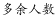
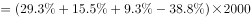
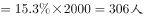

# 比重差（部分量作差）计算——饼图跨类合并口径

考点：[[20-考点/资料分析/比重/比重差（部分量作差）计算——饼图跨类合并口径|比重 / 比重差（部分量作差）计算——饼图跨类合并口径]]
材料：[[15-材料/资料分析/185296 某机构对2000名在线旅行预订用户的|185296 某机构对2000名在线旅行预订用户的]]

**问法模型**：题干问'A类比B类多多少人'且A类（火车）需由高铁+动车+普通列车合并 → 先合并占比作差，再乘样本总数2000换算为人数

## 推理链
1. 第1步：定位图1（饼图，单选口径合计100%），提取高铁29.30%、动车15.50%、普通列车9.30%、飞机38.80%，总人数2000人
2. 第2步：图1中无现成'火车'项，按题干定义合并：火车占比=29.30%+15.50%+9.30%=54.10%
3. 第3步：作差：54.10%−38.80%=15.30%
4. 第4步：换算人数：2000×15.30%=306人（即1082人−776人=306人）
5. 第5步：对照选项，306人落在300～320之间，选B

**最快解法**：⚡ 口算合并＋尾数法：三项占比之和尾数（.30+.50+.30=1.10）与54.10%对齐，54.1%−38.8%=15.3%，2000×15.3%=306，直接锁定B，无需精算

## 易错点
- ⚠ 在图1中直接找'火车'项会落空，必须自行合并高铁+动车+普通列车三项（阅读陷阱：跨类合并口径）
- ⚠ 只算出15.3%的百分差而忘记乘基数2000换算成人数，误以为答案与百分比区间对应
- ⚠ 误把图2（多选口径、合计超100%）的因素占比或图3的时长档占比混入计算，两图口径不同不可跨图拼数

## 母题抽象
> 🧩 当题干出现'A类（定义为若干子类之和）比B类多多少人'且样本总数已知时，先在饼图中合并子类占比作差得到百分差，再乘总人数，对照人数区间选项验证

**同类特征**：首选火车（包括高铁、动车和普通列车）、比……多多少人、饼图跨类合并、被调查者共2000名、人数区间式选项（不到X/X～Y之间）

## 相关题
（暂无）

---

### 题干
被调查者中，首选火车（包括高铁、动车和普通列车）出行的比首选飞机出行的多多少人？

### 选项
- A. 不到300人
- B. 300～320人之间　✅
- C. 321～340人之间
- D. 多于340人

### 官方解析

定位图1，最经常选择高铁、动车和普通列车的占比分别为，，，选择飞机的占比。被调查者共2000名。则。

故正确答案为B。

### 给定材料

       某机构对2000名在线旅行预订用户进行了关于经常选择的交通方式的抽样调查，结果如下：

> [!warning] 疑点（官方解析可能有误，待人工复核）
> 官方解析文字中占比数值在原文中缺失（仅显示标点），但依据图1数据（54.10%−38.80%=15.30%，×2000=306人）计算结果与答案B完全一致，无实质口径错误
