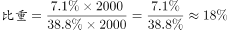

# 现期比重·跨图拼数据（子集占整体比重）

考点：[[20-考点/资料分析/比重/现期比重·跨图拼数据（子集占整体比重）|比重 / 现期比重·跨图拼数据（子集占整体比重）]]
材料：[[15-材料/资料分析/185296 某机构对2000名在线旅行预订用户的|185296 某机构对2000名在线旅行预订用户的]]

**问法模型**：题干问'在最经常选择飞机的用户中，考虑积分奖励的人占比'→ 先用题干假设把图2因素人数全部装入图1飞机集合，再求 部分人数÷集合人数 的子集占比

## 推理链
1. 第1步：定位图2，考虑积分奖励活动的人数占比7.1%，对应人数=2000×7.1%=142人
2. 第2步：题干假设'考虑积分奖励者均最经常选择飞机'，故这142人全部落在图1'飞机'集合内，是飞机用户的子集
3. 第3步：定位图1，最经常选择飞机的占比38.80%，对应人数=2000×38.80%=776人
4. 第4步：所求比重=142÷776≈18.3%（等价于7.1%÷38.80%）
5. 第5步：与选项对照，约18.3%对应A，故选A

**最快解法**：⚡ 跨图占比相除+截位直除：整体2000约掉，占比=7.1%/38.8%≈7.1/38.8，截位直除得≈0.183，即约18.3%，秒选A（不必换算具体人数）

## 易错点
- ⚠ 分母错用2000：直接答7.1%，忽略了问的是'在飞机用户中'的占比，分母必须是飞机人数776
- ⚠ 两图口径陷阱：图1为单选（合计100%）、图2为多选（合计约173.4%），若无视题干假设'均会选飞机'，两图数据无法直接建立包含关系
- ⚠ 未先换算人数或换算遗漏×2000，导致142、776取值错误

## 母题抽象
> 🧩 当题干出现'在A类用户中，具备B特征的人占比'且A、B分属两幅口径不同的图时，用'跨图拼数据+子集包含'模型：占比=B占比÷A占比（整体相同则人数倍数约掉），先验证B占比<A占比确认子集关系成立

**同类特征**：在……出行的用户中……占比约为、题干假设'均会将飞机作为最经常选择'、积分奖励活动（图2因素）、最经常选择飞机（图1方式）、样本2000人、两图跨图建立联系

## 相关题
（暂无）

---

### 题干
因主要出行方式中只有飞机拥有积分奖励活动，所以出行时将积分奖励活动作为考虑因素的人，均会将飞机作为最经常选择的交通方式。则在最经常选择飞机出行的用户中，出行时考虑到积分奖励活动因素的人占比约为：

### 选项
- A. 

　✅
- B. 

- C. 

- D. 

### 官方解析

根据“······的占比约为”判断本题为现期比重问题。定位图2，考虑积分奖励活动占被调查者人数的，且只有飞机拥有积分奖励活动。选择飞机的人数占被调查者的。。

故正确答案为A。

### 给定材料

       某机构对2000名在线旅行预订用户进行了关于经常选择的交通方式的抽样调查，结果如下：

