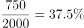
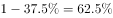
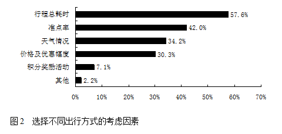

# 现期比重（部分量反求占比＋互补占比匹配分组档位）

考点：[[20-考点/资料分析/比重/现期比重（部分量反求占比＋互补占比匹配分组档位）|比重 / 现期比重（部分量反求占比＋互补占比匹配分组档位）]]
材料：[[15-材料/资料分析/185296 某机构对2000名在线旅行预订用户的|185296 某机构对2000名在线旅行预订用户的]]

**问法模型**：题干给出'优先选飞机人数在750人左右'这一部分量 → 用 部分量÷整体(2000) 求占比，再取互补占比(1-占比)到图3各时长档中匹配最接近档位，最后将选项的运行时间归入该档位

## 推理链
1. 第1步：整体为2000名被调查者，所有人只能二选一坐高铁或飞机，故'优先选飞机'与'优先选高铁'占比互补；题干给出部分量750人
2. 第2步：求选飞机占比750÷2000=37.5%，由互补关系得选高铁占比=1-37.5%=62.5%
3. 第3步：图3给出各时长档'优先选高铁'占比（2小时以内97.7%、3小时以内83.6%、5小时以内62.4%、8小时以内19.6%、8小时以上6.5%），与62.5%最接近的是'5小时以内'档62.4%
4. 第4步：验证该档人数：2000×(1-62.4%)=2000×37.6%≈752人≈750人，吻合
5. 第5步：将选项运行时间归档：西安4.5小时落'5小时以内'档（对应752人）；太原2.5小时落'3小时以内'（2000×16.4%≈328人）；广州8小时落'8小时以内'（2000×80.4%≈1608人）；贵阳9小时落'8小时以上'（2000×93.5%≈1870人）
6. 第6步：只有西安（4.5小时）对应约750人，与选项A吻合

**最快解法**：⚡ 互补比重＋截位直除：750÷2000=37.5%→1-37.5%=62.5%，目测图3中62.4%与62.5%几乎重合，锁定'5小时以内'档，再对照选项运行时间，仅西安4.5小时<5小时，秒选A，其余选项无需逐一计算

## 易错点
- ⚠ 图3纵轴是'优先选高铁'而非'优先选飞机'的占比，必须用1-占比反向换算：750人对应选飞机37.5%、选高铁62.5%；直接拿37.5%去图3匹配或正向乘62.4%都会错
- ⚠ '永远优先选择飞机2.3%'是与'2小时以内97.7%'互补的全局条目，不是第六个时长档，不能拿来参与匹配
- ⚠ 选项运行时间必须正确归档：广州8小时归'8小时以内'（含8小时边界）而非'8小时以上'，贵阳9小时才落'8小时以上'；档位边界看错会导致选C/D

## 母题抽象
> 🧩 当题干出现'某部分人数在××人左右'且材料只给各分组占比时，用 部分量÷整体 求占比，再取互补比重(1-占比)到分组分布图中找最接近档位，最后将选项条件（时间/范围）归入该档位验证

**同类特征**：人数在……左右（部分量反推占比）、均要求坐高铁或飞机（二选一互补口径）、选项以运行时间对应图3时长档位、图3纵轴为'优先选高铁'占比需反向、整体为2000名被调查者、跨图匹配（人数→占比→时长档）

## 相关题
（暂无）

---

### 题干
如果2000名被调查者均要求坐高铁或飞机从同一城市前往北京，那么从哪个城市出发时，优先选择飞机的人数在750人左右？

### 选项
- A. 西安（高铁运行时间：4.5小时）　✅
- B. 太原（高铁运行时间：2.5小时）
- C. 广州（高铁运行时间：8小时）
- D. 贵阳（高铁运行时间：9小时）

### 官方解析

根据“······优先选择飞机的人数在750人左右”，且材料中为比重，判断本题为现期比重问题。优先选择飞机的人数750人，且占全部被调查者的。所以优先选择高铁的占比是。定位图3，5小时以内优先选择高铁的占比（）最接近。选项中西安最符合条件。

故正确答案为A。

### 给定材料

       某机构对2000名在线旅行预订用户进行了关于经常选择的交通方式的抽样调查，结果如下：

