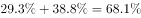
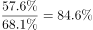
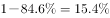

# 现期比重计算（跨图拼数据＋子集剩余比重）

考点：[[20-考点/资料分析/比重/现期比重计算（跨图拼数据＋子集剩余比重）|比重 / 现期比重计算（跨图拼数据＋子集剩余比重）]]
材料：[[15-材料/资料分析/185296 某机构对2000名在线旅行预订用户的|185296 某机构对2000名在线旅行预订用户的]]

**问法模型**：题干给出'所有考虑X因素的人均属于A∪B集合'的子集假设，问A∪B中不考虑X的人占比 → 模型为 1 −（X因素占比 ÷ A∪B合计占比）

## 推理链
1. 第1步：图1提取最经常选择飞机38.80%、高铁29.30%，合并'飞机或高铁'集合占比=38.80%+29.30%=68.10%，对应人数2000×68.1%=1362人
2. 第2步：图2提取考虑行程总耗时因素的人占被调查者的57.6%，对应人数2000×57.6%=1152人
3. 第3步：依据题干假设，这1152人全部落在'飞机或高铁'的1362人集合内（子集关系），故考虑行程总耗时者占该集合比重=1152/1362≈84.6%
4. 第4步：不考虑行程总耗时的人占比=1−84.6%≈15.4%（等价算法：(1362−1152)/1362=210/1362≈15.4%）
5. 第5步：与选项对照，B项（约15.4%）最接近，故选B

**最快解法**：⚡ 公式法＋截位直除：占比=1−57.6%/68.1%，截位得57.6/68.1≈0.85，则1−0.85≈15%，对照选项锁定B（精确值15.4%）；也可用人数法210/1362，首位商1、次位5，直接得15.4%

## 易错点
- ⚠ 分母漏合并：误只取飞机38.80%或高铁29.30%单项作分母，导致57.6/38.8≈1.48或57.6/29.3≫100%的荒谬结果
- ⚠ 跨图口径陷阱：图2是多选口径（各因素合计约173.4%），57.6%与68.1%不能直接相减得百分点，必须先做'子集装入'再求比重
- ⚠ 求'不考虑'忘记取补：把1152/1362≈84.6%误当成答案；或误用68.1%−57.6%=10.5%（百分点差）当占比

## 母题抽象
> 🧩 当题干出现'所有考虑X因素的人均属于某集合，求该集合中不考虑X的人占比'时，用剩余比重模型：占比=1−(X占全体比重÷集合占全体比重)，验证分子分母均来自不同图但同为占2000人的百分比口径

**同类特征**：所有考虑……的人均……、在……的人中……占比约为、跨图（图1+图2）拼数据、子集/假设条件建立两图联系、求'不考虑'即取补集、纯百分比无绝对数

## 相关题
（暂无）

---

### 题干
如调查中，所有考虑行程总耗时因素的人均最经常选择飞机或高铁出行，则在最经常选择飞机或高铁出行的人中，不考虑行程总耗时因素的人占比约为：

### 选项
- A. 

- B. 

　✅
- C. 

- D. 

### 官方解析

根据“······的占比约为”判断本题为现期比重问题。定位材料图1和图2，最经常选择高铁或飞机的占被调查者的比重为。考虑行程总耗时因素的人占被调查者的，因为，所有考虑行程总耗时因素的人均最经常选择飞机或高铁出行。故考虑行程总耗时因素的人占最经常选择高铁或飞机的比重为，不考虑行程总耗时因素的人占比为。B项最接近。

故正确答案为B。

### 给定材料

       某机构对2000名在线旅行预订用户进行了关于经常选择的交通方式的抽样调查，结果如下：

