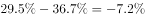

# 两时点占比之差（百分点）

考点：[[20-考点/资料分析/比重/两时点占比之差（百分点）|比重 / 两时点占比之差（百分点）]]
材料：[[15-材料/资料分析/185368 2010-2014年全国劳动就业状况|185368 2010-2014年全国劳动就业状况]]

**问法模型**：题干问'和某年末相比，某年占比提高了几个百分点' → 用现期占比减基期占比，保留正负号，结果单位是百分点而非百分率

## 推理链
1. 第1步：从统计表定位'第一产业就业人员占比'行，取2010年末数值36.7%
2. 第2步：同一行取2014年末数值29.5%
3. 第3步：占比之差=29.5%-36.7%=-7.2个百分点（表格直接给出两期占比，无需计算总量）
4. 第4步：题干问'提高了'多少，实际占比在下降，故提高量为-7.2个百分点，对照选项只有A（-7.2个百分点）符合，选A

**最快解法**：⚡ 口算直减：36.7-29.5=7.2，第一产业占比由36.7%降至29.5%为下降方向，故'提高'为-7.2个百分点，秒选A

## 易错点
- ⚠ 方向陷阱：第一产业占比实际是下降7.2个百分点，题干问'提高了'，正确答案是-7.2个百分点（A），只看数值不看方向会误选D（7.2个百分点）
- ⚠ 行定位陷阱：表格中第一/第二/第三产业占比三行相邻，2010年数值36.7/28.7/34.6量级相近，易把第二产业28.7%或第三产业34.6%误当第一产业数据，算出6.0（误选C）或1.2（误选B）
- ⚠ 单位陷阱：占比之差是'百分点'不是'%'，题干和选项均以百分点表述，直接百分数相减即可，切勿再做除法或换算

## 母题抽象
> 🧩 当题干出现'某年末与另一年末相比，某占比（比重）提高/降低几个百分点'的特征时，直接用表格两期占比相减并保留符号（下降为负），无需引入总量，注意数据变动方向与问法方向是否一致

**同类特征**：和2010年末相比、2014年末、第一产业就业人员占比、提高了、个百分点、简单加减计算

## 相关题
- [[10-真题/资料分析/比重/1789664 比重差值计算（百分点搭桥）|1789664]]（江苏 2016，相关度2）
- [[10-真题/资料分析/增长/10718183 名义增速与实际增速之差（百分点计算）|10718183]]（深圳市考 2024，相关度1）
- [[10-真题/资料分析/比重/16070258 现期比重差值（两个部分占比相减）|16070258]]（重庆 2026，相关度1）
- [[10-真题/资料分析/比重/1752600 两期比重变化（比重差，百分点表述）|1752600]]（北京 2016，相关度1）
- [[10-真题/资料分析/比重/2042846 两期比重差（比重差值计算）|2042846]]（江苏 2017，相关度1）

---

### 题干
和2010年末相比，2014年末全国第一产业就业人员占比提高了：

### 选项
- A. -7.2个百分点　✅
- B. 1.2个百分点
- C. 6.0个百分点
- D. 7.2个百分点

### 官方解析

由题干“占比提高”，结合材料中已经给出了2010和2014年全国第一产业就业人员占比，可判定该题属于简单加减计算问题。定位表格数据，2010年末全国第一产业就业人员占比，2014年末全国第一产业就业人员占比，因为，所以和2010年末相比，2014年末全国第一产业就业人员占比提高了-7.2个百分点。

故正确答案为A。

### 给定材料

        2014年末全国就业人员77253万人，比上年末增加276万人。其中，城镇就业人员39310万人，比上年末增加1070万人。

> [!warning] 疑点（官方解析可能有误，待人工复核）
> 官方解析中'2010年末……占比，2014年末……占比'两处未填具体数字（排版留白），但结论-7.2个百分点与表格数据一致，答案A无问题
