# 比重比较（分子取当年、分母取上年末的错位分数比较取最大）

考点：[[20-考点/资料分析/比重/比重比较（分子取当年、分母取上年末的错位分数比较取最大）|比重 / 比重比较（分子取当年、分母取上年末的错位分数比较取最大）]]
材料：[[15-材料/资料分析/185368 2010-2014年全国劳动就业状况|185368 2010-2014年全国劳动就业状况]]

**问法模型**：题干问'2011-2014年再就业人数占上年末登记失业人数比重的最大值'→ 采用分子取当年再就业人数、分母取上一年末登记失业人数的错位配对模型，逐项求比值后取最大。

## 推理链
1. 第1步：从表格提取分子——2011-2014年城镇失业人员再就业人数分别为553、552、566、551万人。
2. 第2步：提取分母——'占上年末'指用上一年末城镇登记失业人数：2010年末908、2011年末922、2012年末917、2013年末926万人。
3. 第3步：按年错位配对列式：2011年=553/908、2012年=552/922、2013年=566/917、2014年=551/926。
4. 第4步：截位直除估算：553/908≈60.9%、552/922≈59.9%、566/917≈61.7%、551/926≈59.5%。
5. 第5步：比较四个比值，566/917（2013年，约61.7%）最大，与选项对照锁定D。

**最快解法**：⚡ 分数比较+截位直除：先观察分子分母大小关系——566为四个分子中最大且917非最大分母，直接锁定566/917最有希望；再对553/908与566/917首两位直除验证（60.9% vs 61.7%），确认2013年最大，选D。

## 易错点
- ⚠ 分母口径错位：'占上年末'必须用上一年末登记失业人数（2011年用908而非922），错用同年分母（如553/922）即全盘出错。
- ⚠ 看串行：登记失业人数（908/922/917/926/952）与登记失业率（4.14/4.09/4.09/4.05/4.09）两行相邻、量级易混，需精确定位'人数'行。
- ⚠ 分子口径混淆：误用'城镇新增就业人数'（1310/1322等）替代'再就业人数'（566等），两者口径不同。

## 母题抽象
> 🧩 当题干出现'某年A占上年（末）B的比重（最大/最小值）'特征时，用'分子取当年、分母取上年末'的错位配对法逐项列分数，再以分数性质+截位直除比较大小，验证分子最大且分母非最大者胜出。

**同类特征**：占上年末、城镇失业人员再就业人数、城镇登记失业人数、比重的最大值、2011-2014年连续区间、分数比较

## 相关题
- [[10-真题/资料分析/比重/1756324 退票手续费率比较（定额费用÷票价的比值比较）|1756324]]（国考 2016，相关度1）

---

### 题干
2011-2014年，全国城镇失业人员再就业人数占上年末全国城镇登记失业人数比重的最大值是：

### 选项
- A. 
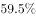

- B. 
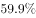

- C. 
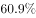

- D. 
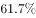
　✅

### 官方解析

由题干“2011—2014年···比重的最大值”，可判定该题是比值计算问题。

方法一：定位表格中数据，列表可得:

最大值为2013年的。

方法二：2011—2014年，全国城镇失业人员再就业人数占上年末全国城镇登记失业人数比分别为：2011年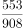，2012年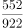，2013年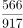，2014年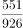，可得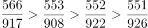，因此2011—2014年，全国城镇失业人员再就业人数占上年末全国城镇登记失业人数比重的最大值是2013年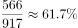。

故正确答案为D。

### 给定材料

        2014年末全国就业人员77253万人，比上年末增加276万人。其中，城镇就业人员39310万人，比上年末增加1070万人。

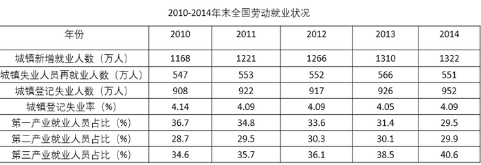

