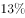
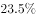
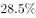
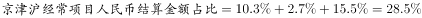
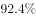
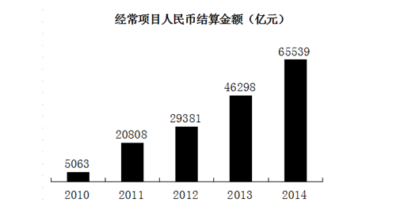
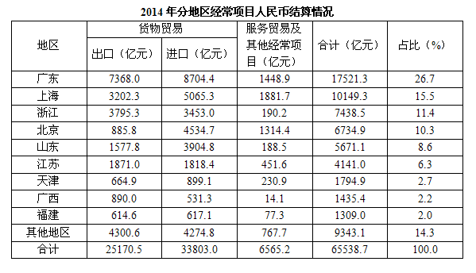

# 现期比重计算（多地区占比求和）

考点：[[20-考点/资料分析/比重/现期比重计算（多地区占比求和）|比重 / 现期比重计算（多地区占比求和）]]

**问法模型**：题干问'京津沪经常项目人民币结算金额占比达到'→ 表格已直接给出各地占比，合计占比=三地占比相加

## 推理链
1. 第1步：题干锁定'2014年''京津沪''经常项目人民币结算金额占比'，判定为现期比重问题
2. 第2步：定位材料表格，表格已分别给出2014年北京、天津、上海三地的经常项目人民币结算金额占比
3. 第3步：三地占比口径一致（同除以全国经常项目人民币结算金额6.55万亿元），可直接相加：占比合计=北京占比+天津占比+上海占比
4. 第4步：将加和结果与选项对照，匹配D选项，故正确答案为D

**最快解法**：⚡ 表格直接加和法：表格已给三地占比，无需用绝对金额重算，直接将三地占比数值相加即得答案，属最省时的'读数+加法'题

## 易错点
- ⚠ 舍近求远：误用各地绝对结算金额相加再除以总额6.55万亿元重算，既慢又易引入取数误差
- ⚠ 看错列：误取表格中其他项目（如ODI、FDI或资本项目）的占比列而非'经常项目'列
- ⚠ 时间口径：误用其他年份（表格通常为多年数据）而非2014年对应行/列

## 母题抽象
> 🧩 当题干求'若干地区（分项）合计占比'且表格已直接给出各地占比时，直接加和即可，切勿用绝对额重算或换算基期

**同类特征**：'占比达到'问法、多地区（京津沪）合并求占比、经常项目人民币结算金额、现期比重、表格数据读取、直接加和即可

## 相关题
- [[10-真题/资料分析/比重/4792819 现期比重计算（多部分比重依次求解）|4792819]]（新疆 2014，相关度1）
- [[10-真题/资料分析/比重/827355 现期比重比较（部分占比过半速判）|827355]]（政法干警 2014，相关度1）
- [[10-真题/资料分析/比重/2272297 现期比重比较|2272297]]（选调 2015，相关度1）
- [[10-真题/资料分析/比重/2187857 现期比重计算（部分量需先由'总量−其中量'减法间接求得）|2187857]]（山东 2018，相关度1）
- [[10-真题/资料分析/比重/10297330 基数不同的比重加权合成（混合比重）|10297330]]（浙江 2025，相关度1）

---

### 题干
2014年，京津沪经常项目人民币结算金额占比达到：

### 选项
- A. 

- B. 

- C. 

- D. 

　✅

### 官方解析

由题干“2014年，京津沪经常项目人民币结算金额占比”，可判定本题为现期比重问题。定位表格可得，2014年，北京、天津、上海的经常项目人民币结算金额占比分别为、、。则。

故正确答案为D。

### 给定材料

        2014年，人民币国际使用继续较快发展，人民币跨境收支占本外币跨境收支的比重上升至，离岸人民币市场进一步拓展，人民币国际合作不断深化。据环球银行金融电信协会（SWIFT）统计，2014年12月，人民币成为全球第2大贸易融资货币、第5大支付货币、第6大外汇交易货币。

        2014年，经常项目人民币结算金额6.55万亿元，同比增长。对外直接投资（ODI）人民币结算金额1865.6亿元，同比增长；外商来华直接投资（FDI）人民币结算金额8620.2亿元，同比增长。

