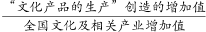
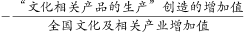
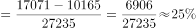

# 现期比重之差（同分母比重差一步求解）

考点：[[20-考点/资料分析/比重/现期比重之差（同分母比重差一步求解）|比重 / 现期比重之差（同分母比重差一步求解）]]
材料：[[15-材料/资料分析/185418 2015年全国文化及相关产业增加值（|185418 2015年全国文化及相关产业增加值（]]

**问法模型**：题干出现'A占总量比重比B占比高出约'（两部分对同一总量求比重再作差）→ 采用同分母比重差模型(A−B)/总量，先分子相减再一次除法，无需分别算两个比重

## 推理链
1. 第1步：从材料第一段提取分母——2015年全国文化及相关产业增加值27235亿元；从第二段提取两个分子——'文化产品的生产'17071亿元、'文化相关产品的生产'10165亿元，均为2015年现期值
2. 第2步：比重差公式=(17071/27235)−(10165/27235)，分母相同可合并为(17071−10165)÷27235，一步除法完成
3. 第3步：分子差=17071−10165=6906亿元，6906÷27235，截位估算：6906/27235≈69/272≈0.2536，即约25.4%
4. 第4步：验算结构——17071+10165=27236与总量27235仅差1亿元，属四舍五入尾差，确认口径无误
5. 第5步：与选项对照，计算结果约25.4%与B项一致，故正确答案为B

**最快解法**：⚡ 分子减法+截位直除：17071−10165=6906，6906/27235，分子分母同截两位商69/272≈0.25，结合首位商2、次位商5得约25.4%，直接锁定B；切勿分别算17071/27235与10165/27235再相减（两次除法且引入误差）

## 易错点
- ⚠ 分步求比重陷阱：先分别求两个比重再相减，多一次除法且中间舍入可能偏离选项，正确做法是同分母先减分子
- ⚠ 分母口径陷阱：分母必须用文化及相关产业增加值27235亿元，材料中另有'占GDP比重'口径（分母为GDP），两套占比分母不同不可混用
- ⚠ 尾差干扰：17071+10165=27236与总量27235相差1亿元，为四舍五入所致，验算时允许尾差，不必重算或怀疑数据
- ⚠ 单位陷阱：结果为百分数（比重差），勿与'提高X个百分点'类比重变化量混淆

## 母题抽象
> 🧩 当题干出现'两部分各自占同一总量的比重相差多少'特征时，用(A−B)/同分母一步求比重差，再验算A+B≈总量（允许尾差）确认口径，与选项对照即可

**同类特征**：占…的比重比…高出约、同一总量（27235亿元）作共同分母、两部分增加值现期值直接给出（17071、10165亿元）、现期（2015年）比重差计算、选项为百分数形式、无需增速数据即可求解

## 相关题
- [[10-真题/资料分析/比重/2187787 现期比重计算|2187787]]（黑龙江 2018，相关度1）
- [[10-真题/资料分析/增长/2742312 一般增长率计算（基期总额需由基期量×基期均价构造）|2742312]]（北京 2021，相关度1）
- [[10-真题/资料分析/增长/2144703 一般增长率计算（个数型增长，基期为'个'数）|2144703]]（新疆 2017，相关度1）
- [[10-真题/资料分析/比重/3019279 现期比重（表中数据直接计算）|3019279]]（广东 2021，相关度1）

---

### 题干
2015年，“文化产品的生产”创造的增加值占全国文化及相关产业增加值的比重比“文化相关产品的生产”创造的增加值所占比重高出约：

### 选项
- A. 

- B. 

　✅
- C. 

- D. 

### 官方解析

根据题干“2015年……所占比重”可判定此题为现期比重问题。定位文字材料第一段“2015年，全国文化及相关产业增加值27235亿元”和文字材料第二段“2015年，‘文化产品的生产’创造的增加值为17071亿元，‘文化相关产品的生产’创造的增加值为10165亿元”可知比重差为。

故正确答案为B。

### 给定材料

       2015年，全国文化及相关产业增加值27235亿元，比上年增长（未扣除价格因素）。在2014年增长的基础上继续保持两位数增长，呈快速增长态势。2015年文化及相关产业增加值占GDP的比重为，比上年提高0.16个百分点。

       2015年，代表文化内容的“文化产品的生产”创造的增加值为17071亿元，而“文化相关产品的生产”创造的增加值为10165亿元；且“文化产品的生产”作为我国文化产业的主体，增速达，远高于“文化相关产品的生产”的的增速。从产品类型看，文化制造业增加值11053亿元，比上年增长，占，文化批发零售业增加值2542亿元，增长，占；文化服务业增加值13640亿元，增长，占。

       2015年文化休闲娱乐服务业和以“互联网+”为主要形式的文化信息传输服务业实现增加值分别为2044亿元和2858亿元，增速分别达和，占文化及相关产业的比重分别为和，均比上年提高0.5个百分点；广播电视电影服务业实现增加值1227亿元，占比，比上年提高0.2个百分点，文化创意和设计服务业实现增加值4953亿元，增长，占比，比上年提高0.4个百分点。

