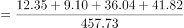
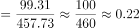
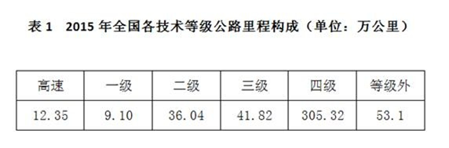

# 现期比重计算（部分需自行加总+跨表与文字拼接整体值）

考点：[[20-考点/资料分析/比重/现期比重计算（部分需自行加总+跨表与文字拼接整体值）|比重 / 现期比重计算（部分需自行加总+跨表与文字拼接整体值）]]
材料：[[15-材料/资料分析/185420 2015年年末全国公路状况：公路总里|185420 2015年年末全国公路状况：公路总里]]

**问法模型**：题干'2015年……占公路总里程的比重'且选项为成数区间 → 现期比重=部分/整体，先从表1加总'三级及以上'（高速+一级+二级+三级），再除以文字段公路总里程457.73万公里，对照成数区间选答案

## 推理链
1. 第1步：题干要求2015年'三级及以上技术等级公路'占'公路总里程'的比重；分子对应表1中的高速12.35、一级9.10、二级36.04、三级41.82万公里，分母为文字段给出的公路总里程457.73万公里
2. 第2步：'三级及以上'须自行加总，不能误用技术等级公路里程404.63（该项含四级305.32，口径不符）；公式：现期比重=部分值÷整体值
3. 第3步：部分=12.35+9.10+36.04+41.82=99.31万公里；比重=99.31/457.73
4. 第4步：截位直除，99.31/457.73≈99.31/458≈0.217，即约21.7%，落在20%~30%区间，为'两成多'，对照选项选B

**最快解法**：⚡ 成数锚点法+截位直除：先加总分子99.31；再口算锚点——457.73×0.2≈91.5、457.73×0.3≈137.3，99.31介于91.5与137.3之间且靠近下界，判定为'两成多'，无需精算直接选B

## 易错点
- ⚠ 口径陷阱：误把表1技术等级里程合计404.63当'三级及以上'分子（404.63/457.73≈88%，远超四成），'三级及以上'必须只加总高速+一级+二级+三级=99.31
- ⚠ 整体值口径：分母须用公路总里程457.73（含等级外53.1），若误用技术等级里程404.63作分母虽得24.5%仍落'两成多'，但属口径错误
- ⚠ 漏项陷阱：'三级及以上'含高速、一级、二级，若只算三级41.82/457.73≈9%会误判为'两成以下'错选A

## 母题抽象
> 🧩 当题干出现'某类（含'及以上/以下'等集合表述）占总量比重'且选项为成数区间时，先按定义自行加总分子（勿用现成合计口径），分母取总量口径，用总量×20%/30%锚点或截位直除快速锁定成数区间

**同类特征**：占……的比重、三级及以上技术等级、公路总里程、选项为成数区间（两成/三成/四成）、现期时点存量（2015年末）、分子需自行加总、分母取自文字段

## 相关题
- [[10-真题/资料分析/比重/1797626 现期比重计算与比重差值（百分点）比较|1797626]]（山东 2016，相关度1）
- [[10-真题/资料分析/比重/1751688 现期比重计算|1751688]]（江苏 2015，相关度1）
- [[10-真题/资料分析/比重/12536401 两期比重连续变化趋势判断（比重升降结论+基期增速还原）|12536401]]（四川 2024，相关度1）
- [[10-真题/资料分析/比重/2049300 现期比重计算（整体值未直接给出，需跨句拼凑分母）|2049300]]（选调 2017，相关度1）
- [[10-真题/资料分析/比重/2719396 现期比重之差（百分点差比较）|2719396]]（国考 2021，相关度1）

---

### 题干
2015年三级及以上技术等级公路里程占公路总里程的比重为：

### 选项
- A. 两成以下
- B. 两成多　✅
- C. 三成多
- D. 四成多

### 官方解析

由题干“2015年······占······比重为”，可判定本题是现期比重问题。定位文字材料第一段和表1，，比重为两成多。

故正确答案为B。

### 给定材料

        2015年年末全国公路总里程457.73万公里，其中技术等级公路里程404.63万公里，占公路总里程的比重比上一年提高1.0个百分点。

        各行政等级公路里程分别为：国道18.53万公里、省道32.97万公里、县道55.43万公里、乡道111.32万公里、专用公路8.17万公里，比上年末分别增加0.61万公里、0.69万公里、0.23万公里、0.81万公里和0.14万公里。

         全国高速公路里程12.35万公里，比上年末增加1.16万公里。其中，国家高速公路7.96万公里，增加0.65万公里。全国高速公路车道里程54.84万公里，增加5.28万公里。

> [!warning] 疑点（官方解析可能有误，待人工复核）
> 官方解析表述过简、未列出具体算式，但结论B与计算99.31/457.73≈21.7%（两成多）一致，无实质矛盾
