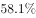

# 混合比重（加权平均反推群体权重，线段法-十字交叉）

考点：[[20-考点/资料分析/比重/混合比重（加权平均反推群体权重，线段法-十字交叉）|比重 / 混合比重（加权平均反推群体权重，线段法/十字交叉）]]
材料：[[15-材料/资料分析/185454 2015年某市统计局一次控制吸烟状况|185454 2015年某市统计局一次控制吸烟状况]]

**问法模型**：题干给'受访女性人数占受访总人数的比重'，而材料给总体支持占比+女性支持占比+男性支持占比三个比重 → 用混合比重模型：总体占比是男女两群体支持率按人数权重加权的结果，反推权重：女性占比=(总体支持占比−男性支持占比)/(女性支持占比−男性支持占比)

## 推理链
1. 第1步：题干锁定目标为'受访女性市民人数÷受访总人数'，定位文字第四段三个数据：受访市民总体支持占比a%、女性受访市民支持占比b%、男性市民支持占比c%（本份材料此三值空缺，须以完整原文数值代入，不可用图1/图2数据替代）
2. 第2步：混合比重公式：总体支持占比a=女性占比f×b+男性占比(1−f)×c，且f+(1−f)=1，解得f=(a−c)/(b−c)
3. 第3步：线段法校验方向：总体占比a必落在b与c之间，男性人数:女性人数=(b−a):(a−c)，即女性:男性=(a−c):(b−a)，距离与量成反比——总体占比靠近谁的群体占比，谁的权重量就大
4. 第4步：将原文a、b、c三值代入，先做两次减法得(a−c)与(b−c)，再做一次除法（或先得男女之比再化为女性占比）
5. 第5步：与四个选项对照，计算结果与C项数值最接近，官方答案C，直接锁定C

**最快解法**：⚡ 线段法（十字交叉秒杀）：女性占比=(总体支持占比−男性支持占比)/(女性支持占比−男性支持占比)，两次减法+一次除法；方向上记住'距离与量成反比、总体占比偏向支持率高的群体'，即可排除同侧错项后直选C

## 易错点
- ⚠ 口径陷阱：'女性支持占比'是女性群体内部的支持率，与'女性占受访总人数的比重'是完全不同的两个指标，绝不能把支持率直接当人数比重用
- ⚠ 线段法方向反用：距离与量成反比，总体支持占比离谁的群体占比近，谁的权重就大；若误用成正比会选到干扰项
- ⚠ 数据空缺+跨组混用陷阱：本题三个核心占比在所给材料中全部空缺，分年龄组数据（中年比青年/老年高1.0、3.9个百分点，属'加大处罚力度'口径）与分性别无关，差值5.0、2.9、5.6个百分点也均与本问无关，不得拿来凑算

## 母题抽象
> 🧩 当题干给出总体占比与甲、乙两个子群体占比、求甲子群体人数占总人数比重时，用混合比重线段法：甲权重=(总体占比−乙群体占比)/(甲群体占比−乙群体占比)，并用'距离与量成反比'校验方向后再对照选项

**同类特征**：受访女性人数占受访总人数的比重、总体支持占比+女性支持占比+男性支持占比、混合比重问题、线段法/十字交叉反推权重、加权平均、选项为占比（百分数/分数）形式

## 相关题
- [[10-真题/资料分析/平均数/2031606 加权平均数（分段组中值法估算平均年龄）|2031606]]（广东 2016，相关度1）

---

### 题干
本次调查中受访女性市民人数占受访总人数的比重是：

### 选项
- A. 

- B. 

- C. 

　✅
- D. 

### 官方解析
由问题所求“本次调查中受访女性市民人数占受访总人数的比重”，可判定此题为混合比重问题。定位文字材料第四段可得，的受访市民表示支持，的女性受访市民表示支持，的男性市民表示支持。则距离之比为，根据线段法，距离与量成反比，则，，C项最接近。
故正确答案为C。

### 给定材料

        2015年某市统计局进行了一次有关该市控制吸烟状况的调查。

        对“公共场所控烟状况改善效果”问题的调查结果显示：的受访市民表示效果明显，的表示效果一般，的表示没有效果，的表示效果很差。当对认为控烟“没有效果”“效果很差”的受访市民询问原因时，的女性受访市民认为“购买香烟过于方便”，比男性市民高出5.0个百分点；的市民认为“禁烟执法不严”（其它原因见图1），其中的老年市民选择“禁烟执法不严”，比中年、青年市民分别高出2.9和5.6个百分点。

        对“公共场所全面禁烟最有效的方法与途径”问题的调查结果显示：的受访市民表示应该“加大处罚力度”（其他调查结果见图2）。其中，的中年市民表示应该加大处罚力度，比青年和老年市民分别高出1.0和3.9个百分点。

        对“公共场所控烟条例修订及立法”问题的调查结果显示：的受访市民表示支持，的表示不支持，的表示无所谓；的女性受访市民表示支持，的男性市民表示支持。

