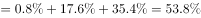
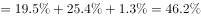
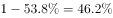
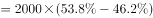
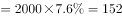

# 现期比重差求人数差（分组人数比较）

考点：[[20-考点/资料分析/比重/现期比重差求人数差（分组人数比较）|比重 / 现期比重差求人数差（分组人数比较）]]
材料：[[15-材料/资料分析/186398 某市调查总队对2000名市民的媒体需|186398 某市调查总队对2000名市民的媒体需]]

**问法模型**：题干出现'A及以下'比'B及以上'的受访市民多多少'的问法 → 用人数差=总人数×（两类比重和之差）一步求差，勿分别求各人数再相减

## 推理链
1. 第1步：题干要求'高中/中专'及以下（小学及以下+初中+高中/中专三类）比'大专'及以上（大专+大学本科+研究生三类）多的人数，总人数为2000人
2. 第2步：模型为人数差=2000×（前三类比重和−后三类比重和）；因六类比重合计100%，也可设前三类比重和为a，则差=2000×(2a−100%)
3. 第3步：定位文字段所给六类比重，两类比重和之差为152/2000=7.6个百分点，代入得2000×7.6%=152人；官方解析提示可用尾数法验证结果尾数为2
4. 第4步：对照选项A.148、B.150、C.152、D.154，尾数为2的仅C，且量级为百人级，锁定C.152人

**最快解法**：⚡ 公式法+尾数法：人数差=总人数×比重差=2000×（前三类比重和−后三类比重和），先只算比重差一个数再乘2000，不必逐类求人数；再用尾数法（四个选项尾数8/0/2/4各不相同，结果尾数为2）直接锁定C

## 易错点
- ⚠ 分组口径：'高中/中专及以下'是三类（小学及以下、初中、高中/中专），'大专及以上'是三类（大专、大学本科、研究生），漏算/多算任一类即错
- ⚠ 数据源陷阱：比重和人数只在文字段，统计表中只有平均时长，切勿到表格里找占比，更不能用表格时长数据反推比重；本版材料文字段比重数值留空，属材料缺口
- ⚠ 数量级核对：总人数2000人，1个百分点对应20人，差值应在百人量级（选项148~154），若算出几十人或其他量级说明比重差算错

## 母题抽象
> 🧩 当题干出现'按某分组标准，A部分合计比B部分合计多多少人'且给出总量与各部分比重时，用'人数差=总量×比重和之差'一步求解，并用尾数法或'1个百分点对应量'核对选项

**同类特征**：比……多（人数差）、'及以下'与'及以上'分组求和、总人数2000人、现期比重、数据来自文字段、选项尾数各不相同可用尾数法

## 相关题
- [[10-真题/资料分析/比重/4792819 现期比重计算（多部分比重依次求解）|4792819]]（新疆 2014，相关度1）
- [[10-真题/资料分析/比重/827355 现期比重比较（部分占比过半速判）|827355]]（政法干警 2014，相关度1）
- [[10-真题/资料分析/比重/2272297 现期比重比较|2272297]]（选调 2015，相关度1）
- [[10-真题/资料分析/比重/2032972 现期比重计算（多地区占比求和）|2032972]]（吉林 2015，相关度1）
- [[10-真题/资料分析/比重/2187857 现期比重计算（部分量需先由'总量−其中量'减法间接求得）|2187857]]（山东 2018，相关度1）

---

### 题干
文化程度为“高中/中专”及以下的受访市民比“大专”及以上的多：

### 选项
- A. 148人
- B. 150人
- C. 152人　✅
- D. 154人

### 官方解析

由题干“文化程度为······比······多”并结合材料中给出总人数及比重，求两类人数的差值，可判定该题是现期比重问题。定位文字材料数据，可得“高中/中专”及以下的受访市民所占比重，“大专”及以上的受访市民（也可以直接用总的减去“高中/中专”及以下的受访市民，即）。受访市民总共2000人，因此可得文化程度为“高中/中专”及以下的受访市民比“大专”及以上的多人（可用尾数法判断尾数为2）。

故正确答案为C。

### 给定材料

      某市调查总队随机抽取2000名市民开展媒体需求调查，受访市民按文化程度分为小学及以下、初中、高中/中专、大专、大学本科、研究生等六类，所占比重分别为、、、、、，调查结果见下表。

> [!warning] 疑点（官方解析可能有误，待人工复核）
> 本版材料文字段中六类文化程度的比重数值空缺（'分别为 、 、……'处留空），官方解析中比重数据亦被省略，仅能依据官方答案152人反推两类比重和之差为7.6个百分点（152=2000×7.6%）；此为材料缺口而非解析结论错误，答案C不受影响
