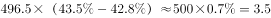

# 现期比重求部分量之差（总量×占比差）

考点：[[20-考点/资料分析/比重/现期比重求部分量之差（总量×占比差）|比重 / 现期比重求部分量之差（总量×占比差）]]
材料：[[15-材料/资料分析/186400 2016年第一季度全国星级饭店按一至|186400 2016年第一季度全国星级饭店按一至]]

**问法模型**：题干问'餐饮收入比客房收入多多少'且选项带单位'亿元'→ 用 全国营业收入×(餐饮占比−客房占比) 一步求两块收入的绝对差额

## 推理链
1. 第1步：定位表格'全国'合计行，取2016年第一季度营业收入496.5亿元、餐饮收入占比43.5%、客房收入占比42.8%
2. 第2步：依据'部分量=总量×占比'，餐饮收入=496.5×43.5%，客房收入=496.5×42.8%，故差额=496.5×(43.5%−42.8%)
3. 第3步：占比差=43.5%−42.8%=0.7%，代入得496.5×0.7%=3.4755≈3.5亿元
4. 第4步：与选项对照，3.5亿元对应B，排除A(4.8)、C(3.1)、D(2.6)，故选B

**最快解法**：⚡ 占比差法（一步乘法）：先算43.5%−42.8%=0.7%，再496.5×0.7%≈500×0.007=3.5亿元，直接锁定B；无需分别算出餐饮、客房的绝对额再相减

## 易错点
- ⚠ 把'多多少'误解为占比之差0.7个百分点，忽略选项带'亿元'要求的是绝对额，必须乘以营业收入496.5亿元
- ⚠ 分子分母取数行错位：占比必须用'全国'合计行的43.5%/42.8%（加权平均占比），错用某星级分档行数据会算错
- ⚠ 计算精度陷阱：496.5×0.7%=3.4755亿元，四舍五入后为3.5亿元，与C项3.1亿元接近易因估算粗糙选错

## 母题抽象
> 🧩 当题干出现'某部分比另一部分多/少多少（选项带绝对额单位）'且材料给出同一总量下的两个占比时，直接用 总量×占比差 一步求差额，不要分别算两个部分量再相减

**同类特征**：现期时间断面（2016年第一季度）、'A收入比B收入多'的差值问法、选项带单位'亿元'（求绝对额而非百分点）、取'全国'合计行的总量与占比、占比差×总量一步计算、部分量=总量×占比模型

## 相关题
（暂无）

---

### 题干
2016年第一季度，全国星级饭店餐饮收入比客房收入多：

### 选项
- A. 4.8亿元
- B. 3.5亿元　✅
- C. 3.1亿元
- D. 2.6亿元

### 官方解析

根据题干所求“2016年第一季度···多···”，选项带单位，可判定此题为现期计算问题。定位表格可得，2016年第一季度全国星级饭店营业收入为496.5亿元，餐饮收入占比、客房收入占比。则餐饮收入比客房收入多亿元。

故正确答案为B。

### 给定材料

