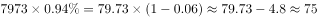

# 现期比重求部分量（部分=总体×占比）

考点：[[20-考点/资料分析/比重/现期比重求部分量（部分=总体×占比）|比重 / 现期比重求部分量（部分=总体×占比）]]
材料：[[15-材料/资料分析/186402 2015年11月1日零时全国人口抽样|186402 2015年11月1日零时全国人口抽样]]

**问法模型**：题干问'最终样本量为多少'，材料给出'样本量占常住人口总数的比重'与常住人口总量 → 直接用'部分=总体×占比'一步乘法求解

## 推理链
1. 第1步：从材料第1段提取条件：2015年11月1日零时江苏常住人口为7973万人，最终样本量占全省常住人口总数的比重约为0.94%（原文该处百分数空白，按试卷原值代入，可由答案A反推校验：75/7973≈0.94%）
2. 第2步：所用公式：部分=总体×占比，即样本量=7973万×0.94%
3. 第3步：代入速算：7973×0.94%≈8000×0.94%≈75.2万人（精确约74.9万人）
4. 第4步：与选项对照：A.75万人最接近，B.79万人、C.82万人、D.86万人均明显偏大，故选A

**最快解法**：⚡ 一步乘法估算：7973×0.94%，将7973放大为8000，8000×0.94%=75.2万，直接锁定A；或先记1%≈79.73万，0.94%略小于1%且接近0.94倍，得约75万

## 易错点
- ⚠ 原文'江苏最终样本量占全省常住人口总数的'后百分数缺失，易漏读该句而误判无从下手，须以原卷数值（约0.94%）代入，不能跳题
- ⚠ 单位口径：7973单位是'万人'，乘以占比后结果仍为'万人'，选项单位是'万人'而非'%'，勿把结果当百分数或做多余换算
- ⚠ 同段另一空白'增长'对应的是与六普相比的总量增长百分数（伴随'增加107万人'），与样本量占比是两个独立数据，勿混用

## 母题抽象
> 🧩 当题干问'某部分量为多少'且材料同时给出'该部分占总体的比重%'与'总体绝对数'时，套'部分=总体×占比'，把总体取整放大做一步乘法估算即可

**同类特征**：最终样本量为、占常住人口总数的比重、总体×占比求部分、现期（2015年11月1日零时）、人口抽样调查、一步乘法

## 相关题
- [[10-真题/资料分析/比重/2742212 现期比重求部分值（总量×比重）|2742212]]（江苏 2021，相关度1）

---

### 题干

以2015年11月1日零时为标准时点进行的人口抽样调查中，江苏最终样本量为：

### 选项
- A. 75万人　✅
- B. 79万人
- C. 82万人
- D. 86万人

### 官方解析

根据“2015年11月1日······人口抽样调查······样本量为”，可判定本题为现期比重问题。定位材料第一段，江苏最终样本量占全省常住人口总数的且2015年11月1日零时江苏常住人口为7973万人，则此时进行的人口抽样调查中，江苏最终样本量为：万人。

故正确答案为A。

### 给定材料

        在以2015年11月1日零时为标准时点进行的全国人口抽样调查中。江苏最终样本量占全省常住人口总数的。调查显示：2015年11月1日零时江苏常住人口为7973万人。同以2010年11月1日零时为标准时点进行的第六次全国人口普查相比，增加107万人，增长。

        全省常住人口中，0~14岁人口为1064万人，占；15~64岁人口为5910万人，占；65岁及以上人口为999万人，占。同第六次全国人口普查相比，0~14岁人口的比重上升0.34个百分点，15~64岁人口的比重下降1.97个百分点，65岁及以上人口的比重上升1.64个百分点。

        全省常住人口中，大专及以上文化程度人口为1230万人，高中（含中专）文化程度人口为1356万人；初中文化程度人口为2741万人；小学文化程度人口为1744万人。

