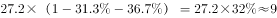
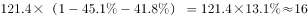
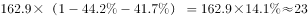
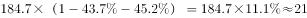

# 现期比重求部分量（隐含比重：其他收入=营业收入×(1−餐饮占比−客房占比)）并比较大小

考点：[[20-考点/资料分析/比重/现期比重求部分量（隐含比重：其他收入=营业收入×(1−餐饮占比−客房占比)）并比较大小|比重 / 现期比重求部分量（隐含比重：其他收入=营业收入×(1−餐饮占比−客房占比)）并比较大小]]
材料：[[15-材料/资料分析/186400 2016年第一季度全国星级饭店按一至|186400 2016年第一季度全国星级饭店按一至]]

**问法模型**：题干问'取得其他收入（除餐饮、客房收入外）最高的是'，材料只给营业收入总量和餐饮、客房两个占比 → 用'其他收入占比=100%−餐饮占比−客房占比，其他收入=营业收入×其他收入占比'求出各档部分量再比较

## 推理链
1. 第1步：从表格提取四个选项对应星级的数据——二星级27.2亿元/31.3%/36.7%，三星级121.4亿元/45.1%/41.8%，四星级162.9亿元/44.2%/41.7%，五星级184.7亿元/43.7%/45.2%
2. 第2步：其他收入占比=100%−餐饮收入占比−客房收入占比，其他收入=营业收入×其他收入占比
3. 第3步：求各档其他收入占比：二星级100%−31.3%−36.7%=32.0%，三星级13.1%，四星级14.1%，五星级11.1%
4. 第4步：交叉相乘求其他收入绝对额：二星27.2×32.0%≈8.7亿元，三星121.4×13.1%≈15.9亿元，四星162.9×14.1%≈23.0亿元，五星184.7×11.1%≈20.5亿元（一星级0.3×3.1%≈0.01亿元可忽略）
5. 第5步：比较绝对额：四星级23.0亿元>五星级20.5亿元>三星级15.9亿元>二星级8.7亿元，对照选项选C

**最快解法**：⚡ 先口算各档其他收入占比并初筛：二星级32.0%虽最高但基数仅27.2亿元，27×32%≈8.7亿元直接淘汰；剩余三档截位乘法：四星163×14.1%≈23、五星185×11.1%≈20.5、三星121×13.1%≈15.9，四星级最高，选C

## 易错点
- ⚠ 只比营业收入大小误选五星级（184.7亿元最大），或只比其他收入占比误选二星级（32.0%最高但基数太小），必须'营业收入×其他收入占比'交叉相乘后再比较
- ⚠ 其他收入占比算错：餐饮占比+客房占比≠100%（如二星级31.3%+36.7%=68.0%，剩余32.0%才是其他收入），需用100%减去两项
- ⚠ 误用全国行数据或把一星级（0.3亿元极小量）纳入逐项计算浪费时间；全国行43.5%/42.8%是加权平均占比，不能反推某档其他收入

## 母题抽象
> 🧩 当题干出现'除A、B外的其他部分最高/最多是谁'且材料给总量与各分项占比时，先构造隐含占比=100%−各已知占比，再用'总量×隐含占比'交叉相乘后比大小，切勿单看总量或单看占比下结论

**同类特征**：其他收入（除餐饮、客房收入外）、最高的是、全表给总量+两个分项占比、需构造隐含比重(100%−已知占比之和)、部分量=总量×占比、选项为不同分档主体

## 相关题
（暂无）

---

### 题干
2016年第一季度，全国星级饭店中取得其他收入（除餐饮、客房收入外）最高的是：

### 选项
- A. 二星级饭店
- B. 三星级饭店
- C. 四星级饭店　✅
- D. 五星级饭店

### 官方解析

根据问题所求“2016年第一季度······取得其他收入（除餐饮、客房收入外）最高的是”，结合材料给出条件为总量和占比，可判定此题为现期比重问题。其他收入占比=1-餐饮收入占比-客房收入占比，其他收入=总收入×其他收入占比，代入表格数据可得，

二星级饭店其他收入：亿元；

三星级饭店其他收入：亿元；

四星级饭店其他收入：亿元；

五星级饭店其他收入：亿元。

四星级饭店最高。

故正确答案为C。

### 给定材料

> [!warning] 疑点（官方解析可能有误，待人工复核）
> 官方解析中四个星级的其他收入计算结果数值显示为空（'：亿元'前缺数字），疑为排版丢失；按公式实算为二星8.7、三星15.9、四星23.0、五星20.5亿元，四星级最高，与答案C一致，不影响结论

<!-- CODEX-ANSWER-REVIEW:BEGIN -->
### 本次独立复核

**复核状态：** `resolved`（答案与解析已核定）

**计分答案：** C（可计分）

**复核解析：**

各星级其他收入=营业收入×(1−餐饮收入比重−客房收入比重)。按图表逐星级代入，二星约8.7亿元、三星约15.9亿元、四星约23.0亿元、五星约20.5亿元；最高为四星，选C。

**相关信息：**

营业收入中其他收入为餐饮、客房之外的余项。

**题源依据：** [固定版本原题](https://github.com/Mentat-Uran/kaogongzhentizhengliu/blob/84ab93d4b64b61d897bece8a1c0a5bab06b4feb2/10-%E7%9C%9F%E9%A2%98/%E8%B5%84%E6%96%99%E5%88%86%E6%9E%90/%E6%AF%94%E9%87%8D/2042096%20%E7%8E%B0%E6%9C%9F%E6%AF%94%E9%87%8D%E6%B1%82%E9%83%A8%E5%88%86%E9%87%8F%EF%BC%88%E9%9A%90%E5%90%AB%E6%AF%94%E9%87%8D%EF%BC%9A%E5%85%B6%E4%BB%96%E6%94%B6%E5%85%A5%3D%E8%90%A5%E4%B8%9A%E6%94%B6%E5%85%A5%C3%97(1%E2%88%92%E9%A4%90%E9%A5%AE%E5%8D%A0%E6%AF%94%E2%88%92%E5%AE%A2%E6%88%BF%E5%8D%A0%E6%AF%94)%EF%BC%89%E5%B9%B6%E6%AF%94%E8%BE%83%E5%A4%A7%E5%B0%8F.md)；固定内容 commit `84ab93d4b64b61d897bece8a1c0a5bab06b4feb2`，Markdown blob `a363ee8ff9e301288191179a5534d2a567041056`。
<!-- CODEX-ANSWER-REVIEW:END -->
