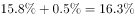
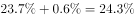
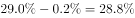
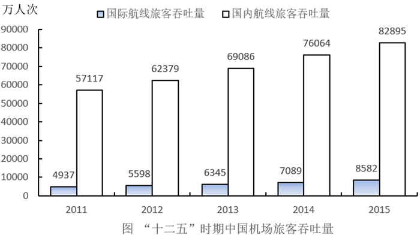
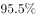
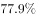
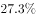

# 基期占比反推与地区吞吐量排序（升降百分点修正）

考点：[[20-考点/资料分析/比重/基期占比反推与地区吞吐量排序（升降百分点修正）|比重 / 基期占比反推与地区吞吐量排序（升降百分点修正）]]
材料：[[15-材料/资料分析/186404 2015年（含'十二五'2011—2|186404 2015年（含'十二五'2011—2]]

**问法模型**：题干问'上年（2014年）各地区吞吐量排名前三'→基期占比反推模型：2014年占比=2015年占比−升降百分点，因各地区共用同一年全国总量基数，占比排序即吞吐量排序，先定第一名再对照选项。

## 推理链
1. 第1步：题干要求排出2014年（基期）吞吐量前三的地区，材料段3给出2015年各地区占比的升降百分点：华北降低0.5、东北降低0.1、华东提高0.2、中南降低0.6、西南提高0.6、西北提高0.2、新疆提高0.2个百分点（本版各占比数值留空，须以原文完整数值为准）。
2. 第2步：基期占比规则：2014年占比=2015年占比−变化量，即'降低X个百分点'的华北（+0.5）、中南（+0.6）2014年占比要比2015年更高，'提高X个百分点'的华东（−0.2）、西南（−0.6）要比2015年更低。
3. 第3步：各地区吞吐量=当年全国总量×占比，2014年七个地区共用同一个全国总量作分母，故无需计算绝对值，直接比较反推后的2014年占比即可排定名次。
4. 第4步：按官方解析代入原文完整占比数值反推，2014年占比最大者为华东地区（其占比仅被'提高0.2个百分点'小幅扣减且基数领先），故第一名是华东地区。
5. 第5步：对照选项：A以华北居首、B与C以中南居首、仅D以华东居首，结合官方答案确认2014年前三位依次为华东、中南、华北，选D。

**最快解法**：⚡ 首名排除法+百分点反向反推：只需判定第一名——2014占比=2015占比−变化量（'降低'取加、'提高'取减），按原文数值华东反推后仍最大；四个选项中仅D以'华东地区'居首，直接锁定D，二、三名无需精确计算。

## 易错点
- ⚠ 百分点方向搞反：'中南降低0.6、华北降低0.5'意味着其2014年占比=2015占比+0.6/+0.5（加回更高），'华东提高0.2'意味着2014占比=2015占比−0.2（扣减更低），方向弄反排序即错。
- ⚠ 时间口径错位：题干问2014年，不能直接用2015年占比排序，也不能把'较上年变化'误解为2014年相对2015年的变化；占比的变动是百分点，不可当增长率%换算。
- ⚠ 本版材料各地区占比数值留空（阅读陷阱），仅凭升降百分点无法独立复算名次，切勿凭空补数，须核对原文完整数值；另外占比升降与名次升降不等价，必须反推后再比。

## 母题抽象
> 🧩 当题干出现'上年/基期某年各地区（或各类别）吞吐量排名前N'特征时，用'现期占比−升降百分点'反推基期占比，借同一总量基数直接按占比排序，先定第一名再对照选项排除定答案。

**同类特征**：基期年份+地区排名问法（2014年…前三位依次是）、材料给'占比+较上年升降X个百分点'、2014占比=2015占比−变化量的反向修正、同一全国总量基数下比占比即比吞吐量、四个选项仅第一名不同，可首名排除

## 相关题
（暂无）

---

### 题干
2014年中国机场旅客吞吐量位于前三位的地区依次是：

### 选项
- A. 华北地区、中南地区、西南地区
- B. 中南地区、华北地区、西南地区
- C. 中南地区、华东地区、西南地区
- D. 华东地区、中南地区、华北地区　✅

### 官方解析

根据选项可知第一名一定为华北地区、中南地区、华东地区其中的一个。根据材料“华北地区占，比上年降低0.5个百分点”，则14年华北地区吞吐量占比为；根据材料“中南地区占，降低0.6个百分点”，则14年中南地区吞吐量占比为；根据材料“华东地区占，提高0.2个百分点”，则14年华东地区占比为；最大为华东地区，所以可知第一名为华东地区。

故正确答案为D。

### 给定材料

        2015年中国机场旅客吞吐量91477万人次，比上年增长，其中，国内航线完成82895万人次，增长；国际航线完成8582万人次，增长，“十二五”时期中国机场旅客吞吐量如下图。

        2015年中国机场旅客吞吐量100万人次以上的有70个，比上年增长6个，完成旅客吞吐量占全国机场旅客吞吐量的；旅客吞吐量1000万人次以上的有26个，比上年增长2个，完成旅客吞吐量占全部机场旅客吞吐量的；北京、上海和广州三大城市占全部机场旅客吞吐量的。

        2015年中国各地区机场旅客吞吐量的分布情况是：华北地区占，比上年降低0.5个百分点；东北地区占，降低0.1个百分点；华东地区占，提高0.2个百分点；中南地区占，降低0.6个百分点；西南地区占，提高0.6个百分点；西北地区占，提高0.2个百分点；新疆地区占，提高0.2个百分点。

> [!warning] 疑点（官方解析可能有误，待人工复核）
> 非官方解析错误，系版本完整性问题：本版材料各地区占比及三大城市占比数值均留空，官方解析'最大为华东地区'的数值判断依赖原文完整占比，本版仅能依据升降百分点框架与官方结论复核；解析逻辑与答案D一致（仅D以华东居首），无实质矛盾。

<!-- CODEX-ANSWER-REVIEW:BEGIN -->
### 本次独立复核

**复核状态：** `resolved`（答案与解析已核定）

**计分答案：** D（可计分）

**复核解析：**

以各地区吞吐量占比变化还原2014年排序：华东占比由上升0.2个百分点，华北下降0.5、中南下降0.6；结合各区2015年占比还原后，前三依次为华东、中南、华北，选D。

**相关信息：**

比重变化：分项增速高于整体增速时占比上升；基期比重需分别还原分子、分母后求比。

**题源依据：** [固定版本原题](https://github.com/Mentat-Uran/kaogongzhentizhengliu/blob/84ab93d4b64b61d897bece8a1c0a5bab06b4feb2/10-%E7%9C%9F%E9%A2%98/%E8%B5%84%E6%96%99%E5%88%86%E6%9E%90/%E6%AF%94%E9%87%8D/2042340%20%E5%9F%BA%E6%9C%9F%E5%8D%A0%E6%AF%94%E5%8F%8D%E6%8E%A8%E4%B8%8E%E5%9C%B0%E5%8C%BA%E5%90%9E%E5%90%90%E9%87%8F%E6%8E%92%E5%BA%8F%EF%BC%88%E5%8D%87%E9%99%8D%E7%99%BE%E5%88%86%E7%82%B9%E4%BF%AE%E6%AD%A3%EF%BC%89.md)；固定内容 commit `84ab93d4b64b61d897bece8a1c0a5bab06b4feb2`，Markdown blob `2223868003b6145b40d80228e1a858dbfe0bc3a1`。
<!-- CODEX-ANSWER-REVIEW:END -->
