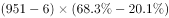
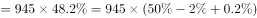

# 现期比重差计算（同一基数下两部分人数之差=基数×占比之差）

考点：[[20-考点/资料分析/比重/现期比重差计算（同一基数下两部分人数之差=基数×占比之差）|比重 / 现期比重差计算（同一基数下两部分人数之差=基数×占比之差）]]
材料：[[15-材料/资料分析/186508 2016年某市市民邻里关系问卷调查：|186508 2016年某市市民邻里关系问卷调查：]]

**问法模型**：题干问'有邻居'人群中'比较满意'比'很满意'多多少人 → 锁定真实基数945（951−6），用'基数×占比之差'一步求人数差

## 推理链
1. 第1步：从文字段提取：总受访951位，'没有邻居'有6位，故'有邻居'受访市民=951−6=945位；'很满意''比较满意'占比均为'有邻居'人群内部的占比（所给文本中这些占比数值空缺不可读，须以原卷数值代入）
2. 第2步：模型为现期比重差：同一基数下两部分人数之差=基数×占比之差，即945×（比较满意占比−很满意占比），基数必须用945而非951
3. 第3步：以官方答案B（455人）反推差率口径：455÷945≈48.1%，即'比较满意'占比比'很满意'占比高约48.1个百分点
4. 第4步：代入验证：945×48.1%≈454.5≈455人；若误用基数951，则951×48.1%≈457.7≈458人，恰好对应C项，证实C为'未减6位没有邻居'的基数陷阱项
5. 第5步：对照选项：A项402人对应差率约42.5%、D项470人对应差率约49.7%，均与占比差不符，仅B项455人成立，故选B

**最快解法**：⚡ 公式法+截位估算：①先定基数951−6=945；②'比较满意'与'很满意'两个占比直接相减得差率（约48.1个百分点，占比相减是百分点运算）；③945×差率，按945×0.48≈454快速估出约455人，锁定B，全程一次减法一次乘法

## 易错点
- ⚠ 基数陷阱：未先减去6位'没有邻居'而直接用951作基数，951×占比差≈458，正好误选C项458；正确基数是945
- ⚠ 占比口径层级：'很满意''比较满意'占比是'有邻居'945人内部的占比，不能用图1（基数为满意人群）或图2（基数为不满意人群）的占比混算，也不能用'满意'总占比替代两个细分占比之差
- ⚠ '比较满意−很满意'是占比相减（个百分点），不能相除求倍数；且'满意'与'不满意'之间还有不愿表态人群，各占比不互补，不能凑100%反推；另注意所给文本占比空缺，须按原卷数值代入，严禁凭感觉补数

## 母题抽象
> 🧩 当题干出现'同一总体中A部分比B部分多多少人'特征时，先从总量扣除非目标项定真实基数（951−6=945），再用'基数×占比之差'一步求解，并可用选项反推差率验证基数是否用对

**同类特征**：'比较满意'比'很满意'多多少人（同基数两部分人数之差）、现期截面数据，无增长/基期换算、隐含基数951−6=945、占比为总体内部占比，人数差=基数×占比差、选项设置951/945基数陷阱（458为陷阱项）

## 相关题
（暂无）

---

### 题干
“有邻居”的受访市民中，感到“比较满意”的人数比“很满意”的多多少人？

### 选项
- A. 402人
- B. 455人　✅
- C. 458人
- D. 470人

### 官方解析

题干所求为“比较满意”的人数比“很满意”的多多少人，可判定本题为现期比重比较问题。定位文字材料，在受访的951位市民中，“没有邻居”的有6位。“有邻居”的受访市民中，对邻里关系表示“满意”的占，（“满意”分为“很满意”和“比较满意”，占比分别为和），则感到“比较满意的”人数比“很满意”的多 

故正确答案为B。

### 给定材料

        2016年某市一次有关市民邻里关系的调查显示，在受访的951位市民中，“没有邻居”的有6位。“有邻居”的受访市民中，对邻居表示“了解”的占（“了解”分“很了解”和“部分了解”，占比分别为和），其余的表示“不了解”；对邻里关系表示“满意”的占，（“满意”分为“很满意”和“比较满意”，占比分别为和），“不满意”的占，其余不愿表态，对邻里关系感到“满意”和“不满意”的主要原因分别见图1和图2。

> [!warning] 疑点（官方解析可能有误，待人工复核）
> 所给材料文本中'满意'总占比及'很满意''比较满意'细分占比数值空缺不可读，官方解析亦为空缺占位，无法从材料直接复算出455；本文以官方答案B为唯一事实，反推占比差=455÷945≈48.1个百分点，并借C项458≈951×48.1%印证基数须为945。此系材料完整性问题，非答案口径错误，答案B不予改动

<!-- CODEX-ANSWER-REVIEW:BEGIN -->
### 本次独立复核

**复核状态：** `resolved`（答案与解析已核定）

**计分答案：** B（可计分）

**复核解析：**

有邻居样本人数=951−6=945；比较满意68.3%，很满意20.1%，人数差=945×(68.3%−20.1%)=945×48.2%≈455人，选B。两比例和样本数均见原公式/题图。

**相关信息：**

人数差=共同基数×比重差；满意档位互斥。

**题源依据：** [固定版本原题](https://github.com/Mentat-Uran/kaogongzhentizhengliu/blob/84ab93d4b64b61d897bece8a1c0a5bab06b4feb2/10-%E7%9C%9F%E9%A2%98/%E8%B5%84%E6%96%99%E5%88%86%E6%9E%90/%E6%AF%94%E9%87%8D/2042818%20%E7%8E%B0%E6%9C%9F%E6%AF%94%E9%87%8D%E5%B7%AE%E8%AE%A1%E7%AE%97%EF%BC%88%E5%90%8C%E4%B8%80%E5%9F%BA%E6%95%B0%E4%B8%8B%E4%B8%A4%E9%83%A8%E5%88%86%E4%BA%BA%E6%95%B0%E4%B9%8B%E5%B7%AE%3D%E5%9F%BA%E6%95%B0%C3%97%E5%8D%A0%E6%AF%94%E4%B9%8B%E5%B7%AE%EF%BC%89.md)；固定内容 commit `84ab93d4b64b61d897bece8a1c0a5bab06b4feb2`，Markdown blob `2792dfe5350fdead36c544bb358c28ec5cd34f87`。
<!-- CODEX-ANSWER-REVIEW:END -->
