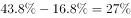

# 两期比重差（比重差值计算）

考点：[[20-考点/资料分析/比重/两期比重差（比重差值计算）|比重 / 两期比重差（比重差值计算）]]
材料：[[15-材料/资料分析/186512 J省S市2015年（对比2010年-|186512 J省S市2015年（对比2010年-]]

**问法模型**：题干问'2015年……占全省的比重比2010年提高了多少个百分点'→ 属两期比重之差，材料表格已直接给出两期比重，直接相减得百分点差，无需套基期/增长率公式

## 推理链
1. 第1步：题干锁定指标为'发明专利申请量占全省的比重'，比较期2015年、基期2010年，所求为百分点差
2. 第2步：定位附表第2列'申请量占全省的比重(%)'：2015年=43.8，2010年=16.8（注意不是授权量列、也不是万人拥有量列）
3. 第3步：代入差值公式：43.8%−16.8%=27.0个百分点
4. 第4步：对照选项，27.0个百分点对应B，正确答案为B

**最快解法**：⚡ 直接查表相减（口算级）：43.8−16.8=27.0，锁定B；全题约5秒，无需任何速算技巧，唯一动作是选对表格列（'申请量占全省的比重'列）

## 易错点
- ⚠ 错列陷阱：误用'授权量占全省的比重'列（16.8−3=13.8，无对应选项但会浪费时间）或'万人发明专利拥有量'列（27.4−'—'，2010年缺失）
- ⚠ 把'提高了多少个百分点'误当增长率处理，去算43.8/16.8−1≈160.7%，方向完全错误
- ⚠ 2010年万人拥有量为'—'属数据缺失，不能读作0参与计算；且本题根本用不到该列

## 母题抽象
> 🧩 当题干出现'A期某比重比B期提高了多少个百分点'且表格直接给出两期比重时，先核对指标口径选对列，再两值相减即可，切忌套增长率公式或换列

**同类特征**：占全省的比重、比2010年提高、个百分点、发明专利申请量、两期比重差、查表直接相减

## 相关题
- [[10-真题/资料分析/增长/10718183 名义增速与实际增速之差（百分点计算）|10718183]]（深圳市考 2024，相关度1）
- [[10-真题/资料分析/比重/16070258 现期比重差值（两个部分占比相减）|16070258]]（重庆 2026，相关度1）
- [[10-真题/资料分析/比重/1752600 两期比重变化（比重差，百分点表述）|1752600]]（北京 2016，相关度1）
- [[10-真题/资料分析/比重/1789664 比重差值计算（百分点搭桥）|1789664]]（江苏 2016，相关度1）
- [[10-真题/资料分析/增长/2050644 两期增速变化比较（百分点差值）|2050644]]（吉林 2017，相关度1）

---

### 题干
2015年该市发明专利申请量占全省的比重比2010年提高了：

### 选项
- A. 22.5个百分点
- B. 27.0个百分点　✅
- C. 32.1个百分点
- D. 40.8个百分点

### 官方解析

根据问题所求“2015年······比重比2010年提高”，可判定本题为两期比重问题。定位表格可得，2015年该市发明专利申请量占全省的比重为，2010年为，，即2015年比重比2010年提高27个百分点。

故正确答案为B。

### 给定材料

        2015年J省S市全社会研发经费投入占地区生产总值的比重为，比2010年提高0.3个百分点。其中，规模以上工业企业研发经费投入占全社会研发经费投入的。规模以上工业企业中，建有独立研发机构的占，以上的大型企业建有独立研发机构。

        2015年末该市拥有技术企业3478家，人才总数由2010年末的146万人增加到2015年末的227万人。其中，高层次人才由2010年末的8万人增加到2015年末的18万人。每万名劳动者中研发人员由158人增加到175人。

        2015年该市发明专利拥有量的90%来自于企业，2010-2015年S市发明专利申请量、授权量占全省专利申请量、授权量的比重，以及万人发明专利拥有量情况见下表。

