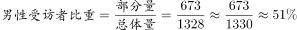

# 现期比重计算（部分占总体）

考点：[[20-考点/资料分析/比重/现期比重计算（部分占总体）|比重 / 现期比重计算（部分占总体）]]
材料：[[15-材料/资料分析/186648 某次社会调查（样本1328人）的受访|186648 某次社会调查（样本1328人）的受访]]

**问法模型**：题干为'男性受访者约占总受访者的（　）'，选项均为百分数，属于部分占总体的现期比重问法 → 直接套模型：比重=部分人数÷总人数=673÷1328

## 推理链
1. 第1步：题干问'男性占总受访者的比重'，选项为百分数，所求为本次调查的现期比重，定位材料第一段
2. 第2步：材料直接可读两个绝对数：总受访者1328人（总体）、男性受访者673人（部分）；并用男673+女655=1328核验口径吻合
3. 第3步：现期比重公式：比重=部分÷总体=673÷1328
4. 第4步：速算：1328×50%=664，673-664=9，比重=50%+9/1328≈50%+0.7%≈50.7%
5. 第5步：对照选项，计算值≈50.7%与B项一致，锁定B（与官方解析673/1328的算法完全一致）

**最快解法**：⚡ 半数基准法+截位直除：先取总体的一半1328×50%=664作基准，673-664=9，9/1328≈0.7%，故比重≈50.7%，一步锁定B，无需精确竖除

## 易错点
- ⚠ 分子分母颠倒或误用女性655作分子（655/1328≈49.3%），须认准'男性占总'→男性673为分子、1328为分母
- ⚠ 材料正文所有百分比数值均为空缺，切勿试图从原文找现成占比，本题必须用绝对数673/1328自行计算
- ⚠ 受'男性略高于女性'表述误导直接凭直觉选50%附近的非计算项；'约'字问法只需算到0.1%精度即可与选项对照

## 母题抽象
> 🧩 当题干出现'某部分占总体的（比重）'且选项为百分数时，直接用'部分÷总体'代入材料现期绝对数，以总体的一半或整百为基准截位速算，验证最接近的选项

**同类特征**：'……占……'的比重问法、选项为百分数、现期（本次调查当年）数据、部分与总体均为可直接读取的绝对数、构成比/份额型材料、'约'字估算问法

## 相关题
- [[10-真题/资料分析/增长/9629 一般增长率计算（现期需由增量倒推）|9629]]（安徽 2009，相关度1）
- [[10-真题/资料分析/比重/2604234 现期比重计算|2604234]]（广东 2020，相关度1）
- [[10-真题/资料分析/增长/27835 一般增长率计算（已知现期量与增长量求增长率）|27835]]（河北 2012，相关度1）
- [[10-真题/资料分析/平均数/10204497 平均数增长率（均价=值-量的比值增长率）|10204497]]（海南 2024，相关度1）
- [[10-真题/资料分析/增长/12536395 隔年（间隔）增长率|12536395]]（四川 2024，相关度1）

---

### 题干
男性受访者约占总受访者的（  ）。

### 选项
- A. 

- B. 

　✅
- C. 

- D. 

### 官方解析

根据问题所求“…占…”，选项为百分数，且所求为现期，可判定此题为现期比重问题。定位材料第一段，“受访者人数为1328人，其中男性受访者共673人”，则。

故正确答案为B。

### 给定材料

        在我国某次调查中，受访者人数为1328人，其中男性受访者共673人，略高于女性受访者的655人。

        从年龄结构看，30-44岁的受访者居多，占；其次是45-59岁的受访者，占；20-29岁的受访者占；60-74岁的受访者占；20岁以下（不含20岁）和75岁以上的受访者占比比较低，分别是和。

        就受教育程度而言，大学本科的受访者居多，占；其次是中专和大专的受访者，分别占和；高中、初中的受访者分别占和；小学及以下的受访者占；研究生及以上的受访者较少，仅占。

        从职业来看，本次调查涵盖了各类职业人群。其中，专业技术人员占，位居首位，紧跟其后的是商业、服务人员，占；受访者中有较多的学生和离退休人员，分别占和。

        就月收入情况而言，无收入的受访者占；收入在2000元以内的受访者占；收入在2001-3000元的受访者占。的受访者收入在3001-4000元，收入在4001-6000元的受访者占；收入在6000元以上的受访者占，其比重比去年增加了4.2个百分点。

        从婚姻状况来看，的受访者已婚，的受访者未婚，离婚和丧偶的受访者分别占和。

