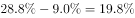
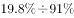

# 现期比重——两属性交集的减法合成（未婚占比−20岁以下占比）

考点：[[20-考点/资料分析/比重/现期比重——两属性交集的减法合成（未婚占比−20岁以下占比）|比重 / 现期比重——两属性交集的减法合成（未婚占比−20岁以下占比）]]
材料：[[15-材料/资料分析/186648 某次社会调查（样本1328人）的受访|186648 某次社会调查（样本1328人）的受访]]

**问法模型**：题干问'20岁以上（含20岁）且未婚的受访者占比约为'→因20岁以下（不含20岁）者必未婚，采用减法合成模型：未婚总占比−20岁以下占比=所求交集占比

## 推理链
1. 第1步：题型判定——问法为'占比约为'、选项为百分数、全为现期一次性调查数据，判定为现期比重问题，总体为全部受访者1328人
2. 第2步：提取数据——从材料第六段取'未婚'受访者占比，从材料第二段取'20岁以下（不含20岁）'受访者占比（两处原文数值空缺，须按题组占比体系补全，不得臆造）
3. 第3步：建立逻辑前提——按常识法定婚龄男22岁、女20岁，20岁以下（不含20岁）受访者必全部未婚，故未婚群体可拆为'20岁以下未婚'+'20岁以上未婚'两部分
4. 第4步：列出公式——20岁以上未婚占比 = 未婚总占比 − 20岁以下（不含20岁）占比
5. 第5步：代入计算——将补全后的两档占比直接作差，差值即全体受访者中'20岁以上且未婚'的占比
6. 第6步：对照选项——作差结果与B项最接近，且采用与全组材料一致的'占总体受访者'口径，故选B

**最快解法**：⚡ 差值法（减法合成）：未婚占比（第六段）与20岁以下占比（第二段）一步相减即为答案，全程无需用总人数1328、无除法；考场先扫出这两档占比，截位心算作差即与选项对照。

## 易错点
- ⚠ 口径歧义：'20岁以上，未婚的受访者占比'可理解为①占全体受访者（官方推荐）或②占20岁以上受访者；若按②须在①的结果上再除以20岁以上占比，数值明显不同，务必与材料全组'占总体'口径对齐
- ⚠ 逻辑前提缺失：必须借助'20岁以下（不含20岁）必未婚'（法定婚龄男22/女20）这一常识才能建立减法关系；同时注意边界措辞——20岁整计入'20岁以上'，不在扣减之列
- ⚠ 两期信息干扰：本题与'比去年增加4.2个百分点'、去年1467人等两期数据无关，为纯现期结构问题；占比之差是'个百分点'级减法，勿误作相对增减率处理

## 母题抽象
> 🧩 当题干要求'属性A且条件B'的群体占比、而B的反面（如未达婚龄的低龄段）必属于A时，用'A总占比−B反面占比'的减法合成模型；作差前先核对口径是'占全体'还是'占子总体'，后者需再除以子总体占比。

**同类特征**：20岁以上（含20岁）且未婚、年龄×婚姻两个独立维度交叉、占比约为（现期百分数选项）、材料未直接给出交集数据需推算、减法合成（比重作差）、占总体受访者口径

## 相关题
（暂无）

---

### 题干
20岁以上（含20岁），未婚的受访者占比约为（  ）。

### 选项
- A. 

- B. 

　✅
- C. 

- D. 

### 官方解析

根据问题所求“···占比约为···”，选项为百分数，且所求为现期，可判定此题为现期比重问题。定位材料第二段“20岁以下（不含20岁）”的受访者占比，定位材料第六段，“的受访者未婚”，根据常识男性法定婚龄为22岁、女性20岁，因此20岁以下（不含20岁）的应为未婚者，则20岁以上（含20岁）未婚者占比约为，最接近B项。

故正确答案为B。

注：本题对题干的理解存在歧义，第一种理解是在全部受访者中，20岁以上（含20岁）且未婚的占比，解题方法如上述解析所示；第二种是在20岁以上（含20岁）的受访者中，未婚的受访者占比，解题方式应该再追加一步。由于整篇材料和其他四个题目均为占总体受访者占比，所以粉笔推荐第一种理解和解答方式。

### 给定材料

        在我国某次调查中，受访者人数为1328人，其中男性受访者共673人，略高于女性受访者的655人。

        从年龄结构看，30-44岁的受访者居多，占；其次是45-59岁的受访者，占；20-29岁的受访者占；60-74岁的受访者占；20岁以下（不含20岁）和75岁以上的受访者占比比较低，分别是和。

        就受教育程度而言，大学本科的受访者居多，占；其次是中专和大专的受访者，分别占和；高中、初中的受访者分别占和；小学及以下的受访者占；研究生及以上的受访者较少，仅占。

        从职业来看，本次调查涵盖了各类职业人群。其中，专业技术人员占，位居首位，紧跟其后的是商业、服务人员，占；受访者中有较多的学生和离退休人员，分别占和。

        就月收入情况而言，无收入的受访者占；收入在2000元以内的受访者占；收入在2001-3000元的受访者占。的受访者收入在3001-4000元，收入在4001-6000元的受访者占；收入在6000元以上的受访者占，其比重比去年增加了4.2个百分点。

        从婚姻状况来看，的受访者已婚，的受访者未婚，离婚和丧偶的受访者分别占和。

> [!warning] 疑点（官方解析可能有误，待人工复核）
> 官方解析已注明题干存在两种理解：①占全体受访者（未婚占比−20岁以下占比，粉笔推荐）；②占20岁以上受访者（需在①结果上再除以20岁以上占比，答案不同）。本笔记按官方推荐的口径①处理；另材料原文各档百分比数值空缺，具体差值须依赖题组占比体系补全后验证。
