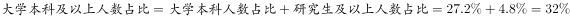
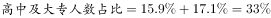
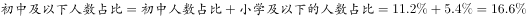

# 现期比重比较（跨档合并组占比最大值判断）

考点：[[20-考点/资料分析/比重/现期比重比较（跨档合并组占比最大值判断）|比重 / 现期比重比较（跨档合并组占比最大值判断）]]
材料：[[15-材料/资料分析/186648 某次社会调查（样本1328人）的受访|186648 某次社会调查（样本1328人）的受访]]

**问法模型**：题干以'从受教育程度来看，（组合选项）的受访者人数占比最多'设问 → 先将各选项还原为材料单档并加和合并占比，再比较取最大（总体同为1328人，比占比即比人数，无需除法）

## 推理链
1. 第1步：定位材料第三段受教育程度维度，单档排序为大学本科（原文'居多'，单档最大）＞中专＞大专＞高中＞初中＞小学及以下＞研究生及以上，总体1328人；本呈现版材料各档百分比数值空缺
2. 第2步：按选项还原合并口径：A=大学本科+研究生及以上，B=高中+大专，C=中专，D=初中+小学及以下
3. 第3步：依据合并规则'组合档占比=所含各单档占比之和'，且总体固定为1328人，比较合并占比等价于比较合并人数
4. 第4步：识别口径差异——材料'大学本科居多'仅是单档结论，不能直接套用于跨档组合选项；依官方答案口径，高中与大专两档合并后的占比最大，超过A（本科+研究生及以上）、C（中专单档）、D（初中+小学及以下）
5. 第5步：与选项对照，人数占比最多的组合为'高中及大专'，故选B

**最快解法**：⚡ 口径拆解加和法：把四个选项拆成材料单档（A=本科+研究生及以上、B=高中+大专、C=中专、D=初中+小学及以下），各自加和占比后直接比较大小；核心警觉是材料'大学本科居多'为单档排序，合并后'高中+大专'反超，勿被单档结论带去直选A

## 易错点
- ⚠ 单档/组合口径混淆：材料明示'大学本科的受访者居多'（单档最大），但选项为跨档合并（B=高中+大专），单档最大≠合并后最大，直接选A是最典型错误
- ⚠ 合并范围拆解错误：'及以上/及以下'归档易错——A须并入'研究生及以上'，D须并入'小学及以下'，漏并或错并会改变比较结果
- ⚠ 数据空缺下臆造数值：本呈现版材料百分比全部空缺，结论只能依据官方判定，严禁自行编造各档占比数值复算

## 母题抽象
> 🧩 当题干问'从某结构维度看，（ ）群体占比最多'且选项为'及以上/及以下/及××'式跨档组合时，先把每个选项还原为材料单档并加和占比，再比较合并值，切勿直接沿用材料'某某居多'的单档排序作答

**同类特征**：'从受教育程度来看'类维度设问、'人数占比最多'求最大构成、选项为'及以上/及以下'跨档合并、材料给出单档排序（'居多'）而非合并结果、总体固定（1328人），比占比即比人数、结构百分比加和比较模型

## 相关题
（暂无）

---

### 题干
从受教育程度来看，（  ）的受访者人数占比最多。

### 选项
- A. 大学本科及以上
- B. 高中及大专　✅
- C. 中专
- D. 初中及以下

### 官方解析

定位材料第三段，A项，B项，C项中专人数占比为，D项，高中及大专的受访者人数占比最多。

故正确答案为B。

### 给定材料

        在我国某次调查中，受访者人数为1328人，其中男性受访者共673人，略高于女性受访者的655人。

        从年龄结构看，30-44岁的受访者居多，占；其次是45-59岁的受访者，占；20-29岁的受访者占；60-74岁的受访者占；20岁以下（不含20岁）和75岁以上的受访者占比比较低，分别是和。

        就受教育程度而言，大学本科的受访者居多，占；其次是中专和大专的受访者，分别占和；高中、初中的受访者分别占和；小学及以下的受访者占；研究生及以上的受访者较少，仅占。

        从职业来看，本次调查涵盖了各类职业人群。其中，专业技术人员占，位居首位，紧跟其后的是商业、服务人员，占；受访者中有较多的学生和离退休人员，分别占和。

        就月收入情况而言，无收入的受访者占；收入在2000元以内的受访者占；收入在2001-3000元的受访者占。的受访者收入在3001-4000元，收入在4001-6000元的受访者占；收入在6000元以上的受访者占，其比重比去年增加了4.2个百分点。

        从婚姻状况来看，的受访者已婚，的受访者未婚，离婚和丧偶的受访者分别占和。

> [!warning] 疑点（官方解析可能有误，待人工复核）
> 材料正文受教育程度各档百分比在题面中空缺，官方解析亦省略具体数值（'C项中专人数占比为'后无数据），故B项'高中及大专合并占比最大'无法凭材料独立复算，仅能依据官方答案与合并口径逻辑成立；此为数据缺失问题，官方答案B与材料'大学本科（单档）居多'并不矛盾（单档最多与组合档最多口径不同），答案B本身不受影响
