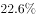
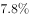
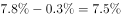
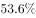
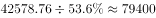
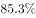
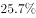

# 基期比重计算（现期值÷(1+增速)反推基期）

考点：[[20-考点/资料分析/比重/基期比重计算（现期值÷(1+增速)反推基期）|比重 / 基期比重计算（现期值÷(1+增速)反推基期）]]
材料：[[15-材料/资料分析/186746 2016年广东省民营经济增加值总量（|186746 2016年广东省民营经济增加值总量（]]

**问法模型**：'2015年……约占当年GDP的（选项为百分数）'→基期比重模型：基期比重=现期比重×(1+整体增速)÷(1+部分增速)，或分子分母分别÷(1+各自增速)后相除。

## 推理链
1. 第1步：题干求'2015年民营工业增加值占当年GDP的比重'且选项为百分数，材料数据均为2016年现期值，判定为基期比重问题。
2. 第2步：从文字段提取条件——2016年民营工业增加值15898.95亿元（现期量）、其增速留白记为a（原文仅给'比全部经济类型工业快3.3个百分点'）；民营经济增加值42578.76亿元、增速留白记为g、占GDP比重留白记为w，且GDP增速=g−0.3个百分点。
3. 第3步：先求2016年GDP=42578.76÷w，得2016年现期比重=15898.95÷(42578.76÷w)。
4. 第4步：套用基期比重公式：2015年比重=现期比重×(1+g−0.3%)÷(1+a)，等价于2015年民营工业15898.95÷(1+a)除以2015年GDP=42578.76÷[w×(1+g−0.3%)]。
5. 第5步：定性校验方向——民营工业增速a高于同期GDP增速（g−0.3），故(1+整体增速)/(1+部分增速)<1，2015年比重应'略小于'2016年现期比重，与官方解析'略小于'的结论一致。
6. 第6步：与选项对照——计算值落在2016年现期比重略下方，四个选项中最接近该值的是B项，故选B。

**最快解法**：⚡ 基期比重公式法+定性方向判断：先用截位直除算2016年现期比重15898.95÷(42578.76÷占GDP比重w)，再乘(1+GDP增速)÷(1+民营工业增速)；因部分增速>整体增速，修正因子略小于1，无需精算两套基期换算，直接锁定'比现期比重略小'的B项。

## 易错点
- ⚠ 现期基期混淆：15898.95亿元是2016年现期值，直接除2016年GDP得到的是现期比重（偏大），漏掉分子分母分别÷(1+增速)会误选偏大的干扰项。
- ⚠ 留白数据依赖：民营经济增速、占GDP比重、民营工业增速在文字段均为留白，只能借'高于同期GDP增幅0.3个百分点''比全部经济类型工业快3.3个百分点'等差值条件间接换算，不得凭空补数；留白缺失时只能靠'基期比重略小于现期比重'定性锁定选项。
- ⚠ 口径混淆：表2'占地区生产总值比重'分母是各区域自身GDP，且四地区增加值加总约43493.74亿元>全省42578.76亿元，不能用地区数据替代全省GDP；'贡献率''拉动GDP增速4.2个百分点'与'占GDP比重'是不同口径指标；百分数与'个百分点'（0.3、3.3）不可混算。

## 母题抽象
> 🧩 当题干出现'基期年份+某部分约占当年整体的比重（选项为百分数）'特征时，用基期比重公式：现期比重×(1+整体增速)÷(1+部分增速)；先比较部分与整体增速定方向（部分快→基期比重略小于现期比重），再按'略小'匹配选项，避免逐项硬算。

**同类特征**：'2015年'基期时间词、'约占当年GDP的'求比重且选项为百分数、部分（民营工业）对整体（GDP）的占比、材料仅给2016年现期数据、关键增速/比重留白需靠'高/快N个百分点'差值条件、基期比重模型

## 相关题
- [[10-真题/资料分析/比重/2188466 基期比重计算|2188466]]（黑龙江 2018，相关度1）
- [[10-真题/资料分析/比重/2444066 基期比重计算|2444066]]（江西 2019，相关度1）
- [[10-真题/资料分析/比重/2616071 基期比重计算|2616071]]（云南 2020，相关度1）
- [[10-真题/资料分析/比重/2049582 基期比重（基期申请量=基期资助量÷基期资助率，含百分点还原）|2049582]]（新疆 2017，相关度1）
- [[10-真题/资料分析/比重/2307731 基期比重计算|2307731]]（辽宁 2018，相关度1）

---

### 题干
2015年广东民营工业实现的增加值约占当年GDP的：

### 选项
- A. 

- B. 

　✅
- C. 

- D. 

### 官方解析

根据题干所求“2015年······约占······”，选项为百分数，且材料数据为2016年，可判定此题为基期比重问题。定位文字材料第一段，2016年，民营经济增加值增速为，高于同期GDP增幅0.3个百分点，则GDP增速为，民营经济占GDP的比重为，则2016年GDP为亿元；定位文字材料第二段，2016年民营工业实现增加值为15898.95亿元，增速为，代入基期比重公式：，2015年比重为，略小于，最接近B项。

故正确答案为B。

### 给定材料

        2016年，广东民营经济增加值突破四万亿元。经初步核算，全年实现民营经济增加值42578.76亿元，按可比价计算，比上年同期增长，增幅高于同期GDP增幅0.3个百分点，其中第二产业增幅比同期GDP第二产业增幅高3个百分点。民营经济占GDP的比重为，比2010年提高3.9个百分点，占比逐年提高；对GDP增长的贡献率为，同比提高1.3个百分点，拉动GDP增速达4.2个百分点，民营经济的作用不断提升，是广东经济增长的主力军。

        分行业看，民营经济发展速度快于全部经济类型的行业有工业、金融业和其他服务业，其中民营工业实现增加值15898.95亿元，同比增长，比全部经济类型工业快3.3个百分点；民营经济占全部经济类型比重较大的行业有农林牧渔业、住宿餐饮业、批发零售业和房地产业，分别为、、和；民营经济对GDP贡献率较大的行业有工业、其他服务业，分别为、。

【注释】

        生产总值（GDP）：指按市场价格计算的一个地区所有常住单位在一定时期内生产活动的最终成果。从价格形态看，它是所有常住单位的增加值之和。

        增加值：总产出减去中间投入后的余额，反映一定时期内各部门、各单位生产经营活动的最终成果，也就是本部门、本单位对生产总值提供的份额。

> [!warning] 疑点（官方解析可能有误，待人工复核）
> 官方解析链条中的民营经济增速、占GDP比重、民营工业增速及选项与结果的具体数值均因原卷公式图片缺失而留白，定量计算无法逐项复核，只能采信其'2015年比重略小于2016年现期比重、最接近B'的定性结论；本题属留白数据依赖型，核对时需回原卷图片取数。

<!-- CODEX-ANSWER-REVIEW:BEGIN -->
### 本次独立复核

**复核状态：** `confirmed`（独立复算确认答案）

**计分答案：** B（可计分）

**复核解析：**

2016年广东民营经济增加值42578.76亿元、同比增长7.8%，占GDP比重53.6%；民营工业增加值15898.95亿元、同比增长9.7%。民营经济增速比GDP高0.3个百分点，所以GDP增速为7.5%。2016年民营工业占GDP比重=15898.95/(42578.76/53.6%)≈20.0143%；2015年基期比重=20.0143%×1.075/1.097≈19.6129%，最接近B项19.6%。

**相关信息：**

资料分析需把图表中缺失或低清公式数据核读后再代入公式；比重百分点变化直接加减，增速变化按基期/现期增长因子还原。

**题源依据：** [固定版本原题](https://github.com/Mentat-Uran/kaogongzhentizhengliu/blob/84ab93d4b64b61d897bece8a1c0a5bab06b4feb2/10-%E7%9C%9F%E9%A2%98/%E8%B5%84%E6%96%99%E5%88%86%E6%9E%90/%E6%AF%94%E9%87%8D/2047738%20%E5%9F%BA%E6%9C%9F%E6%AF%94%E9%87%8D%E8%AE%A1%E7%AE%97%EF%BC%88%E7%8E%B0%E6%9C%9F%E5%80%BC%C3%B7(1%2B%E5%A2%9E%E9%80%9F)%E5%8F%8D%E6%8E%A8%E5%9F%BA%E6%9C%9F%EF%BC%89.md)；固定内容 commit `84ab93d4b64b61d897bece8a1c0a5bab06b4feb2`，Markdown blob `d1c6ff0592b1ebe3d0580a6dc1aac1f3a237d270`。
<!-- CODEX-ANSWER-REVIEW:END -->
