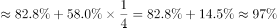
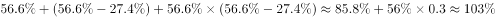
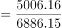
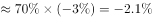
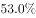
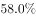
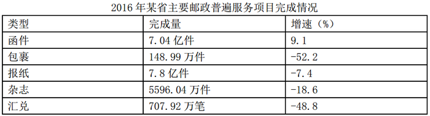
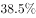
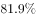
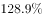

# 两期比重差比较（基期为隔年2014年，需先倒推2015年增速再算隔年增长率）

考点：[[20-考点/资料分析/比重/两期比重差比较（基期为隔年2014年，需先倒推2015年增速再算隔年增长率）|比重 / 两期比重差比较（基期为隔年2014年，需先倒推2015年增速再算隔年增长率）]]
材料：[[15-材料/资料分析/186748 2016年某省邮政通信业务发展情况：|186748 2016年某省邮政通信业务发展情况：]]

**问法模型**：题干问'2016年比重相比2014年提高/降低多少个百分点'→现期比重与隔年基期比重作差，用两期比重差公式 A/B×(a−b)/(1+a)，其中a、b分别为部分（通信）与整体（邮政通信总量）2016年对2014年的隔年增长率

## 推理链
1. 第1步：从第一段提取数据——2016年通信业务总量5006.16亿元、邮政通信业务总量6886.15亿元；两者2016年同比增速数值在原文留空，但分别给出'增幅比上年提高33.2个和27.4个百分点'，即2015年增速=2016年增速−33.2（通信）、2016年增速−27.4（总量）
2. 第2步：规则一（隔年增长率）：2016年对2014年的增长率 r=g2016+g2015+g2016×g2015，先倒推g2015再连乘，不得只加一次增速；规则二（两期比重差）：比重差=现期比重A/B×(a−b)/(1+a)
3. 第3步：定升降符号：现期比重A/B=5006.16/6886.15≈72.7%；依官方解析，通信的隔年增长率a小于总量的隔年增长率b（a−b<0），故2016年比重比2014年下降，排除A、C
4. 第4步：代入计算：72.7%×(a−b)/(1+a)≈−2.1个百分点，即大约降低2个百分点
5. 第5步：与选项对照：与D'降低了1.9个百分点'最接近（题干为'大约'），故选D

**最快解法**：⚡ 公式法+截位直除：①由'增幅提高33.2/27.4个百分点'倒推2015年增速，用隔年增长率公式 r=g16+g15+g16×g15 求出通信隔年增速a与总量隔年增速b；②比较a−b符号：a<b→比重下降，直接排除A、C；③现期比重5006.16/6886.15≈72.7%，乘(a−b)/(1+a)≈−2.1，数量级即可锁定最接近的D，无须精算

## 易错点
- ⚠ 把'增幅比上年提高33.2/27.4个百分点'误当作增速本身——它是2016年与2015年两年增速之差，必须用2016年增速减去该点数才得2015年增速
- ⚠ 基期错用为2015年：题干比较对象是2014年（隔年），须先倒推2015年增速再做隔年增长，漏掉乘积项g2016×g2015会使a、b偏小
- ⚠ 两期比重差必须乘现期比重A/B（≈72.7%）且除以(1+a)，直接拿a−b当答案量级会错；同时'个百分点'与'%'不能混写，比重下降对应选项的'降低了X个百分点'

## 母题抽象
> 🧩 当题干出现'现期比重相比隔年（前两年的基期）提高/降低了多少个百分点'、材料仅给'增幅比上年提高X个百分点'时，先倒推上年增速，用隔年增长率公式求部分增速a与整体增速b，再代入两期比重差公式A/B×(a−b)/(1+a)，由a−b符号定升降排除半数选项，数值选最接近项

**同类特征**：2016年比重相比2014年（隔年基期比较）、提高了/降低了多少个百分点、部分占整体：通信业务总量占邮政通信业务总量、材料给出增幅比上年提高27.4/33.2个百分点、两期比重差公式适用、题干带'大约'，选项选最接近值

## 相关题
（暂无）

---

### 题干
2016年该省完成的通信业务总量占邮政通信业务总量的比重相比2014年大约：

### 选项
- A. 提高了0.6个百分点
- B. 降低了0.6个百分点
- C. 提高了1.9个百分点
- D. 降低了1.9个百分点　✅

### 官方解析

由题干“2016年······比重相比2014年”，可判定该题为两期比重问题。定位文字材料第一段“2016年，某省完成邮政通信业务总量6886.15亿元，同比增长，增幅比上年提高27.4个百分点。其中，完成通信业务总量5006.16亿元，增长，增幅提高33.2个百分点”，则该省完成的通信业务总量2016年相比2014年的增长率，邮政通信业务总量2016年相比2014年的增长率。该省完成的通信业务总量的，邮政通信业务总量的，，比重下降，排除AC。代入两期比重公式，即降低2.1个百分点，与D最接近。

故正确答案为D。

### 给定材料

        2016年，某省完成邮政通信业务总量6886.15亿元，同比增长，增幅比上年提高27.4个百分点。其中，完成邮政业务总量1879.99亿元，增长，增幅提高11.0个百分点；完成通信业务总量5006.16亿元，增长，增幅提高33.2个百分点。

        2016年，该省完成快递业务量76.72亿件，同比增长，占全国快递业务量的比重达到，比排名第二的Z省多16.80亿件。

        2016年，该省电话用户数为1.69亿，其中固定电话用户数为2609.7万，移动电话用户数为14349万，分别比上年减少197.4万户和203.1万户。移动电话中4G用户数为9085.30万，占移动电话用户的比重由上年的提升至。固定电话本地通话时长、长途通话时长以及移动电话通话时长同比分别减少、和，移动短信、彩信业务量分别减少和。

        2016年，该省固定互联网宽带用户数为2850.60万，宽带接入流量同比增长，其中8M及以上和20M及以上宽带接入用户占比分别为和，分别比上年提升26.2个和40.4个百分点，固定宽带用户均资费同比下降。该省移动互联网用户数达1.15亿，移动互联网接入流量同比增长，移动流量资费水平同比下降，通信资费总体水平同比下降。

> [!warning] 疑点（官方解析可能有误，待人工复核）
> 原文三处同比增速数值留空缺失，官方解析中隔年增长率a、b的具体数值亦缺失，凭给定材料无法独立复算出'−2.1个百分点'；解析计算结果（降低2.1个百分点）与D选项（降低1.9个百分点）略有出入，应系隔年增长率取约数或公式近似所致，且题干问'大约'，不影响官方答案D的判定
