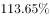
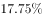
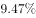
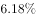
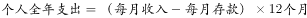
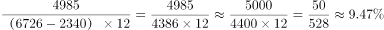

# 现期比重计算（整体值未直接给出，需跨句拼凑分母）

考点：[[20-考点/资料分析/比重/现期比重计算（整体值未直接给出，需跨句拼凑分母）|比重 / 现期比重计算（整体值未直接给出，需跨句拼凑分母）]]
材料：[[15-材料/资料分析/186834 我国年轻人2016年在收入、存款、贷|186834 我国年轻人2016年在收入、存款、贷]]

**问法模型**：题干出现'2016年A支出占个人全年支出的比重'，而'个人全年支出'材料未直接给出 → 比重=部分值÷整体值，分母用（月收入−月存款）×12自行拼出

## 推理链
1. 第1步：从材料提取部分值——2016年年轻人人均旅游交通支出4985元（年度值，无需再乘时间倍数）
2. 第2步：从材料提取整体值的原料——人均月收入6726元、人均月存款2340元，两者均为月度值
3. 第3步：跨句拼凑全年支出：月支出=6726−2340=4386元，全年支出=4386×12=52632元
4. 第4步：代入现期比重公式：比重=4985÷52632≈0.095，约9.5%
5. 第5步：与选项对照，C项（4985/[(6726−2340)×12]≈9.5%）与之吻合，故选C

**最快解法**：⚡ 跨句拼凑+截位直除：先算月支出6726−2340=4386，×12得52632；再截位直除4985/52600≈9.5%，直接锁定C

## 易错点
- ⚠ '个人全年支出'材料未直接给出，误以为材料无整体值而误选'无法得出/无法计算'类选项，实际需用（月收入−月存款）×12跨句拼出
- ⚠ 误用月收入直接×12作分母（6726×12=80712元），漏扣月存款2340元，算成4985/80712≈6.2%而误选
- ⚠ 时间口径错配：交通支出4985元已是年度值，误再×12或×366；而收入/存款是月度值必须×12（2016全年366天只影响日均×年化类计算）

## 母题抽象
> 🧩 当题干问'A占全年支出/全年收入比重'而整体值未直接给出时，用（月收入−月存款）×12拼出分母，再做部分÷整体的截位直除，验证各选项的数值与分子分母形式

**同类特征**：占……的比重、个人全年支出、月收入与月存款成对给出、人均旅游交通支出4985元、现期（2016年）比重、分母需跨句拼凑

## 相关题
- [[10-真题/资料分析/比重/1797626 现期比重计算与比重差值（百分点）比较|1797626]]（山东 2016，相关度1）
- [[10-真题/资料分析/比重/1751688 现期比重计算|1751688]]（江苏 2015，相关度1）
- [[10-真题/资料分析/比重/12536401 两期比重连续变化趋势判断（比重升降结论+基期增速还原）|12536401]]（四川 2024，相关度1）
- [[10-真题/资料分析/比重/2033382 现期比重计算（部分需自行加总+跨表与文字拼接整体值）|2033382]]（河南 2016，相关度1）
- [[10-真题/资料分析/比重/2187853 现期比重计算与比重差（百分点）比较|2187853]]（山东 2018，相关度1）

---

### 题干
2016年，全国年轻人的人均旅游交通支出占个人全年支出的比重为：

### 选项
- A. 

- B. 

- C. 

　✅
- D. 

### 官方解析

由题干“2016年……占……比重”，可判定该题为现期比重问题。由材料可知，2016年年轻人的人均旅游交通支出为4985元，，因此比重为。

故正确答案为C。

### 给定材料

下面是关于我国年轻人2016年各项消费的数据统计：

        2016年（全年366天），全国年轻人人均月收入为6726元。同时，存款额度也在增加，2016年年轻人的人均月存款为2340元，较2015年同比增加，而2015年的人均月存款较2014年增加。在贷款方面，月收入4000元以上的办理信用卡比例超过，而贷款年龄段比例则为：18-25岁占、26-35岁占、36-45岁占。年轻人每月平均记账次数约为41笔，其中上海以1.672笔的人均日记账次数居榜首。在消费方面，KTV的年人均消费由2014年的699.9元增加到2016年的814.6元；在旅游方面，人均年度交通支出达4985元。年轻人2016年在书本上的人均支出达到168元，相对于2015年的155元，同比增长。2016年，年轻人与雾霾相关的支出较2015年多出，人均支出达到998.7元；每日人均食品消费45.9元，比去年增加8.8元，早餐平均花费4.5元。

