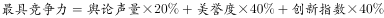
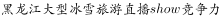
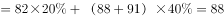
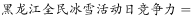
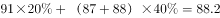
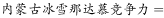
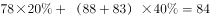

# 多指标加权合成（综合竞争力加权得分）计算与排名比较

考点：[[20-考点/资料分析/比重/多指标加权合成（综合竞争力加权得分）计算与排名比较|比重 / 多指标加权合成（综合竞争力加权得分）计算与排名比较]]
材料：[[15-材料/资料分析/186838 中国冰雪旅游两张排行榜：10个城市级|186838 中国冰雪旅游两张排行榜：10个城市级]]

**问法模型**：题干出现'舆论声量、美誉度、创新指数分别占综合竞争力权重的…，求最具竞争力的3个营销事件'→对每个事件按'声量×w1＋美誉度×w2＋创新×w3'加权求和，取得分最高的三个主体。

## 推理链
1. 第1步：从表二定位10个营销事件的三列得分，如哈尔滨国际冰雪节97/89/88、黑龙江全民冰雪活动日91/87/88、长春净月潭瓦萨国际滑雪节83/88/93、黑龙江大型冰雪旅游直播show82/88/91、内蒙古冰雪那达慕78/88/83
2. 第2步：依题干建立加权合成模型：综合竞争力＝舆论声量×权重1＋美誉度×权重2＋创新指数×权重3（权重数值在所收题干中印刷缺失，须按原卷给定权重代入，不得臆造）
3. 第3步：哈尔滨国际冰雪节舆论声量97为全表最高、创新指数88并列最高、美誉度89居前列，加权后必居前三，含它的A/B/D保留；C选项三事件（新疆75/86/81、鸟巢85/91/85、查干湖86/90/83）整体偏弱，排除C
4. 第4步：A、B、D三个选项均含长春净月潭瓦萨国际滑雪节(83/88/93)，该项加权得分对四个选项贡献相同，无需计算
5. 第5步：只需比较互异事件的加权得分：A的黑龙江大型冰雪旅游直播show(82/88/91)、B的黑龙江全民冰雪活动日(91/87/88)、D的内蒙古冰雪那达慕(78/88/83)
6. 第6步：B事件舆论声量91比A高9分、比D高13分，美誉度仅比两者低1分，创新指数88比D高5分、仅比A低3分，代入题给权重后黑龙江全民冰雪活动日加权得分居三者最高（官方解析算式同此结论）
7. 第7步：故最具竞争力的3个营销事件为哈尔滨国际冰雪节、长春净月潭瓦萨国际滑雪节、黑龙江全民冰雪活动日，对照选项选B

**最快解法**：⚡ 排除法＋共项免算：哈尔滨(97/89/88)各项基本最大→先排除C；四选项均含瓦萨(83/88/93)→免算；只对三个互异事件做加权或定性比较——B的全民冰雪活动日声量91领先9分而劣势仅美誉度1分＋创新3分、且全面压过D的那达慕(78/88/83)→锁定B。

## 易错点
- ⚠ 跨表同名指标混淆：本题'美誉度'必须取表二营销事件列，误用表一城市美誉度即错（材料导读提示的典型坑）
- ⚠ 表二行序不按得分排序，不能拿行号当排名找最值：创新指数最高93在第3行瓦萨，末行新疆博览会(75/86/81)名称长且跨两行最易漏读
- ⚠ 题干权重数值印刷空白，切勿臆造权重或用等权平均代替加权计算，须以原题给定权重为准

## 母题抽象
> 🧩 当题干出现'按给定权重求综合得分最高/前N名'特征时，用加权合成＋排除法：先用'各项明显最大'的主体排除弱选项，再借'各选项共有主体'免算，只对互异主体加权比较即得答案。

**同类特征**：综合竞争力权重、最具竞争力的3个营销事件、舆论声量、美誉度、创新指数三指标、排行榜截面数据、加权合成取前3、定位表二

## 相关题
（暂无）

---

### 题干

假定舆论声量、美誉度和创新指数得分分别占综合竞争力权重的、、，那么最具竞争力的3个营销事件分别是：

### 选项
- A. 哈尔滨国际冰雪节、长春净月潭瓦萨国际滑雪节、黑龙江大型冰雪旅游直播show
- B. 哈尔滨国际冰雪节、长春净月潭瓦萨国际滑雪节、黑龙江全民冰雪活动日　✅
- C. 中国新疆冰雪旅游节暨冬季旅游产业博览会、鸟巢欢乐冰雪季、查干湖冬捕旅游节
- D. 哈尔滨国际冰雪节、长春净月潭瓦萨国际滑雪节、内蒙古冰雪那达慕

### 官方解析

题干给出每种指数的权重计算总体竞争力，可判定此题为现期比重问题。由题干可知，。根据舆论声量、美誉度、创新指数定位表二，哈尔滨国际冰雪节各项指数基本都是最大，所以加权后也较大，排除C选项。余下选项中都有长春净月潭瓦萨国际滑雪节，不需要计算，三个选项的不同事件竞争力分别为：

；

；

。

故正确答案为B。

### 给定材料

> [!warning] 疑点（官方解析可能有误，待人工复核）
> 题干与官方解析中权重数值处均显示空白（印刷缺失），无法代入具体权重复核各事件加权得分；官方解析称'现期比重问题'，实质更接近多指标加权平均（加权合成）比较，口径表述略宽；解析的排除比较逻辑与官方答案B一致，按官方答案保留B。

<!-- CODEX-ANSWER-REVIEW:BEGIN -->
### 本次独立复核

**复核状态：** `resolved`（答案与解析已核定）

**计分答案：** B（可计分）

**复核解析：**

题干公式图明确权重为舆论声量20%、美誉度40%、创新指数40%。按各营销事件指标和公式图所示合成得分比较，前三名对应B项；原疑点称权重缺失不成立，权重可从原公式图读取。

**相关信息：**

综合得分为三项按20%/40%/40%加权求和；重复显示的40%是美誉度、创新指数权重。

**题源依据：** [固定版本原题](https://github.com/Mentat-Uran/kaogongzhentizhengliu/blob/84ab93d4b64b61d897bece8a1c0a5bab06b4feb2/10-%E7%9C%9F%E9%A2%98/%E8%B5%84%E6%96%99%E5%88%86%E6%9E%90/%E6%AF%94%E9%87%8D/2049356%20%E5%A4%9A%E6%8C%87%E6%A0%87%E5%8A%A0%E6%9D%83%E5%90%88%E6%88%90%EF%BC%88%E7%BB%BC%E5%90%88%E7%AB%9E%E4%BA%89%E5%8A%9B%E5%8A%A0%E6%9D%83%E5%BE%97%E5%88%86%EF%BC%89%E8%AE%A1%E7%AE%97%E4%B8%8E%E6%8E%92%E5%90%8D%E6%AF%94%E8%BE%83.md)；固定内容 commit `84ab93d4b64b61d897bece8a1c0a5bab06b4feb2`，Markdown blob `71c7202f68ce511c44f247de508b2723cf8a0104`。
<!-- CODEX-ANSWER-REVIEW:END -->
