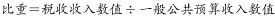
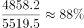
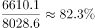
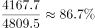
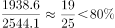

# 现期比重比较

考点：[[20-考点/资料分析/比重/现期比重比较|比重 / 现期比重比较]]
材料：[[15-材料/资料分析/186840 2015年全国及上海、江苏、浙江、安|186840 2015年全国及上海、江苏、浙江、安]]

**问法模型**：题干问'2015年税收收入占一般公共预算收入比重最大的是'+选项为四个省（市）→ 时间与材料一致为现期，直接对每个选项做'税收收入÷一般公共预算收入'的商并比较大小

## 推理链
1. 第1步：题干时间2015年与材料统计表时间一致，无需基期换算，锁定公式：比重=税收收入（第4列）÷一般公共预算收入（第2列）
2. 第2步：上海：4858.2÷5519.5≈88.0%
3. 第3步：江苏：6610.1÷8028.6≈82.3%；浙江：4167.7÷4809.5≈86.7%；福建：1938.6÷2544.1≈76.2%
4. 第4步：四地比重排序为上海88.0%＞浙江86.7%＞江苏82.3%＞福建76.2%，上海最大，与选项A（上海）对照一致

**最快解法**：⚡ 截位直除：四个分子分母各截前三位做商——上海≈486/552≈88.0%，浙江≈417/481≈86.7%，江苏≈661/803≈82.3%，福建≈194/254≈76.2%；先比首两位即可锁定最高的上海选A，上海与浙江接近（88.0%对86.7%），需算到小数点后一位或用差分确认

## 易错点
- ⚠ 口径混淆：分子必须用'税收收入'列、分母用'一般公共预算收入'列，勿与兄弟题'一般公共预算收入÷GDP'的比重口径混读，两列数值也不能相加
- ⚠ 上海（88.0%）与浙江（86.7%）非常接近，若只比首位'8=8'就粗略下单或舍入过猛，易误选C浙江，必须精确到0.1%量级
- ⚠ 表中混有'全国'行，选项均为省（市），无需也不能用全国行数据（124892/152217≈82.1%）参与比较，看到全国行先跳过以省时间

## 母题抽象
> 🧩 当题干出现'某年A占B比重最大（最高）的是'+时间与材料一致时，直接用现期分子列÷分母列逐项截位直除，先比首位、接近时精确到小数点后一位验证排序

**同类特征**：'2015年'现期时间限定、'占……比重最大的是'极值比较问法、分子为税收收入、分母为一般公共预算收入、选项为四个省（市）逐行对应、同一张表内跨两列做商、无需基期换算

## 相关题
- [[10-真题/资料分析/比重/2272297 现期比重比较|2272297]]（选调 2015，相关度2）
- [[10-真题/资料分析/比重/2052082 现期比重比较|2052082]]（吉林 2017，相关度2）
- [[10-真题/资料分析/比重/2031610 现期比重比较|2031610]]（广东 2016，相关度2）
- [[10-真题/资料分析/比重/2166225 现期比重比较|2166225]]（深圳市考 2018，相关度2）
- [[10-真题/资料分析/比重/2172876 现期比重比较|2172876]]（广州市考 2018，相关度2）

---

### 题干
2015年税收收入占一般公共预算收入比重最大的是：

### 选项
- A. 上海　✅
- B. 江苏
- C. 浙江
- D. 福建

### 官方解析

由题干“2015年……占……比重最大”，而且材料时间为2015年，可判定此题为现期比重比较问题。定位表格第二列和第四列，所求。

上海：；江苏：

浙江：；福建：

故正确答案为A。

### 给定材料

