# 两期比重比较与差值计算（平均资助率=资助项数/申请项数）

考点：[[20-考点/资料分析/比重/两期比重比较与差值计算（平均资助率=资助项数-申请项数）|比重 / 两期比重比较与差值计算（平均资助率=资助项数/申请项数）]]
材料：[[15-材料/资料分析/186844 2015年国家自然科学基金委各类项目|186844 2015年国家自然科学基金委各类项目]]

**问法模型**：题干问'全年平均资助率较2014年增加/减少（数值）'→ 两期比重比较模型：分子=资助项数、分母=申请项数，先用分子增速a与分母增速b的大小定升降方向，再以差值=A/B×(a−b)/(1+a)估量级。

## 推理链
1. 第1步：由材料定义式'平均资助率=资助项目数÷接收申请项目数'，判定为两期比重问题，分子为资助项数、分母为申请项数。
2. 第2步：提取现期数据——2015年资助40668项、比上年增加1579项（倒推2014年资助40668−1579=39089项），2015年接收申请173017项。
3. 第3步：现期资助率=40668/173017≈23.5%；分子（资助项数）增长率a=1579/39089≈4.0%。
4. 第4步：分母（申请项数）增长率b为总体申请同比增速（原文该处留白，官方解析代入其数值后b>a），故两期比重差公式A/B×(a−b)/(1+a)中a−b<0，差值为负。
5. 第5步：差值为负⇒2015年平均资助率较2014年减少，排除A、C两个'增加'选项。
6. 第6步：按差值≈23.5%×|a−b|/(1+a)粗算量级，结果与B选项数值一致、与D选项不同，排除D，故选B。

**最快解法**：⚡ 两期比重比较口诀+'截位直除'：先算分子增速a=1579/39089≈4.0%，与分母增速b比较得a<b⇒比重下降，秒排A、C；再截位直除40668/173017≈23.5%，代入差值公式23.5%×(a−b)/(1+a)粗估量级，与B吻合排除D。

## 易错点
- ⚠ 方向判断必须用'分子（资助项数）增速a≈4.0%'与'分母（申请项数）增速b'对比，不能误用面上项目'同比下降2.5个百分点'或青年'同比下降0.7个百分点'等局部百分率替代总体申请增速。
- ⚠ 单位/口径陷阱：差值是两个百分率之差，单位为'个百分点'，不能误当增长率再做除法；2014年资助项数须由40668−1579=39089项倒推，不得直接用40668。
- ⚠ 数据留白陷阱：总体申请'同比增长约'在所给文字中缺失，做题时不得凭空补数，也不得用任一分项增速冒充总体增速，需按官方解析口径代入。

## 母题抽象
> 🧩 当题干出现'某比率（资助率/比重/平均数）现期较上年增加/减少'特征时，用两期比重模型：先比分子增速a与分母增速b定升降（a<b则下降），再套差值=(A/B)×(a−b)/(1+a)估算量级，其中基期分子由'现期±增量'倒推（如40668−1579=39089项）。

**同类特征**：平均资助率较2014年、全年（总体）口径两期比较、增加/减少+数值的选项结构、资助项目占接收申请项目的比重、比上年增加××项（基期倒推）、同比增长约（分母增速）

## 相关题
（暂无）

---

### 题干
2015年国家自然科学基金委全年平均资助率较2014年约：

### 选项
- A. 
增加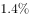

- B. 
减少
　✅
- C. 
增加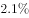

- D. 
减少

### 官方解析

根据题干所求“2015年国家自然科学基金委全年平均资助率较2014年”和材料第二段“平均资助率（资助项目占接收申请项目的比重）”可判定此题为两期比重问题。定位材料第一段“2015年国家自然科学基金委全年共接收173017项各类申请，同比增长约，择优资助各类项目40668项，比上年增加1579项”,可求得2015年择优资助各类项目同比增长率为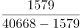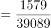，根据两期比重比较公式：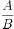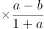，因此2015年国家自然科学基金委全年平均资助率较2014年差值为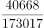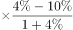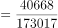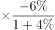，首先为负值，说明减少，排除A、C选项，而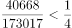，则减少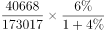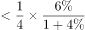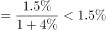，排除D选项。

故正确答案为B。

### 给定材料

根据以下资料，回答下列小题。

        2015年国家自然科学基金委全年共接收173017项各类申请，同比增长约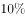，择优资助各类项目40668项，比上年增加1579项，资助直接费用218.8亿元，平均资助强度（资助直接费用与资助项数的比值）53.8万元，各项工作取得新进展新成效。

        在研究项目系列方面，面上项目资助16709项，比上年增加1709项，占总项数的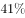，直接费用102.41亿元，平均资助率（资助项目占接收申请项目的比重）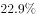，同比下降2.5个百分点。重点项目资助625项，同比增长约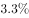，直接费用17.88亿元。重大项目资助20项，直接费用3.18亿元。

        在人才项目系列方面，青年科学基金资助16155项，比上年减少266项，占总项数的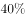，直接费用31.95亿元，平均资助率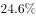，同比下降0.7个百分点。地区科学基金资助2829项，比上年增加78项，直接费用10.96亿元，有力推进了欠发达区域人才稳定与培养。优秀青年科学基金资助400人，国家杰出青年科学基金资助198人，新资助创新研究群体项目38项，促进了优秀人才和团队成长。

> [!warning] 疑点（官方解析可能有误，待人工复核）
> 所给材料文字中总体申请'同比增长约'处数值留白缺失，官方解析中代入的申请增速b与差值具体数值两处公式亦为空占位，导致该题差值的精确数值无法在给定文字中复现，仅能按解析逻辑确认方向为'减少'且量级对应B；答案B为官方唯一事实，不作更改。

<!-- CODEX-ANSWER-REVIEW:BEGIN -->
### 本次独立复核

**复核状态：** `resolved`（答案与解析已核定）

**计分答案：** B（可计分）

**复核解析：**

2015资助项目增长率=(40668−39089)/39089≈4.04%；申请数增长率约10%。部分增速低于整体，资助率下降；差约(40668/173017)×(4.04−10)/(104.04)≈−1.35个百分点，最接近减少1.5个百分点，B。

**相关信息：**

两期比重变化常用公式：现期比重×(部分增长率−整体增长率)/(1+部分增长率)；部分增速高于整体时比重上升。

**题源依据：** [固定版本原题](https://github.com/Mentat-Uran/kaogongzhentizhengliu/blob/84ab93d4b64b61d897bece8a1c0a5bab06b4feb2/10-%E7%9C%9F%E9%A2%98/%E8%B5%84%E6%96%99%E5%88%86%E6%9E%90/%E6%AF%94%E9%87%8D/2049576%20%E4%B8%A4%E6%9C%9F%E6%AF%94%E9%87%8D%E6%AF%94%E8%BE%83%E4%B8%8E%E5%B7%AE%E5%80%BC%E8%AE%A1%E7%AE%97%EF%BC%88%E5%B9%B3%E5%9D%87%E8%B5%84%E5%8A%A9%E7%8E%87%3D%E8%B5%84%E5%8A%A9%E9%A1%B9%E6%95%B0-%E7%94%B3%E8%AF%B7%E9%A1%B9%E6%95%B0%EF%BC%89.md)；固定内容 commit `84ab93d4b64b61d897bece8a1c0a5bab06b4feb2`，Markdown blob `23b8603a5959083bb336bb444237fc25531a6800`。
<!-- CODEX-ANSWER-REVIEW:END -->
