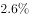
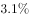
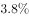
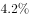
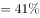
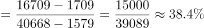
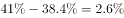

# 两期比重差值比较（比重较上年增加量）

考点：[[20-考点/资料分析/比重/两期比重差值比较（比重较上年增加量）|比重 / 两期比重差值比较（比重较上年增加量）]]
材料：[[15-材料/资料分析/186844 2015年国家自然科学基金委各类项目|186844 2015年国家自然科学基金委各类项目]]

**问法模型**：题干'2015年面上项目占总资助项数的比重较上一年增加约'→ 两期比重差模型：现期比重A₁/B₁减去基期比重A₀/B₀，基期量由'现期−增量'还原。

## 推理链
1. 第1步：材料第1段给出总资助项数：2015年40668项、比上年增加1579项，故2014年总资助=40668−1579=39089项。
2. 第2步：材料第2段给出面上项目：2015年资助16709项、比上年增加1709项，故2014年面上项目=16709−1709=15000项。
3. 第3步：现期比重=16709÷40668≈41.1%（截位直除）。
4. 第4步：基期比重=15000÷39089≈38.4%（截位直除）。
5. 第5步：两期比重差=41.1%−38.4%≈2.7个百分点，定性验证：面上增速1709/15000≈11.4%大于总体增速1579/39089≈4.0%，比重必上升，方向一致。
6. 第6步：与选项对照，约2.7个百分点与A项最接近，故选A。

**最快解法**：⚡ 截位直除+增量还原：先用'现期−增量'得两个基期量（总39089项、面上15000项），再两个除法各截三位直除——16709/40668≈41.1%、15000/39089≈38.4%，作差≈2.7个百分点锁定A；考场上可先由'面上增速>总体增速'判定比重上升、排除下降选项后再精算差值。

## 易错点
- ⚠ 基期还原易错：16709和40668均为2015年现期值，必须分别减去增量1709、1579得2014年值，直接用现期量或把'增加1709项'当成基期值都会算错。
- ⚠ '个百分点'与'%'口径混用：两期比重之差单位是百分点，若选项同时给出2.7%与2.7个百分点的形式需辨析（本题选项为公式图，按数值≈2.7判断）。
- ⚠ 分母口径陷阱：面上占'总项数'的比重，分母必须用材料总量40668项，误用已列各分项之和（约36974项）作分母会偏离结果。

## 母题抽象
> 🧩 当题干出现'A占B的比重较上一年上升/下降约'特征时，用两期比重差模型：由'现期−增量'还原分子分母的基期量，分别求两期比重作差；定性上'部分增速>总体增速⇒比重上升'可先定方向再定量验证。

**同类特征**：较上一年增加约、占总资助项数的比重、比上年增加××项、两期比重差、部分占总体比重的变化

## 相关题
- [[10-真题/资料分析/比重/2042846 两期比重差（比重差值计算）|2042846]]（江苏 2017，相关度1）
- [[10-真题/资料分析/比重/2188159 两期比重差值计算（现期比重-基期比重）|2188159]]（陕西 2018，相关度1）
- [[10-真题/资料分析/比重/2377295 两期比重差值计算（基期比重由'较上年同期占比增加-减少的百分点'加减反推）|2377295]]（选调 2019，相关度1）
- [[10-真题/资料分析/比重/4678705 两期比重差比较（比重变化量最小）|4678705]]（选调 2020，相关度1）
- [[10-真题/资料分析/比重/13504410 两期比重变化（两期比重差）|13504410]]（云南 2025，相关度1）

---

### 题干
2015年面上项目资助项数占总资助项数的比重较上一年增加约：

### 选项
- A. 

　✅
- B. 

- C. 

- D. 

### 官方解析

根据题干所求“2015年面上项目资助项数占总资助项数的比重较上一年增加约”判定此题为两期比重问题，定位材料第一段“择优资助各类项目40668项，比上年增加1579项，”和材料第二段“面上项目资助16709项，比上年增加1709项，占总项数的”已知2015年面上项目资助项数占总资助项数的比重，2014年面上项目资助项数占总资助项数的比重，，与A项最接近。

故正确答案为A。

### 给定材料

根据以下资料，回答下列小题。

        2015年国家自然科学基金委全年共接收173017项各类申请，同比增长约，择优资助各类项目40668项，比上年增加1579项，资助直接费用218.8亿元，平均资助强度（资助直接费用与资助项数的比值）53.8万元，各项工作取得新进展新成效。

        在研究项目系列方面，面上项目资助16709项，比上年增加1709项，占总项数的，直接费用102.41亿元，平均资助率（资助项目占接收申请项目的比重），同比下降2.5个百分点。重点项目资助625项，同比增长约，直接费用17.88亿元。重大项目资助20项，直接费用3.18亿元。

        在人才项目系列方面，青年科学基金资助16155项，比上年减少266项，占总项数的，直接费用31.95亿元，平均资助率，同比下降0.7个百分点。地区科学基金资助2829项，比上年增加78项，直接费用10.96亿元，有力推进了欠发达区域人才稳定与培养。优秀青年科学基金资助400人，国家杰出青年科学基金资助198人，新资助创新研究群体项目38项，促进了优秀人才和团队成长。

> [!warning] 疑点（官方解析可能有误，待人工复核）
> 选项以公式图片形式给出无法直读数值，仅能由官方答案A反推其对应约2.7个百分点；官方解析两期比重的具体算式留白，但与材料自洽计算（16709/40668≈41.1%、15000/39089≈38.4%，差约2.7个百分点）一致，无实质矛盾。

<!-- CODEX-ANSWER-REVIEW:BEGIN -->
### 本次独立复核

**复核状态：** `resolved`（答案与解析已核定）

**计分答案：** A（可计分）

**复核解析：**

2015面上项目占比=16709/40668≈41.08%；2014面上项目数=16709−1709=15000，总资助数=40668−1579=39089，占比≈38.38%；提高约2.70个百分点，最接近2.6个百分点，A。

**相关信息：**

两期比重变化常用公式：现期比重×(部分增长率−整体增长率)/(1+部分增长率)；部分增速高于整体时比重上升。

**题源依据：** [固定版本原题](https://github.com/Mentat-Uran/kaogongzhentizhengliu/blob/84ab93d4b64b61d897bece8a1c0a5bab06b4feb2/10-%E7%9C%9F%E9%A2%98/%E8%B5%84%E6%96%99%E5%88%86%E6%9E%90/%E6%AF%94%E9%87%8D/2049580%20%E4%B8%A4%E6%9C%9F%E6%AF%94%E9%87%8D%E5%B7%AE%E5%80%BC%E6%AF%94%E8%BE%83%EF%BC%88%E6%AF%94%E9%87%8D%E8%BE%83%E4%B8%8A%E5%B9%B4%E5%A2%9E%E5%8A%A0%E9%87%8F%EF%BC%89.md)；固定内容 commit `84ab93d4b64b61d897bece8a1c0a5bab06b4feb2`，Markdown blob `bc823e083a37f4ffef59e04e1cedbb48d00a8e85`。
<!-- CODEX-ANSWER-REVIEW:END -->
