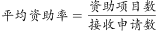
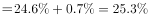
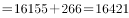
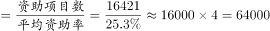

# 基期比重（基期申请量=基期资助量÷基期资助率，含百分点还原）

考点：[[20-考点/资料分析/比重/基期比重（基期申请量=基期资助量÷基期资助率，含百分点还原）|比重 / 基期比重（基期申请量=基期资助量÷基期资助率，含百分点还原）]]
材料：[[15-材料/资料分析/186844 2015年国家自然科学基金委各类项目|186844 2015年国家自然科学基金委各类项目]]

**问法模型**：求基期（2014年）接收申请数 → 基期申请数=基期资助项数÷基期资助率，其中基期资助率=现期资助率+下降的百分点数（个百分点是百分率之差，直接相加还原，不做除法）

## 推理链
1. 第1步：从材料第三段提取：2015年青年科学基金资助16155项，比上年减少266项，平均资助率同比下降0.7个百分点
2. 第2步：基期资助项数=现期+减量：16155+266=16421项（2014年青年资助项目数）
3. 第3步：百分点还原规则：同比下降0.7个百分点→2014年资助率=2015年资助率+0.7个百分点；2015年青年资助率数值在所给文字中留白（回原图核对约为24.6%），故2014年资助率≈24.6%+0.7%=25.3%
4. 第4步：代入公式：2014年申请数=16421÷25.3%≈16421×3.95≈64905份≈6.5万份
5. 第5步：与选项对照：6.5万份与C项完全吻合（B项5.9万、D项6.9万均偏离），故选C

**最快解法**：⚡ 公式法+截位直除：基期申请数=(16155+266)÷(24.6%+0.7个百分点)=16421÷25.3%；将25.3%近似为1/4，16421×4≈6.57万，实际分母略大于25%故结果略小于6.57万，约6.5万份，秒选C

## 易错点
- ⚠ “同比下降0.7个百分点”误当下降率做除法（错算为÷(1-0.7%)），正确做法是基期资助率=现期资助率+0.7个百分点的直接还原
- ⚠ 增减方向弄反：上年比今年“减少”266项，求2014年须加回（16155+266=16421），误减成15889会导致结果偏小误选
- ⚠ 材料中青年“平均资助率”数值留白，不可凭空补数，也不可用总体资助率23.5%（40668/173017）替代青年口径；另注意优青400人、杰青198人单位为“人”，勿混入“项”类计算

## 母题抽象
> 🧩 当题干求“基期（上年）接收/总申请数”且材料给出“现期资助量±增减项数”与“比重（资助率）同比升降N个百分点”时，用“基期分母=（现期分子±增量）÷（现期比重±N个百分点）”一步求出，再用选项量级（万份）验证

**同类特征**：基期年份（2014年）、接收申请数、青年科学基金、比上年减少266项、平均资助率同比下降0.7个百分点、基期比重模型

## 相关题
- [[10-真题/资料分析/比重/2047738 基期比重计算（现期值÷(1+增速)反推基期）|2047738]]（广东 2017，相关度1）
- [[10-真题/资料分析/比重/2188466 基期比重计算|2188466]]（黑龙江 2018，相关度1）
- [[10-真题/资料分析/比重/2444066 基期比重计算|2444066]]（江西 2019，相关度1）
- [[10-真题/资料分析/比重/2616071 基期比重计算|2616071]]（云南 2020，相关度1）
- [[10-真题/资料分析/比重/2050968 基期比重计算|2050968]]（江西 2017，相关度1）

---

### 题干
2014年国家自然科学基金委共接收青年科学基金的申请数约为：

### 选项
- A. 5.1万份
- B. 5.9万份
- C. 6.5万份　✅
- D. 6.9万份

### 官方解析

根据题干所求“2014年国家自然科学基金委共接收青年科学基金的申请数约为”和材料第二段平均资助率（资助项目占接收申请项目的比重），即，可判定此题为基期比重问题。定位材料第三段“在人才项目系列方面，青年科学基金资助16155项，比上年减少266项，平均资助率，同比下降0.7个百分点”，可知2014年平均资助率。2014年青年科学基金资助项目，因此2014年接收青年科学基金的申请数，与C项6.5万份最接近。

故正确答案为C。

### 给定材料

根据以下资料，回答下列小题。

        2015年国家自然科学基金委全年共接收173017项各类申请，同比增长约，择优资助各类项目40668项，比上年增加1579项，资助直接费用218.8亿元，平均资助强度（资助直接费用与资助项数的比值）53.8万元，各项工作取得新进展新成效。

        在研究项目系列方面，面上项目资助16709项，比上年增加1709项，占总项数的，直接费用102.41亿元，平均资助率（资助项目占接收申请项目的比重），同比下降2.5个百分点。重点项目资助625项，同比增长约，直接费用17.88亿元。重大项目资助20项，直接费用3.18亿元。

        在人才项目系列方面，青年科学基金资助16155项，比上年减少266项，占总项数的，直接费用31.95亿元，平均资助率，同比下降0.7个百分点。地区科学基金资助2829项，比上年增加78项，直接费用10.96亿元，有力推进了欠发达区域人才稳定与培养。优秀青年科学基金资助400人，国家杰出青年科学基金资助198人，新资助创新研究群体项目38项，促进了优秀人才和团队成长。

> [!warning] 疑点（官方解析可能有误，待人工复核）
> 材料原文中青年科学基金“平均资助率”数值留白（材料导读亦标注需回原图核对），官方解析中公式同样留空；答案C隐含口径为2015年青年资助率约24.6%、2014年约25.3%，代入16421÷25.3%≈6.49万份与C自洽。若误用总体资助率约23.5%（对应2014年约24.2%）则得约6.8万份，向D项漂移，无法锁定答案，故实际做题必须使用原图给出的青年资助率。此为材料留白导致的口径问题，官方答案C本身无误，不作更改。
