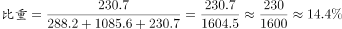
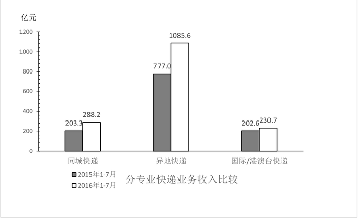
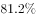
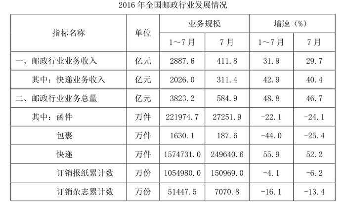

# 两期比重比较（现期比重vs基期比重作差判升降与幅度）

考点：[[20-考点/资料分析/比重/两期比重比较（现期比重vs基期比重作差判升降与幅度）|比重 / 两期比重比较（现期比重vs基期比重作差判升降与幅度）]]
材料：[[15-材料/资料分析/186846 2016年1～7月全国邮政行业运行情|186846 2016年1～7月全国邮政行业运行情]]

**问法模型**：题干为'与上年同期相比，某部分占三部分总收入的比重'上升/下降→分别用柱状图两期数据求基期比重与现期比重再作差，按'个百分点'幅度与选项阈值（5个百分点）对照。

## 推理链
1. 第1步：从柱状图提取数据：2015年1～7月同城203.3、异地777.0、国际/港澳台202.6亿元；2016年1～7月同城288.2、异地1085.6、国际/港澳台230.7亿元。
2. 第2步：分母是三项之和，不能用表格中快递业务收入2026.0亿元：2015年总计203.3+777.0+202.6=1182.9亿元，2016年总计288.2+1085.6+230.7=1604.5亿元。
3. 第3步：基期比重=202.6÷1182.9≈17.1%，现期比重=230.7÷1604.5≈14.4%。
4. 第4步：比重差=14.4%−17.1%≈−2.7个百分点，即比重下降约2.7~2.8个百分点（方向验证：部分增速230.7/202.6−1≈13.9%＜整体增速1604.5/1182.9−1≈35.6%，比重必降）。
5. 第5步：与选项对照：下降且幅度不到5个百分点，选A。

**最快解法**：⚡ 截位直除+增速定方向：先看部分增速13.9%＜整体增速35.6%判定比重下降（排除C、D）；再估幅度：202.6/1183≈17.1%，230.7/1604≈14.4%，差约2.7个百分点＜5，选A。

## 易错点
- ⚠ 分母口径陷阱：误用表格'快递业务收入'2026.0亿元作分母，正确分母是柱状图三项之和1182.9/1604.5（两项口径不一致）。
- ⚠ 基期现期混淆：柱状图灰柱为2015年（基期）、白柱为2016年（现期），看反会误判为'上升'。
- ⚠ 幅度档位陷阱：比重变化按'个百分点'比较（约2.7个百分点），若误把相对变化率（约−16%）当百分点会错选'5个百分点以上'。

## 母题抽象
> 🧩 当题干出现'与上年同期相比，A占B的比重上升/下降多少'时，用两期数据分别求比重作差：先用部分增速与整体增速比大小定升降方向，再截位直除估差值与选项阈值（如5个百分点）比较。

**同类特征**：与上年同期相比、占……总收入的比重、两期比重比较、柱状图灰白两柱对比、选项为升降×不到/超过N个百分点、国际/港澳台快递业务收入

## 相关题
- [[10-真题/资料分析/综合/10204448 综合分析-逐项判断（历史极值确认、两期比重比较、多期累计求和、基期比重）|10204448]]（广东 2024，相关度1）
- [[10-真题/资料分析/比重/17097813 两期比重比较（比重差计算）|17097813]]（山西 2024，相关度1）
- [[10-真题/资料分析/比重/1746802 两期比重变化比较（增速比较法，连续两年判断）|1746802]]（国考 2016，相关度1）
- [[10-真题/资料分析/比重/2136660 两期比重变化比较（比重上升判断）|2136660]]（河南 2017，相关度1）
- [[10-真题/资料分析/比重/2281002 两期比重比较（比重升降-高于上年判断）|2281002]]（四川 2018，相关度1）

---

### 题干
与上年同期相比，2016年1～7月国际/港澳台业务收入占同城、异地和国际/港澳台快递业总收入的比重：

### 选项
- A. 下降了不到5个百分点　✅
- B. 下降了5个百分点以上
- C. 上升了不到5个百分点
- D. 上升了5个百分点以上

### 官方解析

由题干“与上年同期相比，2016年1～7月······占······的比重”，可判定该题为两期比重问题。定位图中数据，2015年1～7月国际/港澳台业务收入占同城、异地和国际/港澳台快递业总收入的 ，2016年1～7月国际/港澳台业务收入占同城、异地和国际/港澳台快递业总收入的，

比低2.3个百分点，即下降了不到5个百分点。

故正确答案为A。

### 给定材料

根据所给资料，回答111～115题。

        2016年1～7月份，同城、异地、国际/港澳台快递业务量分别占全部快递业务量的、和，业务收入如下图所示：

        1～7月份，东、中、西部地区快递业务收入的比重分别为、和，业务量比重分别为、和。与去年同期相比，东部地区快递业务收入比重下降了0.5个百分点，快递业务量比重下降了0.4个百分点；中部地区快递业务收入比重上升了0.3个百分点，快递业务量比重上升了0.4个百分点；西部地区快递业务收入比重上升了0.2个百分点，快递业务量比重持平。

> [!warning] 疑点（官方解析可能有误，待人工复核）
> 官方解析称比重下降2.3个百分点，按图中数据精确计算为202.6/1182.9≈17.1%、230.7/1604.5≈14.4%，差约2.7~2.8个百分点，数值略有出入；但'下降不到5个百分点'的结论与答案A均正确。

<!-- CODEX-ANSWER-REVIEW:BEGIN -->
### 本次独立复核

**复核状态：** `resolved`（答案与解析已核定）

**计分答案：** A（可计分）

**复核解析：**

图中分别计算国际/港澳台业务收入占三类快递业务总收入的比重，2016年1—7月比2015年同期低约2.3个百分点；下降幅度不到5个百分点，选A。

**相关信息：**

比重变化：分项增速高于整体增速时占比上升；基期比重需分别还原分子、分母后求比。

**题源依据：** [固定版本原题](https://github.com/Mentat-Uran/kaogongzhentizhengliu/blob/84ab93d4b64b61d897bece8a1c0a5bab06b4feb2/10-%E7%9C%9F%E9%A2%98/%E8%B5%84%E6%96%99%E5%88%86%E6%9E%90/%E6%AF%94%E9%87%8D/2049596%20%E4%B8%A4%E6%9C%9F%E6%AF%94%E9%87%8D%E6%AF%94%E8%BE%83%EF%BC%88%E7%8E%B0%E6%9C%9F%E6%AF%94%E9%87%8Dvs%E5%9F%BA%E6%9C%9F%E6%AF%94%E9%87%8D%E4%BD%9C%E5%B7%AE%E5%88%A4%E5%8D%87%E9%99%8D%E4%B8%8E%E5%B9%85%E5%BA%A6%EF%BC%89.md)；固定内容 commit `84ab93d4b64b61d897bece8a1c0a5bab06b4feb2`，Markdown blob `7970e27fb100a53db633bbaf7116c174cbe7e798`。
<!-- CODEX-ANSWER-REVIEW:END -->
